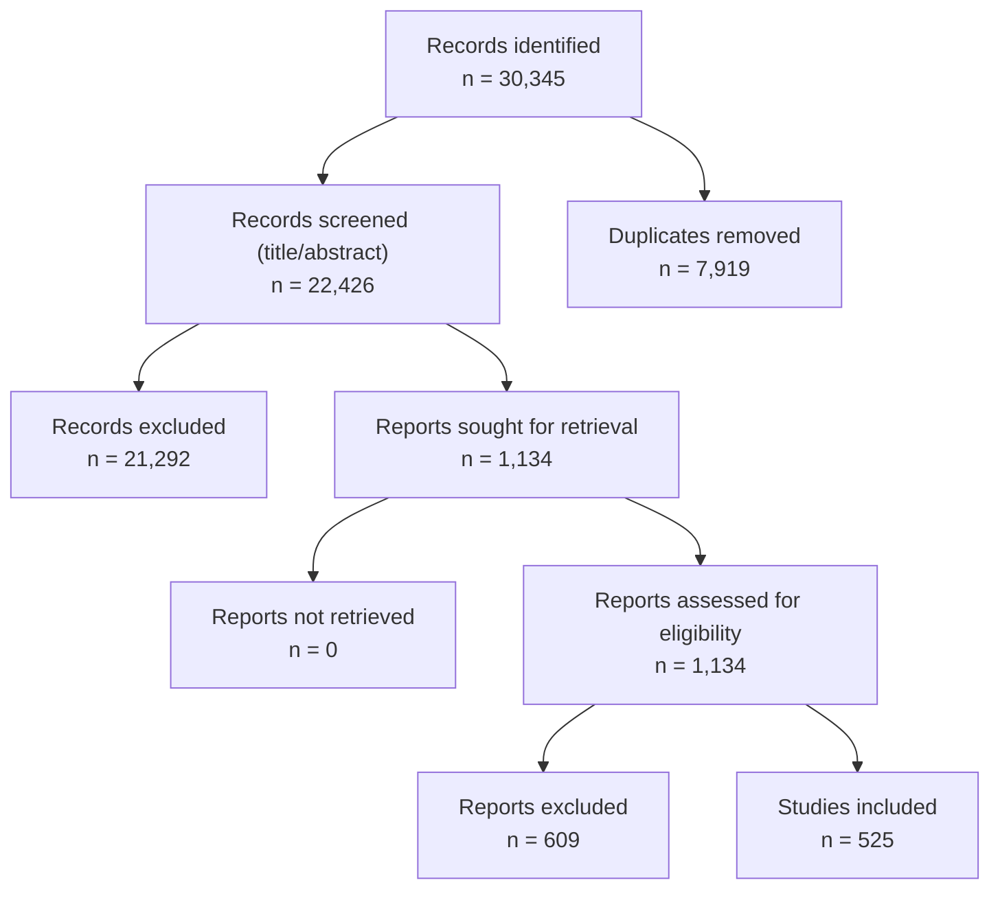

# PRISMA 2020 report — misinformation-intervention meta-analysis

_Generated by `Scripts/build_manuscript_report.py` from the frozen `Results/` outputs and the report-level PRISMA closure. No value is invented: every number is traced to its source._

## Provenance of the flow numbers

- Primary source: `Scripts/prisma_report.py (generator of Scripts/PRISMA_CLOSURE.md)` — the generator of `Scripts/PRISMA_CLOSURE.md`.
- `PRISMA_CLOSURE.md` and the regenerated report-level flow agree on every box and reason (no discrepancies).

## Coding and coder disagreement

The corpus was coded three times, independently and without sight of each other: the canonical analysis route (`Extraction/<Key>.json`), a SpaceBunny route (`Codings/<Key> - SB.json`) and a MiniMax route (`Codings/<Key> - MM.json`). The two agent routes exist to measure inter-rater reliability; they never overwrite the analysis route. Every difference between the routes was then sorted by **what settling it requires**, not by how often it occurs, and each class was routed to the cheapest agent that could settle it soundly.

### How the differences were found

- Differences located: **6,169** in fields that decide what is pooled and **8,932** in fields the analysis does not read, across **697** and **791** study keys respectively. A further **7,145** differences were in free-text fields where the routes say the same thing at different lengths; these are wording, not disagreement, and were not adjudicated.

- Outcome rows were matched **by position within an outcome name**, not by a composite key. The same outcome name recurs once per arm pair, per timepoint and per condition, so a stricter key silently compares the wrong rows.
  Measured: a composite-key matching leaves only **2** of the **1,131** real conflicts visible (1,129 hidden), while a content-based pairing agrees with positional pairing to within 6 conflicts (4,361 vs 4,367).
- Positional matching has one residual weakness: when the routes list the arms of a contrast in a different order, the pairing is off and the disagreement is an artefact rather than a conflict. The master agent verified this on `Choi et al. (2023)`, where all three routes agree once the rows are matched by arm contrast instead of by position. Such items were closed as artefacts, and the matching is the one thing to revisit if the disagreement counts are re-derived.
- A second, sharper weakness: when a route's outcome name **embeds the contrast** (`A vs C`, `experimental`), the name no longer identifies the same row across routes, and the pairing can compare a canonical row against a different contrast entirely. On `Liao et al. (2016)` the resulting queue row was not a real disagreement at all, and its value was not stable between runs. Items of that shape are listed for the human master rather than acted on, because the paper - not the row name - is the only reliable way to identify the contrast.

### A second pairing pass, and what it found

The weakness above is not a cosmetic naming problem: it hides disagreements that change the pooled estimate. The canonical route names a row `Food advertising literacy: differentiating advertising authenticity (Group A vs Group C, posttest)` where an agent route names the same outcome `Advertising authenticity`. The two strings never match, so a name-based comparison has nothing to pair and the canonical route and that route are never compared at all - the disagreement can only surface between the two agent routes, under the agent route's name.

The rows the name-based pass leaves unpaired are therefore paired a second time, by the **contrast** they describe (the arm codes and a coarse timepoint class) and, within a contrast, by how much the outcome names overlap. The pass is strictly additive - it never removes a conflict the name-based pass found, so it cannot hide one - and every conflict it adds is settled by a master agent that reads the paper. Measured on the corpus: **642** study keys carry a disagreement the name-based pass could not see, **9,632** row-level conflicts in total, concentrated in the fields that decide what is pooled (`eligible_primary` 2,974, `dv_polarity` 496, `contrast_type` 4,557, `effect_size_type_reported` 4,411).

The human-queue items that came out of it are not a bookkeeping artefact. A worked example, `Butler et al. (2024)`: the canonical route codes the sharing of true headlines with `yi = -0.580` and the agent routes with `yi = +0.053` and `+0.051` - a **sign** disagreement on a pooled effect, invisible to the name-based pass. The items are addressed by the canonical row they belong to, so the queue names a row that exists and a decision can be written.

### How each class was resolved

The three classes count different things — the rule class is counted in record-level field values, the paper and human classes in adjudicated items — so they are reported separately rather than as a partition of one total.

| class | count | resolved by | status | what it was |
|---|---|---|---|---|
| rule | 2,603 record-level field values | a script | **closed** — 2,603 applied, 0 pending | two of the three routes carry the same value, so the value is settled and no decision is needed |
| paper | 11,757 items over 774 study keys | a master agent | **open** — queued | the paper's own wording settles it: the experiment count, the value of a field the paper states, the taxonomy a row belongs to, how completely an enumeration was done |
| human | 348 items over 164 study keys | a human master | **open** — awaiting a person | a judgement the paper does not dictate |
| prose | 7,145 differences | not adjudicated | closed | a free-text field where the routes say the same thing at different lengths |

The rule class was applied to the analysis route: **2,603** record-level field values were written, each one the value that two of the three routes agreed on, and **0** remained pending — the class is closed. The script is deliberately narrow: it touches only controlled-enumeration fields, never a field the analysis reads as a fact or a judgement, compares per record aligned on `Study_ID` (a field can differ between the records of one paper), never applies a list-subset relation (one route's list being a subset of another's is a completeness question, not a majority), and carries a dependent field with its code where the schema requires one.

The paper class is queued as **11,757** items over **774** study keys (598 with at least one pool-relevant item), handed out in resumable batches by `Scripts/master_agent.py` — **577 of 577 batches settled so far**. The human class is **348** items over **164** study keys, listed in `Results/HUMAN_MASTER_BRIEFING.md` with the competing values side by side.

| field | items | what the human decides |
|---|---|---|
| `eligible_primary` | 215 | is this contrast the primary eligible intervention-vs-control comparison? |
| `dv_polarity` | 73 | which direction of the outcome is desirable (1 = higher is better, 0 = higher is worse)? |
| `Fulltext_Exclusion_Criterion` | 60 | does the study meet every inclusion criterion (C1-C4)? |

To keep that queue short, a **separate evidence pass** has an agent read the paper for each item and report what it shows — with the quote and the page — without making the call: 396 study keys are covered in `Results/human_evidence/<Key>.md`. The human master reads that and confirms or overrides.

### A sign that flips a pooled estimate

The pipeline orients an effect by the row's polarity, so the oriented effect is `yi x polarity_sign`: positive means group 1 is favoured.  Two master agents found the same class of error in different studies - `Dutta-Powell et al. (2024)` stored the **absolute** value of the paper's coefficient, and `Kankova & Matthes (2026)` stored `d = +b/SD` for seven rows whose contrast is *control minus intervention*.  A sign error flips a pooled estimate, so it is worth a corpus-wide check rather than a paper-by-paper one.

`Scripts/check_effect_sign_consistency.py` lists every row whose `effect_favors` contradicts the sign of its oriented effect: **902** rows over **163** study keys, **385** of them `eligible_primary = 1`.  Most of those are a question of the *convention* - whether `yi` is stored as `group1 - group2` or the other way round - which the master agent settles from the paper, key by key.  A harder subset of **2** rows over **2** keys carries the paper's own coefficient in `beta_val` with the **opposite** sign to the stored effect, which cannot be a convention question: one of the two is wrong.

### Two decisions that were deliberately not automated
- **A blank is not always "no".** Several fields use an empty value to mean *not stated* or *unclear* (`code_available`, `consent_reported`, `WEIRD_Rich`), so a gap the analysis route left was routed to the master agent rather than filled with 0: writing 0 would turn *we do not know* into *no*.
- **A blank inclusion criterion is ambiguous.** It may mean *the study meets every inclusion criterion* or merely *this route did not record one*, so a criterion recorded by only one route is a paper question and two different sets of recorded criteria is a human question.

### A structural difference the routes could not resolve

The routes do not always code the same *experiments*. `Scripts/check_experiment_alignment.py` finds **120** keys where the per-experiment sample sizes do not line up: on 70 the same experiment id carries a different N in the analysis route than in the agent routes, and on 50 the analysis route codes fewer experiments than the agent routes do. Both are scope decisions about which of a paper's experiments belong in the review, and both were handed to the master agent to settle against the paper rather than to a rule. The per-key list is `Results/experiment_alignment.csv`.

### A label that contradicts the record it sits in

`Scripts/check_contrast_control_consistency.py` finds **135** DV rows in **23** study keys whose `contrast_type` says one thing and whose own record's `control_group_type` says another — the row labels its comparison *intervention vs no-treatment control* while the record says the comparison arm was a placebo, an active format or misinformation-only. **93** of the rows are `eligible_primary = 1`, so they are pooled. The comparison itself (group 1 vs group 2) is usually right; the *label* is wrong, and that label is what the eligibility judgement — *was the control free of a misinformation intervention?* — is read from. The pooled estimates are not affected (`contrast_type` is carried through the specs but does not route the pool), but the evidence for the eligibility decision is. The master agent settles these against the paper; the list is `Results/contrast_control_consistency.csv`.

### An effect the pipeline cannot see

A DV row whose `effect_size_type_reported` is *none* is read by the standardisation guard as *the paper reported no effect size*, and the row is refused — even when the row carries a usable standardised effect that the coder derived from the paper's own cell means and SDs. `Scripts/check_effect_type_none.py` finds **111** such rows in **13** study keys, of which **73** are `eligible_primary = 1`. Each row carries an effect the pool never sees, and nothing in the logs says why the row is missing:

* 54 rows — type should be means (the paper reports cell means/SDs)
* 33 rows — check: the row carries yi/vi but no d and no cells
* 24 rows — type should be d (the row carries a standardised d)

The guard keys on the reported type *and* the conversion text, so the class is a risk marker rather than a uniform defect: most of these rows are admitted because their conversion text documents a standardisation, and the cost is that the refused ones are silently missing from the pool. Measured against the pool's own DV_Metrics sheet, 58 of the 1,215 eligible rows are refused and no raw-scale effect is admitted. The master agent sets the reported type to what the paper actually reported; the numeric fields are left alone. The list is `Results/effect_type_none_rows.csv`.

### Effects from studies the coding excludes

`Fulltext_Exclusion_Criterion` is the screening layer: a study that fails C1 (no misinformation intervention), C2 (no control group), C3 (not English) or C4 (not a primary experimental study) is still fully coded, harmonised and reproduced, but the criterion keeps the screening layer consistent. The pooled models, however, select on `eligible_primary == 1` and never read the criterion, so an excluded study still contributes its effects unless its key is listed by hand in `Scripts/study_exclusions.py`.

`Scripts/check_excluded_but_pooled.py` finds **384 pooled effects** from **25** study keys that the coding marks as excluded — 384 under C1, 25 under C4, 1 under C2. The clearest case is `Turetsky & Sanderson (2018)`: a mental-health-stigma norms experiment with no misinformation content, coded `['C1']`, 34 eligible rows, 30 of them pooled with an effect, and the key absent from the exclusion list. The mechanism exists and works — `NO_INTERVENTION_EXCLUSIONS` is keyed by `(study_key, experiment)` — it simply does not list these keys. This is a decision for the campaign owner, because it changes the pooled result; the full list is `Results/excluded_but_pooled.csv`.

### A dependence the clustering cannot catch

The meta-analysis clusters non-independent contrasts by `study_key | experiment_id | control_arm`, so it can cluster *within* a paper but not *across* papers. When one trial is published several times, each publication becomes its own cluster and the same participants are counted more than once. `Scripts/find_duplicate_trials.py` flags **45** candidate pairs over **48** study keys — pairs that share an analysed N, a first author and a title vocabulary (for example the FoodMania! trial, reported in `Austin et al. (2020)`, `Austin et al. (2020 a)` and `Austin et al. (2024)` with the same 189 dyads). Some are already handled by `Scripts/study_exclusions.py`; the remainder need a decision from the campaign owner about which outcomes are unique. The list is `Results/possible_duplicate_trials.csv`.

### The reliability measurement was protected

The agreement products compare the agent routes against the analysis route, so writing a majority into the analysis route would make the measurement circular. The pre-reconciliation products were therefore frozen to `Results/irr_baseline_<date>/` **before** any write. Comparing the two shows that **no inter-rater reliability measure moved**: the reconciliation touched only record-level coding fields, never eligibility, polarity, domain or the exclusion criterion. The frozen baseline and the live products are the same measurement.

Full detail: `Results/CODER_DISAGREEMENTS.md`; the per-item queues are `Results/coder_disagreement_human_queue.csv` and `Results/coder_disagreement_agent_queue.csv`; every write is logged in `Results/coder_majority_fixes.csv`.

### Four findings the owner decided on

The reconciliation surfaced four findings that change the pooled numbers and that no script can settle on its own. The campaign owner ruled on each; the decisions are recorded in `Results/CAMPAIGN_DECISIONS.md` and the products below carry them.

**(a) Studies the coding marks as excluded, but the pool still used.** `Fulltext_Exclusion_Criterion` is the screening layer, and the pooled models select on `eligible_primary` without reading it, so an excluded experiment kept contributing its effects. The comparison is made **per record**, because the criterion is recorded per experiment: **26** records in **25** study keys were contributing **384** pooled effects. The owner's decision was to exclude them; the entries are in `Scripts/study_exclusions.py` under `CODING_EXCLUDED_STUDIES`. The studies themselves are untouched - they stay fully coded, harmonised and reproduced.

**(b) A trial published more than once.** The meta-analysis clusters non-independent contrasts by `study_key | experiment_id | control_arm`, so it can cluster within a paper but **not across papers**: a trial published three times is counted three times. Every candidate pair was sent to an agent that read both papers:

| verdict | pairs | what happens |
|---|---|---|
| same trial, confirmed | 24 | the duplicate is excluded, per experiment where only part of a paper is the duplicate |
| different trials | 6 | both are kept |
| contested | 8 | **not** excluded - the verifiers disagreed, and the owner's decision was to exclude only the confirmed pairs |

A contested pair is left to the owner rather than settled by a tie-break, because a contested pair is not a confirmed one. The verdicts are in `Results/duplicate_trial_verdicts_consolidated.csv`.

**(c) Two keys whose coding was for a different paper.** `Scripts/check_source_mismatch.py` compares each record's title with the text of the paper the key points at, and found **two** keys whose title was largely absent from their own paper: `O'Rourke (2019)` carried a Rozendaal et al. (2016) effect under a key whose paper is O'Rourke's 2019 QUB thesis, and `Cho et al. (2023)` carried Litt et al. (2015)'s record, so the real study was uncoded. Both were re-coded from their own papers - and the Litt record was re-filed under its own key - so the audit now reports **0** mismatched keys. The pattern is worth watching for: a key can be repaired by replacing its PDF without its coding ever being redone, which is how both of these arose.

The same pattern is still live in one key: `Fendt et al. (2026 x)` holds two records (`Fendt2026_Morality1`, `Fendt2026_Morality2`) describing an "analytic reflection and morality framing" study that the deposited paper does not contain - the word *morality* does not occur in it, and it has neither the MIST-8 measure nor any results. It is flagged for the same treatment as the two keys above.

**(d) A row whose sign contradicted its own paper.** On `Dutta-Powell et al. (2024)` the six perceived-responsibility rows kept a positive pooled effect where the paper's Table 4 reports negative coefficients. The stored magnitude did come from the table - the standardiser had taken the **absolute** value of the coefficient, which flipped the sign - and the authors read the result as *null* (their third hypothesis is rejected: "the interventions did not change consumers' attitudes about perceived responsibility"). The rows were re-coded from the table's own coefficients with the derivation written into the record.

## Identification

- Records identified: **30,345**.
- Duplicates removed: 7,919.
- Reports after deduplication: 22,426.

## Screening

- Reports screened (title/abstract): 22,426.
- Records excluded at title/abstract: 21,292.
  - No misinformation intervention (C1): 20,968.
  - No control/comparison group (C2): 255.
  - Not a primary experimental study (C4): 45.
  - Not English (C3): 24.

## Eligibility

- Reports sought for retrieval: 1,134.
- Reports not retrieved: 0 (sought-but-unobtained reports are stored as `Fulltext irretrievable` exclusions, so this box is 0).
- Reports assessed for eligibility: 1,134.
- Reports excluded: 609.
  - No misinformation intervention (C1): 401.
  - No control/comparison group (C2): 112.
  - Not a primary experimental study (C4): 38.
  - insufficient reporting: 21.
  - duplicate of an included study: 17.
  - fulltext irretrievable: 13.
  - Not English (C3): 7.

## Inclusion

- **Studies included in the synthesis: 525**.
- Included records: 780; duplicate / non-independent included records: 255.
- Distinct coded papers in `Extraction/`: 793.
- Coded papers in an included report: 524.
- Included reports without a matching coding: 1 (the reconciliation gap against the analysis set).

## PRISMA 2020 flow diagram

- PNG (300 dpi): `Results/figures/PRISMA_2020_flow.png`
- SVG: `Results/figures/PRISMA_2020_flow.svg`
- Mermaid: `Scripts/PRISMA_flow.mmd`
- ASCII: `Scripts/PRISMA_flow_ascii.txt`

```
PRISMA 2020 flow (report level, ASCII)
==============================================================================
[Identification]
  Records identified: 30,345
  Duplicates removed: 7,919
[Screening]
  Reports screened (title/abstract): 22,426
  Records excluded at title/abstract: 21,292
      - No misinformation intervention (C1): 20,968
      - No control/comparison group (C2): 255
      - Not a primary experimental study (C4): 45
      - Not English (C3): 24
[Eligibility]
  Reports sought for retrieval: 1,134
  Reports not retrieved: 0
  Reports assessed for eligibility: 1,134
  Reports excluded: 609
      - No misinformation intervention (C1): 401
      - No control/comparison group (C2): 112
      - Not a primary experimental study (C4): 38
      - insufficient reporting: 21
      - duplicate of an included study: 17
      - fulltext irretrievable: 13
      - Not English (C3): 7
[Included]
  Studies included in synthesis: 525
  Included records: 780; duplicate/non-independent included records: 255
  Coded papers: 793; coded papers in included reports: 524; included reports without a coding: 1
```



## Manuscript tables

Workbook: `Results/manuscript_tables.xlsx` (sheets: Table_1_Study_Characteristics, Table_1b_Studies, Table_2_Posttest, Table_3_Persistence, Table_4_DiD, Table_S1_Derived_Specs, Table_5_Publication_Bias, Table_6_Moderators).

### Table 1. Study characteristics

| Section | Characteristic | Value |
| --- | --- | --- |
| Sample | Studies (k) | 793 |
| Sample | Experiments (coded) | 1,208 |
| Sample | Participants (sum of analysed N) | 2,388,722 |
| Sample | Experiments with analysable N | 1,168 |
| Publication year | Median | 2023 |
| Publication year | Range | 1990–2026 |
| Publication year | Experiments with year | 1,208 |
| Age group | Adults | 945 |
| Age group | Adolescents | 120 |
| Age group | Children | 51 |
| Age group | Mixed | 46 |
| Setting | Online experiment | 680 |
| Setting | Classroom | 218 |
| Setting | Online panel survey | 98 |
| Setting | Field | 96 |
| Setting | Lab | 69 |
| Setting | Other | 34 |
| Setting | Simulated field | 9 |
| Design | Between-subjects | 579 |
| Design | Mixed | 456 |
| Design | Within-subjects | 138 |
| Control group type | No-treatment/Passive | 503 |
| Control group type | Placebo (unrelated content) | 262 |
| Control group type | Active (alternative intervention) | 106 |
| Control group type | Other | 64 |
| Control group type | Misinformation-only | 46 |
| Control group type | Waitlist | 30 |
| Western sample | Western | 1,000 |
| Western sample | not | 165 |
| Intervention type | media_literacy_tips | 301 |
| Intervention type | inoculation | 270 |
| Intervention type | debunking_and_rebuttals | 248 |
| Intervention type | other | 212 |
| Intervention type | credibility_labels | 85 |
| Intervention type | accuracy_prompts | 80 |
| Intervention type | social_norms | 70 |
| Intervention type | lateral_reading | 67 |
| Intervention type | openmindedness_intervention | 66 |
| Intervention type | fact_checking_training | 36 |
| Intervention type | community_correction | 26 |
| Intervention type | prebunking_warning | 26 |
| Intervention type | platform_exposure_reduction | 10 |
| Intervention type | friction | 8 |
| Outcome domain (contrasts) | credibility | 5,324 |
| Outcome domain (contrasts) | other | 4,003 |
| Outcome domain (contrasts) | attitude_policy | 1,917 |
| Outcome domain (contrasts) | sharing_intention | 1,659 |
| Outcome domain (contrasts) | media_literacy_attitudes | 1,247 |
| Outcome domain (contrasts) | critical_thinking | 693 |
| Outcome domain (contrasts) | technique_recognition | 590 |
| Outcome domain (contrasts) | engagement_behavior | 523 |
| Outcome domain (contrasts) | trust | 427 |
| Outcome domain (contrasts) | search_behavior | 318 |
| Outcome domain (contrasts) | confidence | 296 |
| Outcome domain (contrasts) | affect | 108 |

Per-study characteristics are in the `Table_1b_Studies` sheet (1,208 coded experiments).

### Table 2. Pooled immediate-posttest effects

| Layer | Specification | Exclusions | Scope | k | Studies | N (participants) | g | 95% CI | I² (%) | τ² |
| --- | --- | --- | --- | --- | --- | --- | --- | --- | --- | --- |
| Signal detection (re-analysis) | Immediate posttest — all outcomes | on | unrestricted | 249 | 115 | 250,378 | 0.162 | [0.129, 0.195] | 95.1 | 0.0615 |
| Signal detection (re-analysis) | Immediate posttest — all outcomes | on | restricted | 249 | 115 | 250,378 | 0.162 | [0.129, 0.195] | 95.1 | 0.0615 |
| Signal detection (re-analysis) | Immediate posttest — all outcomes | off | unrestricted | 252 | 116 | 254,386 | 0.159 | [0.124, 0.193] | 95.6 | 0.0685 |
| Signal detection (re-analysis) | Immediate posttest — all outcomes | off | restricted | 252 | 116 | 254,386 | 0.159 | [0.124, 0.193] | 95.6 | 0.0685 |
| Signal detection (re-analysis) | Immediate posttest — credibility | on | unrestricted | 176 | 110 | 212,314 | 0.167 | [0.125, 0.209] | 95.0 | 0.0710 |
| Signal detection (re-analysis) | Immediate posttest — credibility | on | restricted | 176 | 110 | 212,314 | 0.167 | [0.125, 0.209] | 95.0 | 0.0710 |
| Signal detection (re-analysis) | Immediate posttest — credibility | off | unrestricted | 177 | 110 | 215,462 | 0.164 | [0.123, 0.205] | 95.0 | 0.0692 |
| Signal detection (re-analysis) | Immediate posttest — credibility | off | restricted | 177 | 110 | 215,462 | 0.164 | [0.123, 0.205] | 95.0 | 0.0692 |

### Table 3. Pooled follow-up persistence effects

| Layer | Specification | Exclusions | Scope | k | Studies | N (participants) | g | 95% CI | I² (%) | τ² |
| --- | --- | --- | --- | --- | --- | --- | --- | --- | --- | --- |
| Signal detection (re-analysis) | Follow-up persistence — all outcomes | on | unrestricted | 43 | 23 | 40,281 | 0.146 | [0.074, 0.218] | 92.5 | 0.0474 |
| Signal detection (re-analysis) | Follow-up persistence — all outcomes | on | restricted | 43 | 23 | 40,281 | 0.146 | [0.074, 0.218] | 92.5 | 0.0474 |
| Signal detection (re-analysis) | Follow-up persistence — all outcomes | off | unrestricted | 43 | 23 | 40,389 | 0.142 | [0.071, 0.214] | 92.5 | 0.0470 |
| Signal detection (re-analysis) | Follow-up persistence — all outcomes | off | restricted | 43 | 23 | 40,389 | 0.142 | [0.071, 0.214] | 92.5 | 0.0470 |
| Signal detection (re-analysis) | Follow-up persistence — credibility | on | unrestricted | 30 | 23 | 33,688 | 0.187 | [0.098, 0.275] | 92.8 | 0.0500 |
| Signal detection (re-analysis) | Follow-up persistence — credibility | on | restricted | 30 | 23 | 33,688 | 0.187 | [0.098, 0.275] | 92.8 | 0.0500 |
| Signal detection (re-analysis) | Follow-up persistence — credibility | off | unrestricted | 30 | 23 | 33,796 | 0.184 | [0.096, 0.272] | 92.8 | 0.0495 |
| Signal detection (re-analysis) | Follow-up persistence — credibility | off | restricted | 30 | 23 | 33,796 | 0.184 | [0.096, 0.272] | 92.8 | 0.0495 |

### Table 4. Pooled pretest-corrected (DiD) effects

| Layer | Specification | Exclusions | Scope | k | Studies | N (participants) | g | 95% CI | I² (%) | τ² |
| --- | --- | --- | --- | --- | --- | --- | --- | --- | --- | --- |
| Signal detection (re-analysis) | Pretest-corrected DiD — all outcomes | on | unrestricted | 49 | 29 | 37,036 | 0.115 | [0.048, 0.182] | 89.3 | 0.0455 |
| Signal detection (re-analysis) | Pretest-corrected DiD — all outcomes | on | restricted | 49 | 29 | 37,036 | 0.115 | [0.048, 0.182] | 89.3 | 0.0455 |
| Signal detection (re-analysis) | Pretest-corrected DiD — all outcomes | off | unrestricted | 51 | 29 | 37,325 | 0.093 | [0.022, 0.165] | 90.8 | 0.0551 |
| Signal detection (re-analysis) | Pretest-corrected DiD — all outcomes | off | restricted | 51 | 29 | 37,325 | 0.093 | [0.022, 0.165] | 90.8 | 0.0551 |
| Signal detection (re-analysis) | Pretest-corrected DiD — credibility | on | unrestricted | 36 | 28 | 36,745 | 0.104 | [0.021, 0.186] | 91.3 | 0.0520 |
| Signal detection (re-analysis) | Pretest-corrected DiD — credibility | on | restricted | 36 | 28 | 36,745 | 0.104 | [0.021, 0.186] | 91.3 | 0.0520 |
| Signal detection (re-analysis) | Pretest-corrected DiD — credibility | off | unrestricted | 37 | 28 | 37,034 | 0.095 | [0.011, 0.179] | 91.6 | 0.0554 |
| Signal detection (re-analysis) | Pretest-corrected DiD — credibility | off | restricted | 37 | 28 | 37,034 | 0.095 | [0.011, 0.179] | 91.6 | 0.0554 |

### Table S1. Derived combined specifications

| Layer | Specification | Exclusions | Scope | k | Studies | N (participants) | g | 95% CI | I² (%) | τ² |
| --- | --- | --- | --- | --- | --- | --- | --- | --- | --- | --- |

### Table 5. Publication-bias tests

| Layer | Specification | Exclusions | k | Studies | Egger intercept | Egger SE | Egger t | Egger p | PET estimate | PET p | PEESE estimate | PEESE p | Preferred | Preferred estimate | Preferred 95% CI | Trim-and-fill k0 | Trim-and-fill adjusted | Trim-and-fill status | p-curve status |
| --- | --- | --- | --- | --- | --- | --- | --- | --- | --- | --- | --- | --- | --- | --- | --- | --- | --- | --- | --- |
| Reported effects (meta-analysis) | Pretest-corrected DiD — all outcomes | on | 501 | 96 | 0.166 | 0.042 | 3.99 | < .001 | 0.166 | < .001 | 0.281 | < .001 | PEESE | 0.281 | [0.234, 0.329] | 32 | 0.462 | ok | ok |
| Reported effects (meta-analysis) | Pretest-corrected DiD — all outcomes | off | 501 | 96 | 0.161 | 0.042 | 3.82 | < .001 | 0.161 | < .001 | 0.270 | < .001 | PEESE | 0.270 | [0.222, 0.317] | 33 | 0.449 | ok | ok |
| Reported effects (meta-analysis) | Pretest-corrected DiD — credibility | on | 151 | 49 | 0.356 | 0.096 | 3.72 | < .001 | 0.356 | < .001 | 0.472 | < .001 | PEESE | 0.472 | [0.362, 0.581] | 10 | 0.593 | ok | ok |
| Reported effects (meta-analysis) | Pretest-corrected DiD — credibility | off | 151 | 49 | 0.338 | 0.101 | 3.35 | .001 | 0.338 | .001 | 0.431 | < .001 | PEESE | 0.431 | [0.317, 0.545] | 8 | 0.533 | ok | ok |
| Reported effects (meta-analysis) | Immediate posttest — all outcomes | on | 3170 | 421 | 0.019 | 0.003 | 5.81 | < .001 | 0.019 | < .001 | 0.048 | < .001 | PEESE | 0.048 | [0.042, 0.054] | 60 | 0.238 | ok | ok |
| Reported effects (meta-analysis) | Immediate posttest — all outcomes | off | 3170 | 421 | 0.013 | 0.003 | 3.89 | < .001 | 0.013 | < .001 | 0.041 | < .001 | PEESE | 0.041 | [0.035, 0.047] | 52 | 0.228 | ok | ok |
| Reported effects (meta-analysis) | Immediate posttest — credibility | on | 1446 | 312 | 0.029 | 0.007 | 4.24 | < .001 | 0.029 | < .001 | 0.077 | < .001 | PEESE | 0.077 | [0.066, 0.088] | 63 | 0.267 | ok | ok |
| Reported effects (meta-analysis) | Immediate posttest — credibility | off | 1446 | 312 | 0.007 | 0.007 | 0.99 | .324 | 0.007 | .324 | 0.055 | < .001 | PET | 0.007 | [-0.007, 0.022] | 62 | 0.255 | ok | ok |
| Reported effects (meta-analysis) | Follow-up persistence — all outcomes | on | 444 | 82 | 0.015 | 0.004 | 3.38 | < .001 | 0.015 | < .001 | 0.032 | < .001 | PEESE | 0.032 | [0.024, 0.040] | 33 | 0.142 | ok | ok |
| Reported effects (meta-analysis) | Follow-up persistence — all outcomes | off | 444 | 82 | 0.015 | 0.004 | 3.46 | < .001 | 0.015 | < .001 | 0.032 | < .001 | PEESE | 0.032 | [0.024, 0.040] | 31 | 0.140 | ok | ok |
| Reported effects (meta-analysis) | Follow-up persistence — credibility | on | 158 | 56 | 0.013 | 0.005 | 2.45 | .015 | 0.013 | .015 | 0.027 | < .001 | PEESE | 0.027 | [0.017, 0.037] | 23 | 0.125 | ok | ok |
| Reported effects (meta-analysis) | Follow-up persistence — credibility | off | 158 | 56 | 0.014 | 0.005 | 2.55 | .012 | 0.014 | .012 | 0.027 | < .001 | PEESE | 0.027 | [0.017, 0.038] | 21 | 0.131 | ok | ok |
| Reported effects (meta-analysis) | Pretest-corrected where possible — all outcomes | on | 3253 | 420 | 0.019 | 0.003 | 5.71 | < .001 | 0.019 | < .001 | 0.048 | < .001 | PEESE | 0.048 | [0.043, 0.054] | 77 | 0.246 | ok | ok |
| Reported effects (meta-analysis) | Pretest-corrected where possible — all outcomes | off | 3253 | 420 | 0.013 | 0.003 | 3.81 | < .001 | 0.013 | < .001 | 0.042 | < .001 | PEESE | 0.042 | [0.036, 0.048] | 71 | 0.238 | ok | ok |
| Reported effects (meta-analysis) | Pretest-corrected where possible — credibility | on | 1461 | 312 | 0.027 | 0.007 | 3.89 | < .001 | 0.027 | < .001 | 0.077 | < .001 | PEESE | 0.077 | [0.066, 0.088] | 71 | 0.281 | ok | ok |
| Reported effects (meta-analysis) | Pretest-corrected where possible — credibility | off | 1461 | 312 | 0.005 | 0.007 | 0.71 | .479 | 0.005 | .479 | 0.055 | < .001 | PET | 0.005 | [-0.009, 0.020] | 69 | 0.269 | ok | ok |
| Reported effects (meta-analysis) | Follow-up where available — all outcomes | on | 3318 | 421 | 0.019 | 0.003 | 6.43 | < .001 | 0.019 | < .001 | 0.045 | < .001 | PEESE | 0.045 | [0.040, 0.051] | 43 | 0.227 | ok | ok |
| Reported effects (meta-analysis) | Follow-up where available — all outcomes | off | 3318 | 421 | 0.014 | 0.003 | 4.64 | < .001 | 0.014 | < .001 | 0.039 | < .001 | PEESE | 0.039 | [0.034, 0.045] | 35 | 0.218 | ok | ok |
| Reported effects (meta-analysis) | Follow-up where available — credibility | on | 1493 | 312 | 0.023 | 0.005 | 4.54 | < .001 | 0.023 | < .001 | 0.059 | < .001 | PEESE | 0.059 | [0.050, 0.067] | 37 | 0.245 | ok | ok |
| Reported effects (meta-analysis) | Follow-up where available — credibility | off | 1493 | 312 | 0.011 | 0.005 | 2.09 | .037 | 0.011 | .037 | 0.044 | < .001 | PEESE | 0.044 | [0.035, 0.053] | 32 | 0.229 | ok | ok |
| Signal detection (re-analysis) | Pretest-corrected DiD — all outcomes | on | 53 | 29 | -0.032 | 0.022 | -1.47 | .147 | -0.032 | .147 | 0.002 | .861 | PET | -0.032 | [-0.075, 0.011] | 3 | 0.027 | ok | ok |
| Signal detection (re-analysis) | Pretest-corrected DiD — all outcomes | off | 55 | 29 | -0.019 | 0.023 | -0.80 | .426 | -0.019 | .426 | 0.008 | .551 | PET | -0.019 | [-0.064, 0.027] | 2 | 0.029 | ok | ok |
| Signal detection (re-analysis) | Pretest-corrected DiD — credibility | on | 36 | 28 | -0.043 | 0.029 | -1.46 | .153 | -0.043 | .153 | -0.008 | .615 | PET | -0.043 | [-0.100, 0.015] | 1 | 0.034 | ok | ok |
| Signal detection (re-analysis) | Pretest-corrected DiD — credibility | off | 37 | 28 | -0.034 | 0.030 | -1.15 | .259 | -0.034 | .259 | -0.001 | .951 | PET | -0.034 | [-0.092, 0.024] | 0 | 0.039 | ok | ok |
| Signal detection (re-analysis) | Immediate posttest — all outcomes | on | 277 | 120 | 0.007 | 0.009 | 0.81 | .422 | 0.007 | .422 | 0.030 | < .001 | PET | 0.007 | [-0.010, 0.025] | 23 | 0.082 | ok | ok |
| Signal detection (re-analysis) | Immediate posttest — all outcomes | off | 280 | 121 | 0.007 | 0.010 | 0.75 | .452 | 0.007 | .452 | 0.031 | < .001 | PET | 0.007 | [-0.012, 0.026] | 30 | 0.088 | ok | ok |
| Signal detection (re-analysis) | Immediate posttest — credibility | on | 175 | 117 | 0.008 | 0.011 | 0.72 | .475 | 0.008 | .475 | 0.027 | < .001 | PET | 0.008 | [-0.013, 0.029] | 13 | 0.073 | ok | ok |
| Signal detection (re-analysis) | Immediate posttest — credibility | off | 176 | 117 | 0.008 | 0.011 | 0.74 | .461 | 0.008 | .461 | 0.027 | < .001 | PET | 0.008 | [-0.013, 0.029] | 14 | 0.073 | ok | ok |
| Signal detection (re-analysis) | Follow-up persistence — all outcomes | on | 45 | 23 | -0.004 | 0.020 | -0.20 | .840 | -0.004 | .840 | 0.021 | .157 | PET | -0.004 | [-0.044, 0.036] | 2 | 0.077 | ok | ok |
| Signal detection (re-analysis) | Follow-up persistence — all outcomes | off | 45 | 23 | -0.004 | 0.020 | -0.20 | .841 | -0.004 | .841 | 0.021 | .152 | PET | -0.004 | [-0.044, 0.036] | 2 | 0.077 | ok | ok |
| Signal detection (re-analysis) | Follow-up persistence — credibility | on | 30 | 23 | 0.009 | 0.033 | 0.26 | .797 | 0.009 | .797 | 0.044 | .054 | PET | 0.009 | [-0.056, 0.073] | 2 | 0.100 | ok | ok |
| Signal detection (re-analysis) | Follow-up persistence — credibility | off | 30 | 23 | 0.009 | 0.033 | 0.26 | .794 | 0.009 | .794 | 0.044 | .051 | PET | 0.009 | [-0.056, 0.073] | 2 | 0.100 | ok | ok |
| Signal detection (re-analysis) | Pretest-corrected where possible — all outcomes | on | 275 | 120 | 0.011 | 0.009 | 1.28 | .200 | 0.011 | .200 | 0.032 | < .001 | PET | 0.011 | [-0.006, 0.029] | 24 | 0.083 | ok | ok |
| Signal detection (re-analysis) | Pretest-corrected where possible — all outcomes | off | 278 | 121 | 0.011 | 0.009 | 1.18 | .240 | 0.011 | .240 | 0.034 | < .001 | PET | 0.011 | [-0.007, 0.029] | 30 | 0.089 | ok | ok |
| Signal detection (re-analysis) | Pretest-corrected where possible — credibility | on | 173 | 117 | 0.012 | 0.011 | 1.12 | .264 | 0.012 | .264 | 0.030 | < .001 | PET | 0.012 | [-0.009, 0.033] | 11 | 0.074 | ok | ok |
| Signal detection (re-analysis) | Pretest-corrected where possible — credibility | off | 174 | 117 | 0.012 | 0.010 | 1.13 | .260 | 0.012 | .260 | 0.031 | < .001 | PET | 0.012 | [-0.009, 0.032] | 12 | 0.074 | ok | ok |
| Signal detection (re-analysis) | Follow-up where available — all outcomes | on | 280 | 120 | 0.017 | 0.007 | 2.39 | .017 | 0.017 | .017 | 0.035 | < .001 | PEESE | 0.035 | [0.026, 0.045] | 17 | 0.073 | ok | ok |
| Signal detection (re-analysis) | Follow-up where available — all outcomes | off | 283 | 121 | 0.017 | 0.008 | 2.17 | .031 | 0.017 | .031 | 0.036 | < .001 | PEESE | 0.036 | [0.026, 0.046] | 24 | 0.080 | ok | ok |
| Signal detection (re-analysis) | Follow-up where available — credibility | on | 178 | 117 | 0.020 | 0.008 | 2.41 | .017 | 0.020 | .017 | 0.034 | < .001 | PEESE | 0.034 | [0.023, 0.045] | 8 | 0.063 | ok | ok |
| Signal detection (re-analysis) | Follow-up where available — credibility | off | 179 | 117 | 0.020 | 0.008 | 2.46 | .015 | 0.020 | .015 | 0.034 | < .001 | PEESE | 0.034 | [0.023, 0.045] | 8 | 0.062 | ok | ok |

### Table 6. Moderator analyses

| Moderator | Level | Layer | Specification | Exclusions | k | Studies | Estimate | 95% CI | p |
| --- | --- | --- | --- | --- | --- | --- | --- | --- | --- |
| Primary data availability | Paper only | Reported effects (meta-analysis) | Pretest-corrected DiD — all outcomes | on | 322 | 59 | 0.385 | [0.336, 0.434] |  |
| Primary data availability | Primary data available | Reported effects (meta-analysis) | Pretest-corrected DiD — all outcomes | on | 179 | 37 | 0.454 | [0.385, 0.523] |  |
| Primary data availability | Difference (meta-regression) | Reported effects (meta-analysis) | Pretest-corrected DiD — all outcomes | on | 501 | 96 | 0.093 | [-0.128, 0.314] | .407 |
| Primary data availability | Paper only | Reported effects (meta-analysis) | Pretest-corrected DiD — all outcomes | off | 322 | 59 | 0.385 | [0.336, 0.434] |  |
| Primary data availability | Primary data available | Reported effects (meta-analysis) | Pretest-corrected DiD — all outcomes | off | 179 | 37 | 0.410 | [0.340, 0.479] |  |
| Primary data availability | Difference (meta-regression) | Reported effects (meta-analysis) | Pretest-corrected DiD — all outcomes | off | 501 | 96 | 0.058 | [-0.156, 0.272] | .593 |
| Primary data availability | Paper only | Reported effects (meta-analysis) | Pretest-corrected DiD — credibility | on | 57 | 23 | 0.506 | [0.344, 0.667] |  |
| Primary data availability | Primary data available | Reported effects (meta-analysis) | Pretest-corrected DiD — credibility | on | 94 | 26 | 0.541 | [0.429, 0.653] |  |
| Primary data availability | Difference (meta-regression) | Reported effects (meta-analysis) | Pretest-corrected DiD — credibility | on | 151 | 49 | 0.001 | [-0.428, 0.430] | .995 |
| Primary data availability | Paper only | Reported effects (meta-analysis) | Pretest-corrected DiD — credibility | off | 57 | 23 | 0.506 | [0.344, 0.667] |  |
| Primary data availability | Primary data available | Reported effects (meta-analysis) | Pretest-corrected DiD — credibility | off | 94 | 26 | 0.455 | [0.336, 0.574] |  |
| Primary data availability | Difference (meta-regression) | Reported effects (meta-analysis) | Pretest-corrected DiD — credibility | off | 151 | 49 | -0.062 | [-0.483, 0.359] | .770 |
| Primary data availability | Paper only | Reported effects (meta-analysis) | Immediate posttest — all outcomes | on | 1273 | 187 | 0.271 | [0.256, 0.286] |  |
| Primary data availability | Primary data available | Reported effects (meta-analysis) | Immediate posttest — all outcomes | on | 1897 | 234 | 0.199 | [0.190, 0.207] |  |
| Primary data availability | Difference (meta-regression) | Reported effects (meta-analysis) | Immediate posttest — all outcomes | on | 3170 | 421 | -0.108 | [-0.187, -0.029] | .007 |
| Primary data availability | Paper only | Reported effects (meta-analysis) | Immediate posttest — all outcomes | off | 1273 | 187 | 0.271 | [0.256, 0.286] |  |
| Primary data availability | Primary data available | Reported effects (meta-analysis) | Immediate posttest — all outcomes | off | 1897 | 234 | 0.186 | [0.178, 0.195] |  |
| Primary data availability | Difference (meta-regression) | Reported effects (meta-analysis) | Immediate posttest — all outcomes | off | 3170 | 421 | -0.115 | [-0.189, -0.041] | .003 |
| Primary data availability | Paper only | Reported effects (meta-analysis) | Immediate posttest — credibility | on | 439 | 113 | 0.288 | [0.264, 0.312] |  |
| Primary data availability | Primary data available | Reported effects (meta-analysis) | Immediate posttest — credibility | on | 1007 | 199 | 0.206 | [0.192, 0.221] |  |
| Primary data availability | Difference (meta-regression) | Reported effects (meta-analysis) | Immediate posttest — credibility | on | 1446 | 312 | -0.074 | [-0.153, 0.005] | .065 |
| Primary data availability | Paper only | Reported effects (meta-analysis) | Immediate posttest — credibility | off | 439 | 113 | 0.288 | [0.264, 0.312] |  |
| Primary data availability | Primary data available | Reported effects (meta-analysis) | Immediate posttest — credibility | off | 1007 | 199 | 0.186 | [0.171, 0.201] |  |
| Primary data availability | Difference (meta-regression) | Reported effects (meta-analysis) | Immediate posttest — credibility | off | 1446 | 312 | -0.097 | [-0.173, -0.020] | .014 |
| Primary data availability | Paper only | Reported effects (meta-analysis) | Follow-up persistence — all outcomes | on | 244 | 32 | 0.160 | [0.137, 0.183] |  |
| Primary data availability | Primary data available | Reported effects (meta-analysis) | Follow-up persistence — all outcomes | on | 200 | 50 | 0.212 | [0.193, 0.231] |  |
| Primary data availability | Difference (meta-regression) | Reported effects (meta-analysis) | Follow-up persistence — all outcomes | on | 444 | 82 | -0.029 | [-0.087, 0.028] | .313 |
| Primary data availability | Paper only | Reported effects (meta-analysis) | Follow-up persistence — all outcomes | off | 244 | 32 | 0.160 | [0.137, 0.183] |  |
| Primary data availability | Primary data available | Reported effects (meta-analysis) | Follow-up persistence — all outcomes | off | 200 | 50 | 0.206 | [0.187, 0.225] |  |
| Primary data availability | Difference (meta-regression) | Reported effects (meta-analysis) | Follow-up persistence — all outcomes | off | 444 | 82 | -0.030 | [-0.087, 0.028] | .311 |
| Primary data availability | Paper only | Reported effects (meta-analysis) | Follow-up persistence — credibility | on | 46 | 16 | 0.155 | [0.102, 0.208] |  |
| Primary data availability | Primary data available | Reported effects (meta-analysis) | Follow-up persistence — credibility | on | 112 | 40 | 0.210 | [0.187, 0.232] |  |
| Primary data availability | Difference (meta-regression) | Reported effects (meta-analysis) | Follow-up persistence — credibility | on | 158 | 56 | 0.004 | [-0.047, 0.054] | .881 |
| Primary data availability | Paper only | Reported effects (meta-analysis) | Follow-up persistence — credibility | off | 46 | 16 | 0.155 | [0.102, 0.208] |  |
| Primary data availability | Primary data available | Reported effects (meta-analysis) | Follow-up persistence — credibility | off | 112 | 40 | 0.213 | [0.190, 0.235] |  |
| Primary data availability | Difference (meta-regression) | Reported effects (meta-analysis) | Follow-up persistence — credibility | off | 158 | 56 | 0.004 | [-0.047, 0.055] | .873 |
| Primary data availability | Paper only | Reported effects (meta-analysis) | Pretest-corrected where possible — all outcomes | on | 1347 | 186 | 0.276 | [0.261, 0.291] |  |
| Primary data availability | Primary data available | Reported effects (meta-analysis) | Pretest-corrected where possible — all outcomes | on | 1906 | 234 | 0.204 | [0.195, 0.212] |  |
| Primary data availability | Difference (meta-regression) | Reported effects (meta-analysis) | Pretest-corrected where possible — all outcomes | on | 3253 | 420 | -0.109 | [-0.188, -0.030] | .007 |
| Primary data availability | Paper only | Reported effects (meta-analysis) | Pretest-corrected where possible — all outcomes | off | 1347 | 186 | 0.276 | [0.261, 0.291] |  |
| Primary data availability | Primary data available | Reported effects (meta-analysis) | Pretest-corrected where possible — all outcomes | off | 1906 | 234 | 0.191 | [0.182, 0.199] |  |
| Primary data availability | Difference (meta-regression) | Reported effects (meta-analysis) | Pretest-corrected where possible — all outcomes | off | 3253 | 420 | -0.116 | [-0.191, -0.042] | .002 |
| Primary data availability | Paper only | Reported effects (meta-analysis) | Pretest-corrected where possible — credibility | on | 447 | 113 | 0.305 | [0.280, 0.330] |  |
| Primary data availability | Primary data available | Reported effects (meta-analysis) | Pretest-corrected where possible — credibility | on | 1014 | 199 | 0.215 | [0.200, 0.229] |  |
| Primary data availability | Difference (meta-regression) | Reported effects (meta-analysis) | Pretest-corrected where possible — credibility | on | 1461 | 312 | -0.076 | [-0.156, 0.005] | .065 |
| Primary data availability | Paper only | Reported effects (meta-analysis) | Pretest-corrected where possible — credibility | off | 447 | 113 | 0.305 | [0.280, 0.330] |  |
| Primary data availability | Primary data available | Reported effects (meta-analysis) | Pretest-corrected where possible — credibility | off | 1014 | 199 | 0.193 | [0.178, 0.208] |  |
| Primary data availability | Difference (meta-regression) | Reported effects (meta-analysis) | Pretest-corrected where possible — credibility | off | 1461 | 312 | -0.098 | [-0.176, -0.020] | .014 |
| Primary data availability | Paper only | Reported effects (meta-analysis) | Follow-up where available — all outcomes | on | 1354 | 187 | 0.269 | [0.254, 0.284] |  |
| Primary data availability | Primary data available | Reported effects (meta-analysis) | Follow-up where available — all outcomes | on | 1964 | 234 | 0.191 | [0.183, 0.199] |  |
| Primary data availability | Difference (meta-regression) | Reported effects (meta-analysis) | Follow-up where available — all outcomes | on | 3318 | 421 | -0.113 | [-0.184, -0.042] | .002 |
| Primary data availability | Paper only | Reported effects (meta-analysis) | Follow-up where available — all outcomes | off | 1354 | 187 | 0.269 | [0.254, 0.284] |  |
| Primary data availability | Primary data available | Reported effects (meta-analysis) | Follow-up where available — all outcomes | off | 1964 | 234 | 0.178 | [0.170, 0.186] |  |
| Primary data availability | Difference (meta-regression) | Reported effects (meta-analysis) | Follow-up where available — all outcomes | off | 3318 | 421 | -0.119 | [-0.188, -0.051] | < .001 |
| Primary data availability | Paper only | Reported effects (meta-analysis) | Follow-up where available — credibility | on | 449 | 113 | 0.289 | [0.265, 0.313] |  |
| Primary data availability | Primary data available | Reported effects (meta-analysis) | Follow-up where available — credibility | on | 1044 | 199 | 0.196 | [0.185, 0.208] |  |
| Primary data availability | Difference (meta-regression) | Reported effects (meta-analysis) | Follow-up where available — credibility | on | 1493 | 312 | -0.096 | [-0.176, -0.017] | .018 |
| Primary data availability | Paper only | Reported effects (meta-analysis) | Follow-up where available — credibility | off | 449 | 113 | 0.289 | [0.265, 0.313] |  |
| Primary data availability | Primary data available | Reported effects (meta-analysis) | Follow-up where available — credibility | off | 1044 | 199 | 0.176 | [0.164, 0.188] |  |
| Primary data availability | Difference (meta-regression) | Reported effects (meta-analysis) | Follow-up where available — credibility | off | 1493 | 312 | -0.111 | [-0.188, -0.034] | .005 |
| Primary data availability | Primary data available | Signal detection (re-analysis) | Pretest-corrected DiD — all outcomes | on | 53 | 29 | 0.038 | [0.012, 0.064] |  |
| Primary data availability | Primary data available | Signal detection (re-analysis) | Pretest-corrected DiD — all outcomes | off | 55 | 29 | 0.036 | [0.009, 0.063] |  |
| Primary data availability | Primary data available | Signal detection (re-analysis) | Pretest-corrected DiD — credibility | on | 36 | 28 | 0.038 | [0.004, 0.072] |  |
| Primary data availability | Primary data available | Signal detection (re-analysis) | Pretest-corrected DiD — credibility | off | 37 | 28 | 0.039 | [0.005, 0.074] |  |
| Primary data availability | Primary data available | Signal detection (re-analysis) | Immediate posttest — all outcomes | on | 277 | 120 | 0.064 | [0.053, 0.076] |  |
| Primary data availability | Primary data available | Signal detection (re-analysis) | Immediate posttest — all outcomes | off | 280 | 121 | 0.066 | [0.053, 0.078] |  |
| Primary data availability | Primary data available | Signal detection (re-analysis) | Immediate posttest — credibility | on | 175 | 117 | 0.058 | [0.043, 0.073] |  |
| Primary data availability | Primary data available | Signal detection (re-analysis) | Immediate posttest — credibility | off | 176 | 117 | 0.057 | [0.043, 0.072] |  |
| Primary data availability | Primary data available | Signal detection (re-analysis) | Follow-up persistence — all outcomes | on | 45 | 23 | 0.066 | [0.037, 0.096] |  |
| Primary data availability | Primary data available | Signal detection (re-analysis) | Follow-up persistence — all outcomes | off | 45 | 23 | 0.066 | [0.037, 0.095] |  |
| Primary data availability | Primary data available | Signal detection (re-analysis) | Follow-up persistence — credibility | on | 30 | 23 | 0.085 | [0.042, 0.129] |  |
| Primary data availability | Primary data available | Signal detection (re-analysis) | Follow-up persistence — credibility | off | 30 | 23 | 0.086 | [0.043, 0.129] |  |
| Primary data availability | Primary data available | Signal detection (re-analysis) | Pretest-corrected where possible — all outcomes | on | 275 | 120 | 0.065 | [0.053, 0.077] |  |
| Primary data availability | Primary data available | Signal detection (re-analysis) | Pretest-corrected where possible — all outcomes | off | 278 | 121 | 0.068 | [0.056, 0.081] |  |
| Primary data availability | Primary data available | Signal detection (re-analysis) | Pretest-corrected where possible — credibility | on | 173 | 117 | 0.061 | [0.046, 0.076] |  |
| Primary data availability | Primary data available | Signal detection (re-analysis) | Pretest-corrected where possible — credibility | off | 174 | 117 | 0.061 | [0.046, 0.076] |  |
| Primary data availability | Primary data available | Signal detection (re-analysis) | Follow-up where available — all outcomes | on | 280 | 120 | 0.062 | [0.053, 0.072] |  |
| Primary data availability | Primary data available | Signal detection (re-analysis) | Follow-up where available — all outcomes | off | 283 | 121 | 0.064 | [0.053, 0.075] |  |
| Primary data availability | Primary data available | Signal detection (re-analysis) | Follow-up where available — credibility | on | 178 | 117 | 0.056 | [0.044, 0.067] |  |
| Primary data availability | Primary data available | Signal detection (re-analysis) | Follow-up where available — credibility | off | 179 | 117 | 0.055 | [0.044, 0.066] |  |
| Domain | attitude_policy | Reported effects (meta-analysis) | Pretest-corrected DiD — all outcomes | on | 60 | 23 | 0.228 | [0.162, 0.293] |  |
| Domain | credibility | Reported effects (meta-analysis) | Pretest-corrected DiD — all outcomes | on | 140 | 44 | 0.556 | [0.459, 0.653] |  |
| Domain | critical_thinking | Reported effects (meta-analysis) | Pretest-corrected DiD — all outcomes | on | 37 | 12 | 0.414 | [0.264, 0.563] |  |
| Domain | media_literacy_attitudes | Reported effects (meta-analysis) | Pretest-corrected DiD — all outcomes | on | 72 | 23 | 0.421 | [0.337, 0.504] |  |
| Domain | other | Reported effects (meta-analysis) | Pretest-corrected DiD — all outcomes | on | 141 | 33 | 0.229 | [0.183, 0.276] |  |
| Domain | search_behavior | Reported effects (meta-analysis) | Pretest-corrected DiD — all outcomes | on | 18 | 6 | 1.107 | [0.741, 1.473] |  |
| Domain | sharing_intention | Reported effects (meta-analysis) | Pretest-corrected DiD — all outcomes | on | 21 | 10 | 0.241 | [0.113, 0.369] |  |
| Domain | technique_recognition | Reported effects (meta-analysis) | Pretest-corrected DiD — all outcomes | on | 3 | 2 | 1.150 | [-0.013, 2.314] |  |
| Domain | trust | Reported effects (meta-analysis) | Pretest-corrected DiD — all outcomes | on | 9 | 5 | 0.329 | [0.158, 0.500] |  |
| Domain | attitude_policy | Reported effects (meta-analysis) | Pretest-corrected DiD — all outcomes | off | 60 | 23 | 0.228 | [0.162, 0.293] |  |
| Domain | credibility | Reported effects (meta-analysis) | Pretest-corrected DiD — all outcomes | off | 140 | 44 | 0.495 | [0.394, 0.596] |  |
| Domain | critical_thinking | Reported effects (meta-analysis) | Pretest-corrected DiD — all outcomes | off | 37 | 12 | 0.414 | [0.264, 0.563] |  |
| Domain | media_literacy_attitudes | Reported effects (meta-analysis) | Pretest-corrected DiD — all outcomes | off | 72 | 23 | 0.431 | [0.353, 0.510] |  |
| Domain | other | Reported effects (meta-analysis) | Pretest-corrected DiD — all outcomes | off | 141 | 33 | 0.240 | [0.196, 0.283] |  |
| Domain | search_behavior | Reported effects (meta-analysis) | Pretest-corrected DiD — all outcomes | off | 18 | 6 | 1.016 | [0.582, 1.450] |  |
| Domain | sharing_intention | Reported effects (meta-analysis) | Pretest-corrected DiD — all outcomes | off | 21 | 10 | 0.204 | [0.071, 0.337] |  |
| Domain | technique_recognition | Reported effects (meta-analysis) | Pretest-corrected DiD — all outcomes | off | 3 | 2 | 1.150 | [-0.013, 2.314] |  |
| Domain | trust | Reported effects (meta-analysis) | Pretest-corrected DiD — all outcomes | off | 9 | 5 | 0.329 | [0.158, 0.500] |  |
| Domain | credibility | Reported effects (meta-analysis) | Pretest-corrected DiD — credibility | on | 140 | 44 | 0.556 | [0.459, 0.653] |  |
| Domain | sharing_intention | Reported effects (meta-analysis) | Pretest-corrected DiD — credibility | on | 11 | 5 | 0.208 | [0.010, 0.405] |  |
| Domain | credibility | Reported effects (meta-analysis) | Pretest-corrected DiD — credibility | off | 140 | 44 | 0.495 | [0.394, 0.596] |  |
| Domain | sharing_intention | Reported effects (meta-analysis) | Pretest-corrected DiD — credibility | off | 11 | 5 | 0.208 | [0.010, 0.405] |  |
| Domain | attitude_policy | Reported effects (meta-analysis) | Immediate posttest — all outcomes | on | 427 | 109 | 0.174 | [0.154, 0.193] |  |
| Domain | credibility | Reported effects (meta-analysis) | Immediate posttest — all outcomes | on | 1170 | 265 | 0.252 | [0.236, 0.268] |  |
| Domain | critical_thinking | Reported effects (meta-analysis) | Immediate posttest — all outcomes | on | 145 | 37 | 0.337 | [0.295, 0.379] |  |
| Domain | media_literacy_attitudes | Reported effects (meta-analysis) | Immediate posttest — all outcomes | on | 147 | 44 | 0.354 | [0.310, 0.398] |  |
| Domain | other | Reported effects (meta-analysis) | Immediate posttest — all outcomes | on | 506 | 126 | 0.231 | [0.204, 0.257] |  |
| Domain | search_behavior | Reported effects (meta-analysis) | Immediate posttest — all outcomes | on | 102 | 18 | 0.279 | [0.197, 0.361] |  |
| Domain | sharing_intention | Reported effects (meta-analysis) | Immediate posttest — all outcomes | on | 460 | 103 | 0.146 | [0.135, 0.157] |  |
| Domain | technique_recognition | Reported effects (meta-analysis) | Immediate posttest — all outcomes | on | 113 | 29 | 0.252 | [0.216, 0.289] |  |
| Domain | trust | Reported effects (meta-analysis) | Immediate posttest — all outcomes | on | 100 | 32 | 0.174 | [0.132, 0.216] |  |
| Domain | attitude_policy | Reported effects (meta-analysis) | Immediate posttest — all outcomes | off | 427 | 109 | 0.172 | [0.153, 0.191] |  |
| Domain | credibility | Reported effects (meta-analysis) | Immediate posttest — all outcomes | off | 1170 | 265 | 0.234 | [0.217, 0.251] |  |
| Domain | critical_thinking | Reported effects (meta-analysis) | Immediate posttest — all outcomes | off | 145 | 37 | 0.332 | [0.291, 0.372] |  |
| Domain | media_literacy_attitudes | Reported effects (meta-analysis) | Immediate posttest — all outcomes | off | 147 | 44 | 0.354 | [0.310, 0.398] |  |
| Domain | other | Reported effects (meta-analysis) | Immediate posttest — all outcomes | off | 506 | 126 | 0.230 | [0.204, 0.257] |  |
| Domain | search_behavior | Reported effects (meta-analysis) | Immediate posttest — all outcomes | off | 102 | 18 | 0.261 | [0.179, 0.344] |  |
| Domain | sharing_intention | Reported effects (meta-analysis) | Immediate posttest — all outcomes | off | 460 | 103 | 0.145 | [0.135, 0.156] |  |
| Domain | technique_recognition | Reported effects (meta-analysis) | Immediate posttest — all outcomes | off | 113 | 29 | 0.253 | [0.216, 0.289] |  |
| Domain | trust | Reported effects (meta-analysis) | Immediate posttest — all outcomes | off | 100 | 32 | 0.174 | [0.132, 0.216] |  |
| Domain | credibility | Reported effects (meta-analysis) | Immediate posttest — credibility | on | 1170 | 265 | 0.252 | [0.236, 0.268] |  |
| Domain | sharing_intention | Reported effects (meta-analysis) | Immediate posttest — credibility | on | 276 | 47 | 0.156 | [0.136, 0.176] |  |
| Domain | credibility | Reported effects (meta-analysis) | Immediate posttest — credibility | off | 1170 | 265 | 0.234 | [0.217, 0.251] |  |
| Domain | sharing_intention | Reported effects (meta-analysis) | Immediate posttest — credibility | off | 276 | 47 | 0.156 | [0.136, 0.176] |  |
| Domain | attitude_policy | Reported effects (meta-analysis) | Follow-up persistence — all outcomes | on | 79 | 26 | 0.143 | [0.101, 0.184] |  |
| Domain | credibility | Reported effects (meta-analysis) | Follow-up persistence — all outcomes | on | 143 | 49 | 0.275 | [0.234, 0.317] |  |
| Domain | critical_thinking | Reported effects (meta-analysis) | Follow-up persistence — all outcomes | on | 15 | 8 | 0.167 | [0.049, 0.285] |  |
| Domain | media_literacy_attitudes | Reported effects (meta-analysis) | Follow-up persistence — all outcomes | on | 25 | 7 | 0.325 | [0.204, 0.446] |  |
| Domain | other | Reported effects (meta-analysis) | Follow-up persistence — all outcomes | on | 88 | 22 | 0.159 | [0.114, 0.205] |  |
| Domain | search_behavior | Reported effects (meta-analysis) | Follow-up persistence — all outcomes | on | 23 | 7 | 0.259 | [0.190, 0.327] |  |
| Domain | sharing_intention | Reported effects (meta-analysis) | Follow-up persistence — all outcomes | on | 47 | 19 | 0.064 | [0.045, 0.082] |  |
| Domain | technique_recognition | Reported effects (meta-analysis) | Follow-up persistence — all outcomes | on | 20 | 6 | 0.184 | [0.096, 0.272] |  |
| Domain | trust | Reported effects (meta-analysis) | Follow-up persistence — all outcomes | on | 4 | 4 | 0.043 | [-0.021, 0.107] |  |
| Domain | attitude_policy | Reported effects (meta-analysis) | Follow-up persistence — all outcomes | off | 79 | 26 | 0.141 | [0.099, 0.182] |  |
| Domain | credibility | Reported effects (meta-analysis) | Follow-up persistence — all outcomes | off | 143 | 49 | 0.274 | [0.233, 0.316] |  |
| Domain | critical_thinking | Reported effects (meta-analysis) | Follow-up persistence — all outcomes | off | 15 | 8 | 0.167 | [0.049, 0.285] |  |
| Domain | media_literacy_attitudes | Reported effects (meta-analysis) | Follow-up persistence — all outcomes | off | 25 | 7 | 0.325 | [0.204, 0.446] |  |
| Domain | other | Reported effects (meta-analysis) | Follow-up persistence — all outcomes | off | 88 | 22 | 0.146 | [0.101, 0.192] |  |
| Domain | search_behavior | Reported effects (meta-analysis) | Follow-up persistence — all outcomes | off | 23 | 7 | 0.262 | [0.195, 0.328] |  |
| Domain | sharing_intention | Reported effects (meta-analysis) | Follow-up persistence — all outcomes | off | 47 | 19 | 0.064 | [0.045, 0.082] |  |
| Domain | technique_recognition | Reported effects (meta-analysis) | Follow-up persistence — all outcomes | off | 20 | 6 | 0.184 | [0.096, 0.272] |  |
| Domain | trust | Reported effects (meta-analysis) | Follow-up persistence — all outcomes | off | 4 | 4 | 0.043 | [-0.021, 0.107] |  |
| Domain | credibility | Reported effects (meta-analysis) | Follow-up persistence — credibility | on | 143 | 49 | 0.275 | [0.234, 0.317] |  |
| Domain | sharing_intention | Reported effects (meta-analysis) | Follow-up persistence — credibility | on | 15 | 7 | 0.028 | [0.011, 0.046] |  |
| Domain | credibility | Reported effects (meta-analysis) | Follow-up persistence — credibility | off | 143 | 49 | 0.274 | [0.233, 0.316] |  |
| Domain | sharing_intention | Reported effects (meta-analysis) | Follow-up persistence — credibility | off | 15 | 7 | 0.028 | [0.011, 0.046] |  |
| Domain | attitude_policy | Reported effects (meta-analysis) | Pretest-corrected where possible — all outcomes | on | 443 | 110 | 0.170 | [0.151, 0.189] |  |
| Domain | credibility | Reported effects (meta-analysis) | Pretest-corrected where possible — all outcomes | on | 1184 | 265 | 0.266 | [0.249, 0.282] |  |
| Domain | critical_thinking | Reported effects (meta-analysis) | Pretest-corrected where possible — all outcomes | on | 148 | 37 | 0.336 | [0.293, 0.378] |  |
| Domain | media_literacy_attitudes | Reported effects (meta-analysis) | Pretest-corrected where possible — all outcomes | on | 166 | 44 | 0.323 | [0.284, 0.363] |  |
| Domain | other | Reported effects (meta-analysis) | Pretest-corrected where possible — all outcomes | on | 529 | 126 | 0.225 | [0.199, 0.252] |  |
| Domain | search_behavior | Reported effects (meta-analysis) | Pretest-corrected where possible — all outcomes | on | 107 | 18 | 0.343 | [0.255, 0.431] |  |
| Domain | sharing_intention | Reported effects (meta-analysis) | Pretest-corrected where possible — all outcomes | on | 461 | 103 | 0.146 | [0.136, 0.157] |  |
| Domain | technique_recognition | Reported effects (meta-analysis) | Pretest-corrected where possible — all outcomes | on | 115 | 29 | 0.262 | [0.225, 0.299] |  |
| Domain | trust | Reported effects (meta-analysis) | Pretest-corrected where possible — all outcomes | on | 100 | 32 | 0.175 | [0.132, 0.217] |  |
| Domain | attitude_policy | Reported effects (meta-analysis) | Pretest-corrected where possible — all outcomes | off | 443 | 110 | 0.168 | [0.150, 0.187] |  |
| Domain | credibility | Reported effects (meta-analysis) | Pretest-corrected where possible — all outcomes | off | 1184 | 265 | 0.247 | [0.230, 0.264] |  |
| Domain | critical_thinking | Reported effects (meta-analysis) | Pretest-corrected where possible — all outcomes | off | 148 | 37 | 0.330 | [0.289, 0.372] |  |
| Domain | media_literacy_attitudes | Reported effects (meta-analysis) | Pretest-corrected where possible — all outcomes | off | 166 | 44 | 0.323 | [0.284, 0.363] |  |
| Domain | other | Reported effects (meta-analysis) | Pretest-corrected where possible — all outcomes | off | 529 | 126 | 0.225 | [0.199, 0.251] |  |
| Domain | search_behavior | Reported effects (meta-analysis) | Pretest-corrected where possible — all outcomes | off | 107 | 18 | 0.327 | [0.238, 0.416] |  |
| Domain | sharing_intention | Reported effects (meta-analysis) | Pretest-corrected where possible — all outcomes | off | 461 | 103 | 0.146 | [0.135, 0.156] |  |
| Domain | technique_recognition | Reported effects (meta-analysis) | Pretest-corrected where possible — all outcomes | off | 115 | 29 | 0.262 | [0.225, 0.299] |  |
| Domain | trust | Reported effects (meta-analysis) | Pretest-corrected where possible — all outcomes | off | 100 | 32 | 0.175 | [0.132, 0.217] |  |
| Domain | credibility | Reported effects (meta-analysis) | Pretest-corrected where possible — credibility | on | 1184 | 265 | 0.266 | [0.249, 0.282] |  |
| Domain | sharing_intention | Reported effects (meta-analysis) | Pretest-corrected where possible — credibility | on | 277 | 47 | 0.156 | [0.136, 0.176] |  |
| Domain | credibility | Reported effects (meta-analysis) | Pretest-corrected where possible — credibility | off | 1184 | 265 | 0.247 | [0.230, 0.264] |  |
| Domain | sharing_intention | Reported effects (meta-analysis) | Pretest-corrected where possible — credibility | off | 277 | 47 | 0.156 | [0.136, 0.176] |  |
| Domain | attitude_policy | Reported effects (meta-analysis) | Follow-up where available — all outcomes | on | 459 | 109 | 0.173 | [0.154, 0.192] |  |
| Domain | credibility | Reported effects (meta-analysis) | Follow-up where available — all outcomes | on | 1210 | 267 | 0.246 | [0.231, 0.262] |  |
| Domain | critical_thinking | Reported effects (meta-analysis) | Follow-up where available — all outcomes | on | 150 | 38 | 0.314 | [0.274, 0.355] |  |
| Domain | media_literacy_attitudes | Reported effects (meta-analysis) | Follow-up where available — all outcomes | on | 161 | 44 | 0.340 | [0.298, 0.383] |  |
| Domain | other | Reported effects (meta-analysis) | Follow-up where available — all outcomes | on | 531 | 128 | 0.235 | [0.208, 0.261] |  |
| Domain | search_behavior | Reported effects (meta-analysis) | Follow-up where available — all outcomes | on | 105 | 19 | 0.269 | [0.188, 0.351] |  |
| Domain | sharing_intention | Reported effects (meta-analysis) | Follow-up where available — all outcomes | on | 475 | 103 | 0.137 | [0.128, 0.147] |  |
| Domain | technique_recognition | Reported effects (meta-analysis) | Follow-up where available — all outcomes | on | 126 | 29 | 0.236 | [0.201, 0.271] |  |
| Domain | trust | Reported effects (meta-analysis) | Follow-up where available — all outcomes | on | 101 | 32 | 0.171 | [0.130, 0.213] |  |
| Domain | attitude_policy | Reported effects (meta-analysis) | Follow-up where available — all outcomes | off | 459 | 109 | 0.171 | [0.152, 0.190] |  |
| Domain | credibility | Reported effects (meta-analysis) | Follow-up where available — all outcomes | off | 1210 | 267 | 0.229 | [0.213, 0.245] |  |
| Domain | critical_thinking | Reported effects (meta-analysis) | Follow-up where available — all outcomes | off | 150 | 38 | 0.309 | [0.270, 0.349] |  |
| Domain | media_literacy_attitudes | Reported effects (meta-analysis) | Follow-up where available — all outcomes | off | 161 | 44 | 0.340 | [0.298, 0.383] |  |
| Domain | other | Reported effects (meta-analysis) | Follow-up where available — all outcomes | off | 531 | 128 | 0.234 | [0.208, 0.260] |  |
| Domain | search_behavior | Reported effects (meta-analysis) | Follow-up where available — all outcomes | off | 105 | 19 | 0.253 | [0.171, 0.335] |  |
| Domain | sharing_intention | Reported effects (meta-analysis) | Follow-up where available — all outcomes | off | 475 | 103 | 0.137 | [0.127, 0.146] |  |
| Domain | technique_recognition | Reported effects (meta-analysis) | Follow-up where available — all outcomes | off | 126 | 29 | 0.236 | [0.201, 0.271] |  |
| Domain | trust | Reported effects (meta-analysis) | Follow-up where available — all outcomes | off | 101 | 32 | 0.171 | [0.130, 0.213] |  |
| Domain | credibility | Reported effects (meta-analysis) | Follow-up where available — credibility | on | 1207 | 265 | 0.247 | [0.231, 0.262] |  |
| Domain | sharing_intention | Reported effects (meta-analysis) | Follow-up where available — credibility | on | 286 | 49 | 0.145 | [0.130, 0.160] |  |
| Domain | credibility | Reported effects (meta-analysis) | Follow-up where available — credibility | off | 1207 | 265 | 0.229 | [0.213, 0.246] |  |
| Domain | sharing_intention | Reported effects (meta-analysis) | Follow-up where available — credibility | off | 286 | 49 | 0.145 | [0.130, 0.161] |  |
| Domain | credibility | Signal detection (re-analysis) | Pretest-corrected DiD — all outcomes | on | 32 | 24 | 0.038 | [-0.001, 0.078] |  |
| Domain | other | Signal detection (re-analysis) | Pretest-corrected DiD — all outcomes | on | 2 | 2 | -0.068 | [-0.262, 0.126] |  |
| Domain | search_behavior | Signal detection (re-analysis) | Pretest-corrected DiD — all outcomes | on | 2 | 2 | 0.079 | [-0.126, 0.284] |  |
| Domain | sharing_intention | Signal detection (re-analysis) | Pretest-corrected DiD — all outcomes | on | 15 | 13 | 0.035 | [0.011, 0.058] |  |
| Domain | technique_recognition | Signal detection (re-analysis) | Pretest-corrected DiD — all outcomes | on | 2 | 2 | 0.086 | [-0.063, 0.235] |  |
| Domain | credibility | Signal detection (re-analysis) | Pretest-corrected DiD — all outcomes | off | 33 | 24 | 0.040 | [-0.001, 0.080] |  |
| Domain | other | Signal detection (re-analysis) | Pretest-corrected DiD — all outcomes | off | 2 | 2 | -0.068 | [-0.262, 0.126] |  |
| Domain | search_behavior | Signal detection (re-analysis) | Pretest-corrected DiD — all outcomes | off | 2 | 2 | 0.079 | [-0.126, 0.284] |  |
| Domain | sharing_intention | Signal detection (re-analysis) | Pretest-corrected DiD — all outcomes | off | 16 | 13 | 0.032 | [-0.001, 0.066] |  |
| Domain | technique_recognition | Signal detection (re-analysis) | Pretest-corrected DiD — all outcomes | off | 2 | 2 | 0.086 | [-0.063, 0.235] |  |
| Domain | credibility | Signal detection (re-analysis) | Pretest-corrected DiD — credibility | on | 32 | 24 | 0.038 | [-0.001, 0.078] |  |
| Domain | sharing_intention | Signal detection (re-analysis) | Pretest-corrected DiD — credibility | on | 4 | 4 | 0.041 | [-0.010, 0.093] |  |
| Domain | credibility | Signal detection (re-analysis) | Pretest-corrected DiD — credibility | off | 33 | 24 | 0.040 | [-0.001, 0.080] |  |
| Domain | sharing_intention | Signal detection (re-analysis) | Pretest-corrected DiD — credibility | off | 4 | 4 | 0.041 | [-0.010, 0.091] |  |
| Domain | credibility | Signal detection (re-analysis) | Immediate posttest — all outcomes | on | 145 | 95 | 0.052 | [0.033, 0.071] |  |
| Domain | other | Signal detection (re-analysis) | Immediate posttest — all outcomes | on | 11 | 8 | 0.044 | [-0.035, 0.123] |  |
| Domain | search_behavior | Signal detection (re-analysis) | Immediate posttest — all outcomes | on | 4 | 3 | 0.680 | [0.092, 1.268] |  |
| Domain | sharing_intention | Signal detection (re-analysis) | Immediate posttest — all outcomes | on | 88 | 57 | 0.059 | [0.047, 0.071] |  |
| Domain | technique_recognition | Signal detection (re-analysis) | Immediate posttest — all outcomes | on | 29 | 15 | 0.072 | [0.018, 0.127] |  |
| Domain | credibility | Signal detection (re-analysis) | Immediate posttest — all outcomes | off | 146 | 95 | 0.052 | [0.033, 0.071] |  |
| Domain | other | Signal detection (re-analysis) | Immediate posttest — all outcomes | off | 11 | 8 | 0.044 | [-0.035, 0.123] |  |
| Domain | search_behavior | Signal detection (re-analysis) | Immediate posttest — all outcomes | off | 4 | 3 | 0.680 | [0.092, 1.268] |  |
| Domain | sharing_intention | Signal detection (re-analysis) | Immediate posttest — all outcomes | off | 89 | 57 | 0.056 | [0.044, 0.069] |  |
| Domain | technique_recognition | Signal detection (re-analysis) | Immediate posttest — all outcomes | off | 30 | 16 | 0.105 | [0.035, 0.175] |  |
| Domain | credibility | Signal detection (re-analysis) | Immediate posttest — credibility | on | 145 | 95 | 0.052 | [0.033, 0.071] |  |
| Domain | sharing_intention | Signal detection (re-analysis) | Immediate posttest — credibility | on | 30 | 22 | 0.074 | [0.054, 0.093] |  |
| Domain | credibility | Signal detection (re-analysis) | Immediate posttest — credibility | off | 146 | 95 | 0.052 | [0.033, 0.071] |  |
| Domain | sharing_intention | Signal detection (re-analysis) | Immediate posttest — credibility | off | 30 | 22 | 0.074 | [0.054, 0.094] |  |
| Domain | credibility | Signal detection (re-analysis) | Follow-up persistence — all outcomes | on | 29 | 22 | 0.087 | [0.042, 0.131] |  |
| Domain | other | Signal detection (re-analysis) | Follow-up persistence — all outcomes | on | 1 | 1 | 0.088 | [-0.017, 0.194] |  |
| Domain | sharing_intention | Signal detection (re-analysis) | Follow-up persistence — all outcomes | on | 9 | 7 | 0.032 | [0.002, 0.062] |  |
| Domain | technique_recognition | Signal detection (re-analysis) | Follow-up persistence — all outcomes | on | 6 | 3 | 0.006 | [-0.058, 0.070] |  |
| Domain | credibility | Signal detection (re-analysis) | Follow-up persistence — all outcomes | off | 29 | 22 | 0.087 | [0.043, 0.131] |  |
| Domain | other | Signal detection (re-analysis) | Follow-up persistence — all outcomes | off | 1 | 1 | 0.088 | [-0.017, 0.194] |  |
| Domain | sharing_intention | Signal detection (re-analysis) | Follow-up persistence — all outcomes | off | 9 | 7 | 0.032 | [0.002, 0.062] |  |
| Domain | technique_recognition | Signal detection (re-analysis) | Follow-up persistence — all outcomes | off | 6 | 3 | 0.004 | [-0.059, 0.067] |  |
| Domain | credibility | Signal detection (re-analysis) | Follow-up persistence — credibility | on | 29 | 22 | 0.087 | [0.042, 0.131] |  |
| Domain | sharing_intention | Signal detection (re-analysis) | Follow-up persistence — credibility | on | 1 | 1 | 0.052 | [0.001, 0.103] |  |
| Domain | credibility | Signal detection (re-analysis) | Follow-up persistence — credibility | off | 29 | 22 | 0.087 | [0.043, 0.131] |  |
| Domain | sharing_intention | Signal detection (re-analysis) | Follow-up persistence — credibility | off | 1 | 1 | 0.052 | [0.001, 0.103] |  |
| Domain | credibility | Signal detection (re-analysis) | Pretest-corrected where possible — all outcomes | on | 143 | 95 | 0.056 | [0.036, 0.075] |  |
| Domain | other | Signal detection (re-analysis) | Pretest-corrected where possible — all outcomes | on | 11 | 8 | 0.039 | [-0.038, 0.116] |  |
| Domain | search_behavior | Signal detection (re-analysis) | Pretest-corrected where possible — all outcomes | on | 4 | 3 | 0.626 | [0.033, 1.218] |  |
| Domain | sharing_intention | Signal detection (re-analysis) | Pretest-corrected where possible — all outcomes | on | 88 | 57 | 0.059 | [0.047, 0.071] |  |
| Domain | technique_recognition | Signal detection (re-analysis) | Pretest-corrected where possible — all outcomes | on | 29 | 15 | 0.069 | [0.013, 0.124] |  |
| Domain | credibility | Signal detection (re-analysis) | Pretest-corrected where possible — all outcomes | off | 144 | 95 | 0.056 | [0.037, 0.075] |  |
| Domain | other | Signal detection (re-analysis) | Pretest-corrected where possible — all outcomes | off | 11 | 8 | 0.039 | [-0.038, 0.116] |  |
| Domain | search_behavior | Signal detection (re-analysis) | Pretest-corrected where possible — all outcomes | off | 4 | 3 | 0.626 | [0.033, 1.218] |  |
| Domain | sharing_intention | Signal detection (re-analysis) | Pretest-corrected where possible — all outcomes | off | 89 | 57 | 0.058 | [0.046, 0.070] |  |
| Domain | technique_recognition | Signal detection (re-analysis) | Pretest-corrected where possible — all outcomes | off | 30 | 16 | 0.102 | [0.030, 0.173] |  |
| Domain | credibility | Signal detection (re-analysis) | Pretest-corrected where possible — credibility | on | 143 | 95 | 0.056 | [0.036, 0.075] |  |
| Domain | sharing_intention | Signal detection (re-analysis) | Pretest-corrected where possible — credibility | on | 30 | 22 | 0.074 | [0.054, 0.094] |  |
| Domain | credibility | Signal detection (re-analysis) | Pretest-corrected where possible — credibility | off | 144 | 95 | 0.056 | [0.037, 0.075] |  |
| Domain | sharing_intention | Signal detection (re-analysis) | Pretest-corrected where possible — credibility | off | 30 | 22 | 0.075 | [0.054, 0.095] |  |
| Domain | credibility | Signal detection (re-analysis) | Follow-up where available — all outcomes | on | 148 | 95 | 0.050 | [0.035, 0.064] |  |
| Domain | other | Signal detection (re-analysis) | Follow-up where available — all outcomes | on | 11 | 8 | 0.024 | [-0.036, 0.084] |  |
| Domain | search_behavior | Signal detection (re-analysis) | Follow-up where available — all outcomes | on | 4 | 3 | 0.680 | [0.092, 1.268] |  |
| Domain | sharing_intention | Signal detection (re-analysis) | Follow-up where available — all outcomes | on | 88 | 57 | 0.058 | [0.046, 0.071] |  |
| Domain | technique_recognition | Signal detection (re-analysis) | Follow-up where available — all outcomes | on | 29 | 15 | 0.085 | [0.042, 0.127] |  |
| Domain | credibility | Signal detection (re-analysis) | Follow-up where available — all outcomes | off | 149 | 95 | 0.049 | [0.035, 0.063] |  |
| Domain | other | Signal detection (re-analysis) | Follow-up where available — all outcomes | off | 11 | 8 | 0.024 | [-0.036, 0.084] |  |
| Domain | search_behavior | Signal detection (re-analysis) | Follow-up where available — all outcomes | off | 4 | 3 | 0.680 | [0.092, 1.268] |  |
| Domain | sharing_intention | Signal detection (re-analysis) | Follow-up where available — all outcomes | off | 89 | 57 | 0.055 | [0.043, 0.068] |  |
| Domain | technique_recognition | Signal detection (re-analysis) | Follow-up where available — all outcomes | off | 30 | 16 | 0.116 | [0.052, 0.179] |  |
| Domain | credibility | Signal detection (re-analysis) | Follow-up where available — credibility | on | 148 | 95 | 0.050 | [0.035, 0.064] |  |
| Domain | sharing_intention | Signal detection (re-analysis) | Follow-up where available — credibility | on | 30 | 22 | 0.076 | [0.056, 0.096] |  |
| Domain | credibility | Signal detection (re-analysis) | Follow-up where available — credibility | off | 149 | 95 | 0.049 | [0.035, 0.063] |  |
| Domain | sharing_intention | Signal detection (re-analysis) | Follow-up where available — credibility | off | 30 | 22 | 0.076 | [0.056, 0.097] |  |
| Metric Family | g | Reported effects (meta-analysis) | Pretest-corrected DiD — all outcomes | on | 492 | 94 | 0.406 | [0.368, 0.444] |  |
| Metric Family | reported | Reported effects (meta-analysis) | Pretest-corrected DiD — all outcomes | on | 9 | 5 | 0.626 | [0.099, 1.153] |  |
| Metric Family | reported | Reported effects (meta-analysis) | Pretest-corrected DiD — all outcomes | off | 501 | 96 | 0.395 | [0.355, 0.435] |  |
| Metric Family | g | Reported effects (meta-analysis) | Pretest-corrected DiD — credibility | on | 143 | 46 | 0.518 | [0.435, 0.601] |  |
| Metric Family | reported | Reported effects (meta-analysis) | Pretest-corrected DiD — credibility | on | 8 | 5 | 0.713 | [0.139, 1.287] |  |
| Metric Family | reported | Reported effects (meta-analysis) | Pretest-corrected DiD — credibility | off | 151 | 49 | 0.473 | [0.378, 0.568] |  |
| Metric Family | d | Reported effects (meta-analysis) | Immediate posttest — all outcomes | on | 144 | 23 | 0.172 | [0.141, 0.202] |  |
| Metric Family | g | Reported effects (meta-analysis) | Immediate posttest — all outcomes | on | 379 | 65 | 0.220 | [0.196, 0.244] |  |
| Metric Family | reported | Reported effects (meta-analysis) | Immediate posttest — all outcomes | on | 2537 | 354 | 0.235 | [0.227, 0.244] |  |
| Metric Family | z | Reported effects (meta-analysis) | Immediate posttest — all outcomes | on | 110 | 18 | 0.062 | [0.047, 0.078] |  |
| Metric Family | reported | Reported effects (meta-analysis) | Immediate posttest — all outcomes | off | 3170 | 421 | 0.212 | [0.205, 0.220] |  |
| Metric Family | d | Reported effects (meta-analysis) | Immediate posttest — credibility | on | 67 | 19 | 0.177 | [0.129, 0.225] |  |
| Metric Family | g | Reported effects (meta-analysis) | Immediate posttest — credibility | on | 134 | 29 | 0.187 | [0.148, 0.225] |  |
| Metric Family | reported | Reported effects (meta-analysis) | Immediate posttest — credibility | on | 1184 | 270 | 0.249 | [0.235, 0.264] |  |
| Metric Family | z | Reported effects (meta-analysis) | Immediate posttest — credibility | on | 61 | 11 | 0.049 | [0.028, 0.070] |  |
| Metric Family | reported | Reported effects (meta-analysis) | Immediate posttest — credibility | off | 1446 | 312 | 0.214 | [0.201, 0.227] |  |
| Metric Family | reported | Reported effects (meta-analysis) | Follow-up persistence — all outcomes | on | 444 | 82 | 0.173 | [0.160, 0.187] |  |
| Metric Family | reported | Reported effects (meta-analysis) | Follow-up persistence — all outcomes | off | 444 | 82 | 0.170 | [0.157, 0.184] |  |
| Metric Family | reported | Reported effects (meta-analysis) | Follow-up persistence — credibility | on | 158 | 56 | 0.176 | [0.157, 0.195] |  |
| Metric Family | reported | Reported effects (meta-analysis) | Follow-up persistence — credibility | off | 158 | 56 | 0.177 | [0.158, 0.197] |  |
| Metric Family | d | Reported effects (meta-analysis) | Pretest-corrected where possible — all outcomes | on | 141 | 22 | 0.167 | [0.136, 0.197] |  |
| Metric Family | g | Reported effects (meta-analysis) | Pretest-corrected where possible — all outcomes | on | 611 | 103 | 0.296 | [0.270, 0.322] |  |
| Metric Family | reported | Reported effects (meta-analysis) | Pretest-corrected where possible — all outcomes | on | 2392 | 334 | 0.229 | [0.221, 0.237] |  |
| Metric Family | z | Reported effects (meta-analysis) | Pretest-corrected where possible — all outcomes | on | 109 | 17 | 0.061 | [0.046, 0.077] |  |
| Metric Family | reported | Reported effects (meta-analysis) | Pretest-corrected where possible — all outcomes | off | 3253 | 420 | 0.218 | [0.210, 0.225] |  |
| Metric Family | d | Reported effects (meta-analysis) | Pretest-corrected where possible — credibility | on | 67 | 19 | 0.177 | [0.129, 0.225] |  |
| Metric Family | g | Reported effects (meta-analysis) | Pretest-corrected where possible — credibility | on | 178 | 47 | 0.323 | [0.268, 0.379] |  |
| Metric Family | reported | Reported effects (meta-analysis) | Pretest-corrected where possible — credibility | on | 1155 | 260 | 0.246 | [0.232, 0.261] |  |
| Metric Family | z | Reported effects (meta-analysis) | Pretest-corrected where possible — credibility | on | 61 | 11 | 0.049 | [0.028, 0.070] |  |
| Metric Family | reported | Reported effects (meta-analysis) | Pretest-corrected where possible — credibility | off | 1461 | 312 | 0.224 | [0.211, 0.237] |  |
| Metric Family | d | Reported effects (meta-analysis) | Follow-up where available — all outcomes | on | 144 | 23 | 0.172 | [0.141, 0.202] |  |
| Metric Family | g | Reported effects (meta-analysis) | Follow-up where available — all outcomes | on | 363 | 63 | 0.212 | [0.188, 0.236] |  |
| Metric Family | reported | Reported effects (meta-analysis) | Follow-up where available — all outcomes | on | 2724 | 360 | 0.225 | [0.217, 0.232] |  |
| Metric Family | z | Reported effects (meta-analysis) | Follow-up where available — all outcomes | on | 87 | 16 | 0.072 | [0.055, 0.090] |  |
| Metric Family | reported | Reported effects (meta-analysis) | Follow-up where available — all outcomes | off | 3318 | 421 | 0.206 | [0.199, 0.212] |  |
| Metric Family | d | Reported effects (meta-analysis) | Follow-up where available — credibility | on | 67 | 19 | 0.177 | [0.129, 0.225] |  |
| Metric Family | g | Reported effects (meta-analysis) | Follow-up where available — credibility | on | 125 | 27 | 0.172 | [0.132, 0.212] |  |
| Metric Family | reported | Reported effects (meta-analysis) | Follow-up where available — credibility | on | 1257 | 272 | 0.234 | [0.222, 0.246] |  |
| Metric Family | z | Reported effects (meta-analysis) | Follow-up where available — credibility | on | 44 | 9 | 0.057 | [0.031, 0.082] |  |
| Metric Family | reported | Reported effects (meta-analysis) | Follow-up where available — credibility | off | 1493 | 312 | 0.204 | [0.193, 0.215] |  |
| Metric Family | d_sdt_did | Signal detection (re-analysis) | Pretest-corrected DiD — all outcomes | on | 53 | 29 | 0.038 | [0.012, 0.064] |  |
| Metric Family | d_sdt_did | Signal detection (re-analysis) | Pretest-corrected DiD — all outcomes | off | 55 | 29 | 0.036 | [0.009, 0.063] |  |
| Metric Family | d_sdt_did | Signal detection (re-analysis) | Pretest-corrected DiD — credibility | on | 36 | 28 | 0.038 | [0.004, 0.072] |  |
| Metric Family | d_sdt_did | Signal detection (re-analysis) | Pretest-corrected DiD — credibility | off | 37 | 28 | 0.039 | [0.005, 0.074] |  |
| Metric Family | d_sdt | Signal detection (re-analysis) | Immediate posttest — all outcomes | on | 277 | 120 | 0.064 | [0.053, 0.076] |  |
| Metric Family | d_sdt | Signal detection (re-analysis) | Immediate posttest — all outcomes | off | 280 | 121 | 0.066 | [0.053, 0.078] |  |
| Metric Family | d_sdt | Signal detection (re-analysis) | Immediate posttest — credibility | on | 175 | 117 | 0.058 | [0.043, 0.073] |  |
| Metric Family | d_sdt | Signal detection (re-analysis) | Immediate posttest — credibility | off | 176 | 117 | 0.057 | [0.043, 0.072] |  |
| Metric Family | d_sdt | Signal detection (re-analysis) | Follow-up persistence — all outcomes | on | 45 | 23 | 0.066 | [0.037, 0.096] |  |
| Metric Family | d_sdt | Signal detection (re-analysis) | Follow-up persistence — all outcomes | off | 45 | 23 | 0.066 | [0.037, 0.095] |  |
| Metric Family | d_sdt | Signal detection (re-analysis) | Follow-up persistence — credibility | on | 30 | 23 | 0.085 | [0.042, 0.129] |  |
| Metric Family | d_sdt | Signal detection (re-analysis) | Follow-up persistence — credibility | off | 30 | 23 | 0.086 | [0.043, 0.129] |  |
| Metric Family | d_sdt | Signal detection (re-analysis) | Pretest-corrected where possible — all outcomes | on | 222 | 93 | 0.070 | [0.057, 0.083] |  |
| Metric Family | d_sdt_did | Signal detection (re-analysis) | Pretest-corrected where possible — all outcomes | on | 53 | 29 | 0.038 | [0.012, 0.064] |  |
| Metric Family | d_sdt | Signal detection (re-analysis) | Pretest-corrected where possible — all outcomes | off | 223 | 94 | 0.074 | [0.061, 0.088] |  |
| Metric Family | d_sdt_did | Signal detection (re-analysis) | Pretest-corrected where possible — all outcomes | off | 55 | 29 | 0.036 | [0.009, 0.063] |  |
| Metric Family | d_sdt | Signal detection (re-analysis) | Pretest-corrected where possible — credibility | on | 137 | 91 | 0.066 | [0.050, 0.083] |  |
| Metric Family | d_sdt_did | Signal detection (re-analysis) | Pretest-corrected where possible — credibility | on | 36 | 28 | 0.038 | [0.004, 0.072] |  |
| Metric Family | d_sdt | Signal detection (re-analysis) | Pretest-corrected where possible — credibility | off | 137 | 91 | 0.066 | [0.050, 0.082] |  |
| Metric Family | d_sdt_did | Signal detection (re-analysis) | Pretest-corrected where possible — credibility | off | 37 | 28 | 0.039 | [0.005, 0.074] |  |
| Metric Family | d_sdt | Signal detection (re-analysis) | Follow-up where available — all outcomes | on | 280 | 120 | 0.062 | [0.053, 0.072] |  |
| Metric Family | d_sdt | Signal detection (re-analysis) | Follow-up where available — all outcomes | off | 283 | 121 | 0.064 | [0.053, 0.075] |  |
| Metric Family | d_sdt | Signal detection (re-analysis) | Follow-up where available — credibility | on | 178 | 117 | 0.056 | [0.044, 0.067] |  |
| Metric Family | d_sdt | Signal detection (re-analysis) | Follow-up where available — credibility | off | 179 | 117 | 0.055 | [0.044, 0.066] |  |
| Intervention Type | Accuracy prompt | Reported effects (meta-analysis) | Pretest-corrected DiD — all outcomes | on | 22 | 2 | 0.353 | [0.179, 0.527] |  |
| Intervention Type | Community correction | Reported effects (meta-analysis) | Pretest-corrected DiD — all outcomes | on | 1 | 1 | 0.827 | [0.394, 1.261] |  |
| Intervention Type | Credibility labels | Reported effects (meta-analysis) | Pretest-corrected DiD — all outcomes | on | 22 | 2 | 0.353 | [0.179, 0.527] |  |
| Intervention Type | Debunking / rebuttals | Reported effects (meta-analysis) | Pretest-corrected DiD — all outcomes | on | 73 | 16 | 0.596 | [0.452, 0.741] |  |
| Intervention Type | Fact-checking training | Reported effects (meta-analysis) | Pretest-corrected DiD — all outcomes | on | 17 | 6 | 0.810 | [0.620, 0.999] |  |
| Intervention Type | Inoculation / prebunking | Reported effects (meta-analysis) | Pretest-corrected DiD — all outcomes | on | 78 | 23 | 0.327 | [0.256, 0.398] |  |
| Intervention Type | Lateral reading | Reported effects (meta-analysis) | Pretest-corrected DiD — all outcomes | on | 57 | 12 | 0.726 | [0.568, 0.883] |  |
| Intervention Type | Media-literacy tips | Reported effects (meta-analysis) | Pretest-corrected DiD — all outcomes | on | 246 | 44 | 0.303 | [0.259, 0.346] |  |
| Intervention Type | Open-mindedness | Reported effects (meta-analysis) | Pretest-corrected DiD — all outcomes | on | 14 | 3 | -0.073 | [-0.301, 0.154] |  |
| Intervention Type | Other | Reported effects (meta-analysis) | Pretest-corrected DiD — all outcomes | on | 35 | 5 | 0.146 | [0.103, 0.189] |  |
| Intervention Type | Prebunking warning | Reported effects (meta-analysis) | Pretest-corrected DiD — all outcomes | on | 3 | 2 | 0.795 | [0.529, 1.062] |  |
| Intervention Type | Social norms | Reported effects (meta-analysis) | Pretest-corrected DiD — all outcomes | on | 55 | 7 | 0.424 | [0.323, 0.525] |  |
| Intervention Type | All interventions | Reported effects (meta-analysis) | Pretest-corrected DiD — all outcomes | on | 501 | 96 | 0.412 | [0.372, 0.452] |  |
| Intervention Type | Accuracy prompt | Reported effects (meta-analysis) | Pretest-corrected DiD — all outcomes | off | 22 | 2 | 0.353 | [0.179, 0.527] |  |
| Intervention Type | Community correction | Reported effects (meta-analysis) | Pretest-corrected DiD — all outcomes | off | 1 | 1 | 0.827 | [0.394, 1.261] |  |
| Intervention Type | Credibility labels | Reported effects (meta-analysis) | Pretest-corrected DiD — all outcomes | off | 22 | 2 | 0.353 | [0.179, 0.527] |  |
| Intervention Type | Debunking / rebuttals | Reported effects (meta-analysis) | Pretest-corrected DiD — all outcomes | off | 73 | 16 | 0.596 | [0.452, 0.741] |  |
| Intervention Type | Fact-checking training | Reported effects (meta-analysis) | Pretest-corrected DiD — all outcomes | off | 17 | 6 | 0.810 | [0.620, 0.999] |  |
| Intervention Type | Inoculation / prebunking | Reported effects (meta-analysis) | Pretest-corrected DiD — all outcomes | off | 78 | 23 | 0.278 | [0.198, 0.357] |  |
| Intervention Type | Lateral reading | Reported effects (meta-analysis) | Pretest-corrected DiD — all outcomes | off | 57 | 12 | 0.599 | [0.434, 0.765] |  |
| Intervention Type | Media-literacy tips | Reported effects (meta-analysis) | Pretest-corrected DiD — all outcomes | off | 246 | 44 | 0.303 | [0.261, 0.345] |  |
| Intervention Type | Open-mindedness | Reported effects (meta-analysis) | Pretest-corrected DiD — all outcomes | off | 14 | 3 | -0.073 | [-0.301, 0.154] |  |
| Intervention Type | Other | Reported effects (meta-analysis) | Pretest-corrected DiD — all outcomes | off | 35 | 5 | 0.146 | [0.103, 0.189] |  |
| Intervention Type | Prebunking warning | Reported effects (meta-analysis) | Pretest-corrected DiD — all outcomes | off | 3 | 2 | -0.123 | [-0.985, 0.738] |  |
| Intervention Type | Social norms | Reported effects (meta-analysis) | Pretest-corrected DiD — all outcomes | off | 55 | 7 | 0.424 | [0.323, 0.525] |  |
| Intervention Type | All interventions | Reported effects (meta-analysis) | Pretest-corrected DiD — all outcomes | off | 501 | 96 | 0.395 | [0.355, 0.435] |  |
| Intervention Type | Accuracy prompt | Reported effects (meta-analysis) | Pretest-corrected DiD — credibility | on | 11 | 2 | 0.522 | [0.270, 0.775] |  |
| Intervention Type | Community correction | Reported effects (meta-analysis) | Pretest-corrected DiD — credibility | on | 1 | 1 | 0.827 | [0.394, 1.261] |  |
| Intervention Type | Credibility labels | Reported effects (meta-analysis) | Pretest-corrected DiD — credibility | on | 11 | 2 | 0.522 | [0.270, 0.775] |  |
| Intervention Type | Debunking / rebuttals | Reported effects (meta-analysis) | Pretest-corrected DiD — credibility | on | 57 | 13 | 0.561 | [0.389, 0.734] |  |
| Intervention Type | Fact-checking training | Reported effects (meta-analysis) | Pretest-corrected DiD — credibility | on | 6 | 4 | 0.298 | [0.118, 0.478] |  |
| Intervention Type | Inoculation / prebunking | Reported effects (meta-analysis) | Pretest-corrected DiD — credibility | on | 38 | 15 | 0.370 | [0.262, 0.478] |  |
| Intervention Type | Lateral reading | Reported effects (meta-analysis) | Pretest-corrected DiD — credibility | on | 33 | 10 | 0.731 | [0.529, 0.933] |  |
| Intervention Type | Media-literacy tips | Reported effects (meta-analysis) | Pretest-corrected DiD — credibility | on | 25 | 10 | 0.209 | [0.087, 0.330] |  |
| Intervention Type | Open-mindedness | Reported effects (meta-analysis) | Pretest-corrected DiD — credibility | on | 5 | 2 | -0.318 | [-0.967, 0.332] |  |
| Intervention Type | Other | Reported effects (meta-analysis) | Pretest-corrected DiD — credibility | on | 5 | 3 | 0.409 | [0.279, 0.538] |  |
| Intervention Type | Prebunking warning | Reported effects (meta-analysis) | Pretest-corrected DiD — credibility | on | 2 | 2 | 0.918 | [0.597, 1.238] |  |
| Intervention Type | Social norms | Reported effects (meta-analysis) | Pretest-corrected DiD — credibility | on | 29 | 5 | 0.579 | [0.447, 0.712] |  |
| Intervention Type | All interventions | Reported effects (meta-analysis) | Pretest-corrected DiD — credibility | on | 151 | 49 | 0.529 | [0.438, 0.620] |  |
| Intervention Type | Accuracy prompt | Reported effects (meta-analysis) | Pretest-corrected DiD — credibility | off | 11 | 2 | 0.522 | [0.270, 0.775] |  |
| Intervention Type | Community correction | Reported effects (meta-analysis) | Pretest-corrected DiD — credibility | off | 1 | 1 | 0.827 | [0.394, 1.261] |  |
| Intervention Type | Credibility labels | Reported effects (meta-analysis) | Pretest-corrected DiD — credibility | off | 11 | 2 | 0.522 | [0.270, 0.775] |  |
| Intervention Type | Debunking / rebuttals | Reported effects (meta-analysis) | Pretest-corrected DiD — credibility | off | 57 | 13 | 0.561 | [0.389, 0.734] |  |
| Intervention Type | Fact-checking training | Reported effects (meta-analysis) | Pretest-corrected DiD — credibility | off | 6 | 4 | 0.298 | [0.118, 0.478] |  |
| Intervention Type | Inoculation / prebunking | Reported effects (meta-analysis) | Pretest-corrected DiD — credibility | off | 38 | 15 | 0.288 | [0.159, 0.418] |  |
| Intervention Type | Lateral reading | Reported effects (meta-analysis) | Pretest-corrected DiD — credibility | off | 33 | 10 | 0.562 | [0.354, 0.771] |  |
| Intervention Type | Media-literacy tips | Reported effects (meta-analysis) | Pretest-corrected DiD — credibility | off | 25 | 10 | 0.150 | [0.025, 0.275] |  |
| Intervention Type | Open-mindedness | Reported effects (meta-analysis) | Pretest-corrected DiD — credibility | off | 5 | 2 | -0.318 | [-0.967, 0.332] |  |
| Intervention Type | Other | Reported effects (meta-analysis) | Pretest-corrected DiD — credibility | off | 5 | 3 | 0.409 | [0.279, 0.538] |  |
| Intervention Type | Prebunking warning | Reported effects (meta-analysis) | Pretest-corrected DiD — credibility | off | 2 | 2 | -0.004 | [-1.634, 1.626] |  |
| Intervention Type | Social norms | Reported effects (meta-analysis) | Pretest-corrected DiD — credibility | off | 29 | 5 | 0.579 | [0.447, 0.712] |  |
| Intervention Type | All interventions | Reported effects (meta-analysis) | Pretest-corrected DiD — credibility | off | 151 | 49 | 0.473 | [0.378, 0.568] |  |
| Intervention Type | Accuracy prompt | Reported effects (meta-analysis) | Immediate posttest — all outcomes | on | 211 | 27 | 0.127 | [0.105, 0.148] |  |
| Intervention Type | Community correction | Reported effects (meta-analysis) | Immediate posttest — all outcomes | on | 60 | 12 | 0.285 | [0.154, 0.416] |  |
| Intervention Type | Credibility labels | Reported effects (meta-analysis) | Immediate posttest — all outcomes | on | 259 | 28 | 0.146 | [0.122, 0.171] |  |
| Intervention Type | Debunking / rebuttals | Reported effects (meta-analysis) | Immediate posttest — all outcomes | on | 906 | 109 | 0.239 | [0.222, 0.255] |  |
| Intervention Type | Fact-checking training | Reported effects (meta-analysis) | Immediate posttest — all outcomes | on | 59 | 11 | 0.587 | [0.424, 0.750] |  |
| Intervention Type | Friction | Reported effects (meta-analysis) | Immediate posttest — all outcomes | on | 29 | 3 | 0.282 | [0.150, 0.414] |  |
| Intervention Type | Inoculation / prebunking | Reported effects (meta-analysis) | Immediate posttest — all outcomes | on | 805 | 103 | 0.183 | [0.174, 0.192] |  |
| Intervention Type | Lateral reading | Reported effects (meta-analysis) | Immediate posttest — all outcomes | on | 182 | 26 | 0.421 | [0.366, 0.476] |  |
| Intervention Type | Media-literacy tips | Reported effects (meta-analysis) | Immediate posttest — all outcomes | on | 780 | 117 | 0.243 | [0.228, 0.258] |  |
| Intervention Type | Open-mindedness | Reported effects (meta-analysis) | Immediate posttest — all outcomes | on | 191 | 29 | 0.141 | [0.107, 0.176] |  |
| Intervention Type | Other | Reported effects (meta-analysis) | Immediate posttest — all outcomes | on | 217 | 33 | 0.183 | [0.145, 0.221] |  |
| Intervention Type | Platform exposure reduction | Reported effects (meta-analysis) | Immediate posttest — all outcomes | on | 74 | 7 | 0.102 | [0.054, 0.149] |  |
| Intervention Type | Prebunking warning | Reported effects (meta-analysis) | Immediate posttest — all outcomes | on | 61 | 14 | 0.371 | [0.238, 0.503] |  |
| Intervention Type | Social norms | Reported effects (meta-analysis) | Immediate posttest — all outcomes | on | 278 | 26 | 0.222 | [0.178, 0.266] |  |
| Intervention Type | All interventions | Reported effects (meta-analysis) | Immediate posttest — all outcomes | on | 3170 | 421 | 0.221 | [0.213, 0.228] |  |
| Intervention Type | Accuracy prompt | Reported effects (meta-analysis) | Immediate posttest — all outcomes | off | 211 | 27 | 0.127 | [0.105, 0.148] |  |
| Intervention Type | Community correction | Reported effects (meta-analysis) | Immediate posttest — all outcomes | off | 60 | 12 | 0.285 | [0.154, 0.416] |  |
| Intervention Type | Credibility labels | Reported effects (meta-analysis) | Immediate posttest — all outcomes | off | 259 | 28 | 0.146 | [0.122, 0.171] |  |
| Intervention Type | Debunking / rebuttals | Reported effects (meta-analysis) | Immediate posttest — all outcomes | off | 906 | 109 | 0.224 | [0.205, 0.242] |  |
| Intervention Type | Fact-checking training | Reported effects (meta-analysis) | Immediate posttest — all outcomes | off | 59 | 11 | 0.587 | [0.424, 0.750] |  |
| Intervention Type | Friction | Reported effects (meta-analysis) | Immediate posttest — all outcomes | off | 29 | 3 | 0.282 | [0.150, 0.414] |  |
| Intervention Type | Inoculation / prebunking | Reported effects (meta-analysis) | Immediate posttest — all outcomes | off | 805 | 103 | 0.183 | [0.174, 0.192] |  |
| Intervention Type | Lateral reading | Reported effects (meta-analysis) | Immediate posttest — all outcomes | off | 182 | 26 | 0.379 | [0.324, 0.433] |  |
| Intervention Type | Media-literacy tips | Reported effects (meta-analysis) | Immediate posttest — all outcomes | off | 780 | 117 | 0.243 | [0.228, 0.258] |  |
| Intervention Type | Open-mindedness | Reported effects (meta-analysis) | Immediate posttest — all outcomes | off | 191 | 29 | 0.132 | [0.101, 0.163] |  |
| Intervention Type | Other | Reported effects (meta-analysis) | Immediate posttest — all outcomes | off | 217 | 33 | 0.175 | [0.137, 0.213] |  |
| Intervention Type | Platform exposure reduction | Reported effects (meta-analysis) | Immediate posttest — all outcomes | off | 74 | 7 | 0.102 | [0.054, 0.149] |  |
| Intervention Type | Prebunking warning | Reported effects (meta-analysis) | Immediate posttest — all outcomes | off | 61 | 14 | 0.371 | [0.238, 0.503] |  |
| Intervention Type | Social norms | Reported effects (meta-analysis) | Immediate posttest — all outcomes | off | 278 | 26 | 0.222 | [0.178, 0.266] |  |
| Intervention Type | All interventions | Reported effects (meta-analysis) | Immediate posttest — all outcomes | off | 3170 | 421 | 0.212 | [0.205, 0.220] |  |
| Intervention Type | Accuracy prompt | Reported effects (meta-analysis) | Immediate posttest — credibility | on | 177 | 26 | 0.114 | [0.094, 0.135] |  |
| Intervention Type | Community correction | Reported effects (meta-analysis) | Immediate posttest — credibility | on | 35 | 10 | 0.388 | [0.161, 0.615] |  |
| Intervention Type | Credibility labels | Reported effects (meta-analysis) | Immediate posttest — credibility | on | 169 | 23 | 0.160 | [0.132, 0.188] |  |
| Intervention Type | Debunking / rebuttals | Reported effects (meta-analysis) | Immediate posttest — credibility | on | 591 | 93 | 0.231 | [0.211, 0.251] |  |
| Intervention Type | Fact-checking training | Reported effects (meta-analysis) | Immediate posttest — credibility | on | 24 | 9 | 0.584 | [0.290, 0.877] |  |
| Intervention Type | Friction | Reported effects (meta-analysis) | Immediate posttest — credibility | on | 9 | 3 | 0.123 | [-0.008, 0.253] |  |
| Intervention Type | Inoculation / prebunking | Reported effects (meta-analysis) | Immediate posttest — credibility | on | 293 | 81 | 0.253 | [0.223, 0.283] |  |
| Intervention Type | Lateral reading | Reported effects (meta-analysis) | Immediate posttest — credibility | on | 80 | 21 | 0.482 | [0.401, 0.564] |  |
| Intervention Type | Media-literacy tips | Reported effects (meta-analysis) | Immediate posttest — credibility | on | 282 | 66 | 0.161 | [0.140, 0.181] |  |
| Intervention Type | Open-mindedness | Reported effects (meta-analysis) | Immediate posttest — credibility | on | 79 | 23 | 0.117 | [0.050, 0.184] |  |
| Intervention Type | Other | Reported effects (meta-analysis) | Immediate posttest — credibility | on | 93 | 25 | 0.203 | [0.133, 0.273] |  |
| Intervention Type | Platform exposure reduction | Reported effects (meta-analysis) | Immediate posttest — credibility | on | 49 | 5 | 0.032 | [0.005, 0.059] |  |
| Intervention Type | Prebunking warning | Reported effects (meta-analysis) | Immediate posttest — credibility | on | 40 | 11 | 0.365 | [0.207, 0.523] |  |
| Intervention Type | Social norms | Reported effects (meta-analysis) | Immediate posttest — credibility | on | 84 | 20 | 0.287 | [0.190, 0.384] |  |
| Intervention Type | All interventions | Reported effects (meta-analysis) | Immediate posttest — credibility | on | 1446 | 312 | 0.228 | [0.216, 0.240] |  |
| Intervention Type | Accuracy prompt | Reported effects (meta-analysis) | Immediate posttest — credibility | off | 177 | 26 | 0.114 | [0.094, 0.135] |  |
| Intervention Type | Community correction | Reported effects (meta-analysis) | Immediate posttest — credibility | off | 35 | 10 | 0.388 | [0.161, 0.615] |  |
| Intervention Type | Credibility labels | Reported effects (meta-analysis) | Immediate posttest — credibility | off | 169 | 23 | 0.160 | [0.132, 0.188] |  |
| Intervention Type | Debunking / rebuttals | Reported effects (meta-analysis) | Immediate posttest — credibility | off | 591 | 93 | 0.208 | [0.186, 0.230] |  |
| Intervention Type | Fact-checking training | Reported effects (meta-analysis) | Immediate posttest — credibility | off | 24 | 9 | 0.584 | [0.290, 0.877] |  |
| Intervention Type | Friction | Reported effects (meta-analysis) | Immediate posttest — credibility | off | 9 | 3 | 0.123 | [-0.008, 0.253] |  |
| Intervention Type | Inoculation / prebunking | Reported effects (meta-analysis) | Immediate posttest — credibility | off | 293 | 81 | 0.252 | [0.222, 0.281] |  |
| Intervention Type | Lateral reading | Reported effects (meta-analysis) | Immediate posttest — credibility | off | 80 | 21 | 0.423 | [0.338, 0.508] |  |
| Intervention Type | Media-literacy tips | Reported effects (meta-analysis) | Immediate posttest — credibility | off | 282 | 66 | 0.160 | [0.140, 0.179] |  |
| Intervention Type | Open-mindedness | Reported effects (meta-analysis) | Immediate posttest — credibility | off | 79 | 23 | 0.114 | [0.051, 0.178] |  |
| Intervention Type | Other | Reported effects (meta-analysis) | Immediate posttest — credibility | off | 93 | 25 | 0.189 | [0.118, 0.259] |  |
| Intervention Type | Platform exposure reduction | Reported effects (meta-analysis) | Immediate posttest — credibility | off | 49 | 5 | 0.032 | [0.005, 0.059] |  |
| Intervention Type | Prebunking warning | Reported effects (meta-analysis) | Immediate posttest — credibility | off | 40 | 11 | 0.365 | [0.207, 0.523] |  |
| Intervention Type | Social norms | Reported effects (meta-analysis) | Immediate posttest — credibility | off | 84 | 20 | 0.287 | [0.191, 0.384] |  |
| Intervention Type | All interventions | Reported effects (meta-analysis) | Immediate posttest — credibility | off | 1446 | 312 | 0.214 | [0.201, 0.227] |  |
| Intervention Type | Accuracy prompt | Reported effects (meta-analysis) | Follow-up persistence — all outcomes | on | 2 | 1 | -0.070 | [-0.136, -0.005] |  |
| Intervention Type | Community correction | Reported effects (meta-analysis) | Follow-up persistence — all outcomes | on | 14 | 2 | 0.058 | [0.031, 0.086] |  |
| Intervention Type | Credibility labels | Reported effects (meta-analysis) | Follow-up persistence — all outcomes | on | 14 | 3 | 0.320 | [0.172, 0.468] |  |
| Intervention Type | Debunking / rebuttals | Reported effects (meta-analysis) | Follow-up persistence — all outcomes | on | 130 | 23 | 0.212 | [0.169, 0.254] |  |
| Intervention Type | Fact-checking training | Reported effects (meta-analysis) | Follow-up persistence — all outcomes | on | 4 | 3 | 0.186 | [-0.030, 0.402] |  |
| Intervention Type | Inoculation / prebunking | Reported effects (meta-analysis) | Follow-up persistence — all outcomes | on | 80 | 25 | 0.195 | [0.144, 0.246] |  |
| Intervention Type | Lateral reading | Reported effects (meta-analysis) | Follow-up persistence — all outcomes | on | 29 | 6 | 0.273 | [0.192, 0.354] |  |
| Intervention Type | Media-literacy tips | Reported effects (meta-analysis) | Follow-up persistence — all outcomes | on | 175 | 27 | 0.184 | [0.154, 0.213] |  |
| Intervention Type | Open-mindedness | Reported effects (meta-analysis) | Follow-up persistence — all outcomes | on | 1 | 1 | 0.171 | [-0.085, 0.426] |  |
| Intervention Type | Other | Reported effects (meta-analysis) | Follow-up persistence — all outcomes | on | 30 | 5 | 0.254 | [0.149, 0.360] |  |
| Intervention Type | Platform exposure reduction | Reported effects (meta-analysis) | Follow-up persistence — all outcomes | on | 8 | 1 | 0.023 | [0.007, 0.038] |  |
| Intervention Type | Prebunking warning | Reported effects (meta-analysis) | Follow-up persistence — all outcomes | on | 7 | 2 | 0.186 | [0.066, 0.307] |  |
| Intervention Type | Social norms | Reported effects (meta-analysis) | Follow-up persistence — all outcomes | on | 21 | 4 | 0.478 | [0.237, 0.719] |  |
| Intervention Type | All interventions | Reported effects (meta-analysis) | Follow-up persistence — all outcomes | on | 444 | 82 | 0.173 | [0.160, 0.187] |  |
| Intervention Type | Accuracy prompt | Reported effects (meta-analysis) | Follow-up persistence — all outcomes | off | 2 | 1 | 0.085 | [-0.002, 0.172] |  |
| Intervention Type | Community correction | Reported effects (meta-analysis) | Follow-up persistence — all outcomes | off | 14 | 2 | 0.058 | [0.031, 0.086] |  |
| Intervention Type | Credibility labels | Reported effects (meta-analysis) | Follow-up persistence — all outcomes | off | 14 | 3 | 0.320 | [0.172, 0.468] |  |
| Intervention Type | Debunking / rebuttals | Reported effects (meta-analysis) | Follow-up persistence — all outcomes | off | 130 | 23 | 0.215 | [0.173, 0.257] |  |
| Intervention Type | Fact-checking training | Reported effects (meta-analysis) | Follow-up persistence — all outcomes | off | 4 | 3 | 0.186 | [-0.030, 0.402] |  |
| Intervention Type | Inoculation / prebunking | Reported effects (meta-analysis) | Follow-up persistence — all outcomes | off | 80 | 25 | 0.198 | [0.147, 0.249] |  |
| Intervention Type | Lateral reading | Reported effects (meta-analysis) | Follow-up persistence — all outcomes | off | 29 | 6 | 0.260 | [0.180, 0.341] |  |
| Intervention Type | Media-literacy tips | Reported effects (meta-analysis) | Follow-up persistence — all outcomes | off | 175 | 27 | 0.177 | [0.148, 0.207] |  |
| Intervention Type | Open-mindedness | Reported effects (meta-analysis) | Follow-up persistence — all outcomes | off | 1 | 1 | 0.000 | [-0.249, 0.250] |  |
| Intervention Type | Other | Reported effects (meta-analysis) | Follow-up persistence — all outcomes | off | 30 | 5 | 0.246 | [0.140, 0.353] |  |
| Intervention Type | Platform exposure reduction | Reported effects (meta-analysis) | Follow-up persistence — all outcomes | off | 8 | 1 | 0.023 | [0.007, 0.038] |  |
| Intervention Type | Prebunking warning | Reported effects (meta-analysis) | Follow-up persistence — all outcomes | off | 7 | 2 | 0.186 | [0.066, 0.307] |  |
| Intervention Type | Social norms | Reported effects (meta-analysis) | Follow-up persistence — all outcomes | off | 21 | 4 | 0.478 | [0.237, 0.719] |  |
| Intervention Type | All interventions | Reported effects (meta-analysis) | Follow-up persistence — all outcomes | off | 444 | 82 | 0.170 | [0.157, 0.184] |  |
| Intervention Type | Accuracy prompt | Reported effects (meta-analysis) | Follow-up persistence — credibility | on | 2 | 1 | -0.070 | [-0.136, -0.005] |  |
| Intervention Type | Community correction | Reported effects (meta-analysis) | Follow-up persistence — credibility | on | 1 | 1 | 0.036 | [-0.094, 0.165] |  |
| Intervention Type | Credibility labels | Reported effects (meta-analysis) | Follow-up persistence — credibility | on | 12 | 3 | 0.228 | [0.099, 0.357] |  |
| Intervention Type | Debunking / rebuttals | Reported effects (meta-analysis) | Follow-up persistence — credibility | on | 79 | 21 | 0.257 | [0.204, 0.310] |  |
| Intervention Type | Fact-checking training | Reported effects (meta-analysis) | Follow-up persistence — credibility | on | 2 | 2 | 0.043 | [-0.057, 0.143] |  |
| Intervention Type | Inoculation / prebunking | Reported effects (meta-analysis) | Follow-up persistence — credibility | on | 32 | 18 | 0.281 | [0.171, 0.391] |  |
| Intervention Type | Lateral reading | Reported effects (meta-analysis) | Follow-up persistence — credibility | on | 13 | 5 | 0.352 | [0.220, 0.484] |  |
| Intervention Type | Media-literacy tips | Reported effects (meta-analysis) | Follow-up persistence — credibility | on | 37 | 12 | 0.135 | [0.083, 0.188] |  |
| Intervention Type | Other | Reported effects (meta-analysis) | Follow-up persistence — credibility | on | 12 | 5 | 0.529 | [0.285, 0.773] |  |
| Intervention Type | Platform exposure reduction | Reported effects (meta-analysis) | Follow-up persistence — credibility | on | 8 | 1 | 0.023 | [0.007, 0.038] |  |
| Intervention Type | Prebunking warning | Reported effects (meta-analysis) | Follow-up persistence — credibility | on | 3 | 1 | 0.241 | [0.068, 0.413] |  |
| Intervention Type | Social norms | Reported effects (meta-analysis) | Follow-up persistence — credibility | on | 3 | 2 | 0.183 | [-0.030, 0.396] |  |
| Intervention Type | All interventions | Reported effects (meta-analysis) | Follow-up persistence — credibility | on | 158 | 56 | 0.176 | [0.157, 0.195] |  |
| Intervention Type | Accuracy prompt | Reported effects (meta-analysis) | Follow-up persistence — credibility | off | 2 | 1 | 0.085 | [-0.002, 0.172] |  |
| Intervention Type | Community correction | Reported effects (meta-analysis) | Follow-up persistence — credibility | off | 1 | 1 | 0.036 | [-0.094, 0.165] |  |
| Intervention Type | Credibility labels | Reported effects (meta-analysis) | Follow-up persistence — credibility | off | 12 | 3 | 0.228 | [0.099, 0.357] |  |
| Intervention Type | Debunking / rebuttals | Reported effects (meta-analysis) | Follow-up persistence — credibility | off | 79 | 21 | 0.262 | [0.209, 0.315] |  |
| Intervention Type | Fact-checking training | Reported effects (meta-analysis) | Follow-up persistence — credibility | off | 2 | 2 | 0.043 | [-0.057, 0.143] |  |
| Intervention Type | Inoculation / prebunking | Reported effects (meta-analysis) | Follow-up persistence — credibility | off | 32 | 18 | 0.286 | [0.177, 0.395] |  |
| Intervention Type | Lateral reading | Reported effects (meta-analysis) | Follow-up persistence — credibility | off | 13 | 5 | 0.323 | [0.191, 0.455] |  |
| Intervention Type | Media-literacy tips | Reported effects (meta-analysis) | Follow-up persistence — credibility | off | 37 | 12 | 0.134 | [0.082, 0.186] |  |
| Intervention Type | Other | Reported effects (meta-analysis) | Follow-up persistence — credibility | off | 12 | 5 | 0.507 | [0.250, 0.764] |  |
| Intervention Type | Platform exposure reduction | Reported effects (meta-analysis) | Follow-up persistence — credibility | off | 8 | 1 | 0.023 | [0.007, 0.038] |  |
| Intervention Type | Prebunking warning | Reported effects (meta-analysis) | Follow-up persistence — credibility | off | 3 | 1 | 0.241 | [0.068, 0.413] |  |
| Intervention Type | Social norms | Reported effects (meta-analysis) | Follow-up persistence — credibility | off | 3 | 2 | 0.183 | [-0.030, 0.396] |  |
| Intervention Type | All interventions | Reported effects (meta-analysis) | Follow-up persistence — credibility | off | 158 | 56 | 0.177 | [0.158, 0.197] |  |
| Intervention Type | Accuracy prompt | Reported effects (meta-analysis) | Pretest-corrected where possible — all outcomes | on | 211 | 27 | 0.127 | [0.105, 0.148] |  |
| Intervention Type | Community correction | Reported effects (meta-analysis) | Pretest-corrected where possible — all outcomes | on | 61 | 12 | 0.293 | [0.163, 0.423] |  |
| Intervention Type | Credibility labels | Reported effects (meta-analysis) | Pretest-corrected where possible — all outcomes | on | 259 | 28 | 0.146 | [0.122, 0.171] |  |
| Intervention Type | Debunking / rebuttals | Reported effects (meta-analysis) | Pretest-corrected where possible — all outcomes | on | 913 | 109 | 0.247 | [0.230, 0.264] |  |
| Intervention Type | Fact-checking training | Reported effects (meta-analysis) | Pretest-corrected where possible — all outcomes | on | 63 | 11 | 0.581 | [0.425, 0.736] |  |
| Intervention Type | Friction | Reported effects (meta-analysis) | Pretest-corrected where possible — all outcomes | on | 29 | 3 | 0.282 | [0.150, 0.414] |  |
| Intervention Type | Inoculation / prebunking | Reported effects (meta-analysis) | Pretest-corrected where possible — all outcomes | on | 824 | 103 | 0.184 | [0.175, 0.193] |  |
| Intervention Type | Lateral reading | Reported effects (meta-analysis) | Pretest-corrected where possible — all outcomes | on | 191 | 26 | 0.494 | [0.427, 0.561] |  |
| Intervention Type | Media-literacy tips | Reported effects (meta-analysis) | Pretest-corrected where possible — all outcomes | on | 826 | 117 | 0.236 | [0.221, 0.250] |  |
| Intervention Type | Open-mindedness | Reported effects (meta-analysis) | Pretest-corrected where possible — all outcomes | on | 191 | 29 | 0.142 | [0.107, 0.176] |  |
| Intervention Type | Other | Reported effects (meta-analysis) | Pretest-corrected where possible — all outcomes | on | 217 | 32 | 0.184 | [0.147, 0.222] |  |
| Intervention Type | Platform exposure reduction | Reported effects (meta-analysis) | Pretest-corrected where possible — all outcomes | on | 74 | 7 | 0.102 | [0.054, 0.149] |  |
| Intervention Type | Prebunking warning | Reported effects (meta-analysis) | Pretest-corrected where possible — all outcomes | on | 62 | 14 | 0.378 | [0.247, 0.509] |  |
| Intervention Type | Social norms | Reported effects (meta-analysis) | Pretest-corrected where possible — all outcomes | on | 288 | 26 | 0.228 | [0.185, 0.271] |  |
| Intervention Type | All interventions | Reported effects (meta-analysis) | Pretest-corrected where possible — all outcomes | on | 3253 | 420 | 0.226 | [0.219, 0.233] |  |
| Intervention Type | Accuracy prompt | Reported effects (meta-analysis) | Pretest-corrected where possible — all outcomes | off | 211 | 27 | 0.127 | [0.105, 0.148] |  |
| Intervention Type | Community correction | Reported effects (meta-analysis) | Pretest-corrected where possible — all outcomes | off | 61 | 12 | 0.293 | [0.163, 0.423] |  |
| Intervention Type | Credibility labels | Reported effects (meta-analysis) | Pretest-corrected where possible — all outcomes | off | 259 | 28 | 0.146 | [0.122, 0.171] |  |
| Intervention Type | Debunking / rebuttals | Reported effects (meta-analysis) | Pretest-corrected where possible — all outcomes | off | 913 | 109 | 0.232 | [0.214, 0.251] |  |
| Intervention Type | Fact-checking training | Reported effects (meta-analysis) | Pretest-corrected where possible — all outcomes | off | 63 | 11 | 0.581 | [0.425, 0.736] |  |
| Intervention Type | Friction | Reported effects (meta-analysis) | Pretest-corrected where possible — all outcomes | off | 29 | 3 | 0.282 | [0.150, 0.414] |  |
| Intervention Type | Inoculation / prebunking | Reported effects (meta-analysis) | Pretest-corrected where possible — all outcomes | off | 824 | 103 | 0.184 | [0.175, 0.193] |  |
| Intervention Type | Lateral reading | Reported effects (meta-analysis) | Pretest-corrected where possible — all outcomes | off | 191 | 26 | 0.448 | [0.383, 0.512] |  |
| Intervention Type | Media-literacy tips | Reported effects (meta-analysis) | Pretest-corrected where possible — all outcomes | off | 826 | 117 | 0.236 | [0.221, 0.250] |  |
| Intervention Type | Open-mindedness | Reported effects (meta-analysis) | Pretest-corrected where possible — all outcomes | off | 191 | 29 | 0.132 | [0.101, 0.163] |  |
| Intervention Type | Other | Reported effects (meta-analysis) | Pretest-corrected where possible — all outcomes | off | 217 | 32 | 0.176 | [0.139, 0.214] |  |
| Intervention Type | Platform exposure reduction | Reported effects (meta-analysis) | Pretest-corrected where possible — all outcomes | off | 74 | 7 | 0.102 | [0.054, 0.149] |  |
| Intervention Type | Prebunking warning | Reported effects (meta-analysis) | Pretest-corrected where possible — all outcomes | off | 62 | 14 | 0.378 | [0.247, 0.509] |  |
| Intervention Type | Social norms | Reported effects (meta-analysis) | Pretest-corrected where possible — all outcomes | off | 288 | 26 | 0.228 | [0.185, 0.271] |  |
| Intervention Type | All interventions | Reported effects (meta-analysis) | Pretest-corrected where possible — all outcomes | off | 3253 | 420 | 0.218 | [0.210, 0.225] |  |
| Intervention Type | Accuracy prompt | Reported effects (meta-analysis) | Pretest-corrected where possible — credibility | on | 177 | 26 | 0.114 | [0.094, 0.135] |  |
| Intervention Type | Community correction | Reported effects (meta-analysis) | Pretest-corrected where possible — credibility | on | 36 | 10 | 0.400 | [0.176, 0.624] |  |
| Intervention Type | Credibility labels | Reported effects (meta-analysis) | Pretest-corrected where possible — credibility | on | 169 | 23 | 0.160 | [0.132, 0.188] |  |
| Intervention Type | Debunking / rebuttals | Reported effects (meta-analysis) | Pretest-corrected where possible — credibility | on | 598 | 93 | 0.243 | [0.223, 0.264] |  |
| Intervention Type | Fact-checking training | Reported effects (meta-analysis) | Pretest-corrected where possible — credibility | on | 28 | 9 | 0.592 | [0.329, 0.855] |  |
| Intervention Type | Friction | Reported effects (meta-analysis) | Pretest-corrected where possible — credibility | on | 9 | 3 | 0.123 | [-0.008, 0.253] |  |
| Intervention Type | Inoculation / prebunking | Reported effects (meta-analysis) | Pretest-corrected where possible — credibility | on | 294 | 81 | 0.252 | [0.222, 0.283] |  |
| Intervention Type | Lateral reading | Reported effects (meta-analysis) | Pretest-corrected where possible — credibility | on | 84 | 21 | 0.572 | [0.472, 0.673] |  |
| Intervention Type | Media-literacy tips | Reported effects (meta-analysis) | Pretest-corrected where possible — credibility | on | 285 | 66 | 0.162 | [0.142, 0.182] |  |
| Intervention Type | Open-mindedness | Reported effects (meta-analysis) | Pretest-corrected where possible — credibility | on | 79 | 23 | 0.116 | [0.048, 0.183] |  |
| Intervention Type | Other | Reported effects (meta-analysis) | Pretest-corrected where possible — credibility | on | 94 | 25 | 0.211 | [0.141, 0.281] |  |
| Intervention Type | Platform exposure reduction | Reported effects (meta-analysis) | Pretest-corrected where possible — credibility | on | 49 | 5 | 0.032 | [0.005, 0.059] |  |
| Intervention Type | Prebunking warning | Reported effects (meta-analysis) | Pretest-corrected where possible — credibility | on | 41 | 11 | 0.376 | [0.220, 0.532] |  |
| Intervention Type | Social norms | Reported effects (meta-analysis) | Pretest-corrected where possible — credibility | on | 85 | 20 | 0.294 | [0.197, 0.391] |  |
| Intervention Type | All interventions | Reported effects (meta-analysis) | Pretest-corrected where possible — credibility | on | 1461 | 312 | 0.239 | [0.226, 0.251] |  |
| Intervention Type | Accuracy prompt | Reported effects (meta-analysis) | Pretest-corrected where possible — credibility | off | 177 | 26 | 0.114 | [0.094, 0.135] |  |
| Intervention Type | Community correction | Reported effects (meta-analysis) | Pretest-corrected where possible — credibility | off | 36 | 10 | 0.400 | [0.176, 0.624] |  |
| Intervention Type | Credibility labels | Reported effects (meta-analysis) | Pretest-corrected where possible — credibility | off | 169 | 23 | 0.160 | [0.132, 0.188] |  |
| Intervention Type | Debunking / rebuttals | Reported effects (meta-analysis) | Pretest-corrected where possible — credibility | off | 598 | 93 | 0.220 | [0.198, 0.243] |  |
| Intervention Type | Fact-checking training | Reported effects (meta-analysis) | Pretest-corrected where possible — credibility | off | 28 | 9 | 0.592 | [0.329, 0.855] |  |
| Intervention Type | Friction | Reported effects (meta-analysis) | Pretest-corrected where possible — credibility | off | 9 | 3 | 0.123 | [-0.008, 0.253] |  |
| Intervention Type | Inoculation / prebunking | Reported effects (meta-analysis) | Pretest-corrected where possible — credibility | off | 294 | 81 | 0.251 | [0.221, 0.281] |  |
| Intervention Type | Lateral reading | Reported effects (meta-analysis) | Pretest-corrected where possible — credibility | off | 84 | 21 | 0.497 | [0.399, 0.596] |  |
| Intervention Type | Media-literacy tips | Reported effects (meta-analysis) | Pretest-corrected where possible — credibility | off | 285 | 66 | 0.161 | [0.141, 0.181] |  |
| Intervention Type | Open-mindedness | Reported effects (meta-analysis) | Pretest-corrected where possible — credibility | off | 79 | 23 | 0.113 | [0.049, 0.178] |  |
| Intervention Type | Other | Reported effects (meta-analysis) | Pretest-corrected where possible — credibility | off | 94 | 25 | 0.197 | [0.127, 0.267] |  |
| Intervention Type | Platform exposure reduction | Reported effects (meta-analysis) | Pretest-corrected where possible — credibility | off | 49 | 5 | 0.032 | [0.005, 0.059] |  |
| Intervention Type | Prebunking warning | Reported effects (meta-analysis) | Pretest-corrected where possible — credibility | off | 41 | 11 | 0.376 | [0.220, 0.532] |  |
| Intervention Type | Social norms | Reported effects (meta-analysis) | Pretest-corrected where possible — credibility | off | 85 | 20 | 0.294 | [0.198, 0.390] |  |
| Intervention Type | All interventions | Reported effects (meta-analysis) | Pretest-corrected where possible — credibility | off | 1461 | 312 | 0.224 | [0.211, 0.237] |  |
| Intervention Type | Accuracy prompt | Reported effects (meta-analysis) | Follow-up where available — all outcomes | on | 211 | 27 | 0.127 | [0.105, 0.148] |  |
| Intervention Type | Community correction | Reported effects (meta-analysis) | Follow-up where available — all outcomes | on | 60 | 12 | 0.285 | [0.154, 0.416] |  |
| Intervention Type | Credibility labels | Reported effects (meta-analysis) | Follow-up where available — all outcomes | on | 258 | 28 | 0.128 | [0.104, 0.151] |  |
| Intervention Type | Debunking / rebuttals | Reported effects (meta-analysis) | Follow-up where available — all outcomes | on | 963 | 110 | 0.231 | [0.215, 0.247] |  |
| Intervention Type | Fact-checking training | Reported effects (meta-analysis) | Follow-up where available — all outcomes | on | 59 | 11 | 0.587 | [0.424, 0.750] |  |
| Intervention Type | Friction | Reported effects (meta-analysis) | Follow-up where available — all outcomes | on | 29 | 3 | 0.282 | [0.150, 0.414] |  |
| Intervention Type | Inoculation / prebunking | Reported effects (meta-analysis) | Follow-up where available — all outcomes | on | 837 | 103 | 0.178 | [0.169, 0.187] |  |
| Intervention Type | Lateral reading | Reported effects (meta-analysis) | Follow-up where available — all outcomes | on | 178 | 26 | 0.410 | [0.354, 0.465] |  |
| Intervention Type | Media-literacy tips | Reported effects (meta-analysis) | Follow-up where available — all outcomes | on | 837 | 117 | 0.242 | [0.227, 0.256] |  |
| Intervention Type | Open-mindedness | Reported effects (meta-analysis) | Follow-up where available — all outcomes | on | 192 | 29 | 0.142 | [0.107, 0.176] |  |
| Intervention Type | Other | Reported effects (meta-analysis) | Follow-up where available — all outcomes | on | 226 | 33 | 0.196 | [0.158, 0.234] |  |
| Intervention Type | Platform exposure reduction | Reported effects (meta-analysis) | Follow-up where available — all outcomes | on | 81 | 7 | 0.090 | [0.055, 0.124] |  |
| Intervention Type | Prebunking warning | Reported effects (meta-analysis) | Follow-up where available — all outcomes | on | 65 | 14 | 0.352 | [0.223, 0.482] |  |
| Intervention Type | Social norms | Reported effects (meta-analysis) | Follow-up where available — all outcomes | on | 281 | 26 | 0.237 | [0.193, 0.282] |  |
| Intervention Type | All interventions | Reported effects (meta-analysis) | Follow-up where available — all outcomes | on | 3318 | 421 | 0.214 | [0.207, 0.221] |  |
| Intervention Type | Accuracy prompt | Reported effects (meta-analysis) | Follow-up where available — all outcomes | off | 211 | 27 | 0.127 | [0.105, 0.148] |  |
| Intervention Type | Community correction | Reported effects (meta-analysis) | Follow-up where available — all outcomes | off | 60 | 12 | 0.285 | [0.154, 0.416] |  |
| Intervention Type | Credibility labels | Reported effects (meta-analysis) | Follow-up where available — all outcomes | off | 258 | 28 | 0.128 | [0.104, 0.151] |  |
| Intervention Type | Debunking / rebuttals | Reported effects (meta-analysis) | Follow-up where available — all outcomes | off | 963 | 110 | 0.217 | [0.199, 0.234] |  |
| Intervention Type | Fact-checking training | Reported effects (meta-analysis) | Follow-up where available — all outcomes | off | 59 | 11 | 0.587 | [0.424, 0.750] |  |
| Intervention Type | Friction | Reported effects (meta-analysis) | Follow-up where available — all outcomes | off | 29 | 3 | 0.282 | [0.150, 0.414] |  |
| Intervention Type | Inoculation / prebunking | Reported effects (meta-analysis) | Follow-up where available — all outcomes | off | 837 | 103 | 0.178 | [0.169, 0.187] |  |
| Intervention Type | Lateral reading | Reported effects (meta-analysis) | Follow-up where available — all outcomes | off | 178 | 26 | 0.365 | [0.310, 0.420] |  |
| Intervention Type | Media-literacy tips | Reported effects (meta-analysis) | Follow-up where available — all outcomes | off | 837 | 117 | 0.242 | [0.227, 0.257] |  |
| Intervention Type | Open-mindedness | Reported effects (meta-analysis) | Follow-up where available — all outcomes | off | 192 | 29 | 0.131 | [0.101, 0.162] |  |
| Intervention Type | Other | Reported effects (meta-analysis) | Follow-up where available — all outcomes | off | 226 | 33 | 0.186 | [0.148, 0.225] |  |
| Intervention Type | Platform exposure reduction | Reported effects (meta-analysis) | Follow-up where available — all outcomes | off | 81 | 7 | 0.090 | [0.055, 0.124] |  |
| Intervention Type | Prebunking warning | Reported effects (meta-analysis) | Follow-up where available — all outcomes | off | 65 | 14 | 0.352 | [0.223, 0.482] |  |
| Intervention Type | Social norms | Reported effects (meta-analysis) | Follow-up where available — all outcomes | off | 281 | 26 | 0.238 | [0.193, 0.282] |  |
| Intervention Type | All interventions | Reported effects (meta-analysis) | Follow-up where available — all outcomes | off | 3318 | 421 | 0.206 | [0.199, 0.212] |  |
| Intervention Type | Accuracy prompt | Reported effects (meta-analysis) | Follow-up where available — credibility | on | 177 | 26 | 0.114 | [0.094, 0.135] |  |
| Intervention Type | Community correction | Reported effects (meta-analysis) | Follow-up where available — credibility | on | 35 | 10 | 0.388 | [0.161, 0.615] |  |
| Intervention Type | Credibility labels | Reported effects (meta-analysis) | Follow-up where available — credibility | on | 168 | 23 | 0.134 | [0.108, 0.160] |  |
| Intervention Type | Debunking / rebuttals | Reported effects (meta-analysis) | Follow-up where available — credibility | on | 613 | 93 | 0.226 | [0.207, 0.246] |  |
| Intervention Type | Fact-checking training | Reported effects (meta-analysis) | Follow-up where available — credibility | on | 24 | 9 | 0.584 | [0.290, 0.877] |  |
| Intervention Type | Friction | Reported effects (meta-analysis) | Follow-up where available — credibility | on | 9 | 3 | 0.123 | [-0.008, 0.253] |  |
| Intervention Type | Inoculation / prebunking | Reported effects (meta-analysis) | Follow-up where available — credibility | on | 303 | 81 | 0.248 | [0.218, 0.277] |  |
| Intervention Type | Lateral reading | Reported effects (meta-analysis) | Follow-up where available — credibility | on | 77 | 21 | 0.477 | [0.395, 0.560] |  |
| Intervention Type | Media-literacy tips | Reported effects (meta-analysis) | Follow-up where available — credibility | on | 293 | 66 | 0.161 | [0.141, 0.181] |  |
| Intervention Type | Open-mindedness | Reported effects (meta-analysis) | Follow-up where available — credibility | on | 79 | 23 | 0.117 | [0.050, 0.184] |  |
| Intervention Type | Other | Reported effects (meta-analysis) | Follow-up where available — credibility | on | 101 | 25 | 0.238 | [0.168, 0.307] |  |
| Intervention Type | Platform exposure reduction | Reported effects (meta-analysis) | Follow-up where available — credibility | on | 56 | 5 | 0.024 | [0.007, 0.041] |  |
| Intervention Type | Prebunking warning | Reported effects (meta-analysis) | Follow-up where available — credibility | on | 40 | 11 | 0.365 | [0.207, 0.523] |  |
| Intervention Type | Social norms | Reported effects (meta-analysis) | Follow-up where available — credibility | on | 84 | 20 | 0.285 | [0.188, 0.382] |  |
| Intervention Type | All interventions | Reported effects (meta-analysis) | Follow-up where available — credibility | on | 1493 | 312 | 0.219 | [0.208, 0.229] |  |
| Intervention Type | Accuracy prompt | Reported effects (meta-analysis) | Follow-up where available — credibility | off | 177 | 26 | 0.114 | [0.094, 0.135] |  |
| Intervention Type | Community correction | Reported effects (meta-analysis) | Follow-up where available — credibility | off | 35 | 10 | 0.388 | [0.161, 0.615] |  |
| Intervention Type | Credibility labels | Reported effects (meta-analysis) | Follow-up where available — credibility | off | 168 | 23 | 0.134 | [0.108, 0.160] |  |
| Intervention Type | Debunking / rebuttals | Reported effects (meta-analysis) | Follow-up where available — credibility | off | 613 | 93 | 0.204 | [0.182, 0.225] |  |
| Intervention Type | Fact-checking training | Reported effects (meta-analysis) | Follow-up where available — credibility | off | 24 | 9 | 0.584 | [0.290, 0.877] |  |
| Intervention Type | Friction | Reported effects (meta-analysis) | Follow-up where available — credibility | off | 9 | 3 | 0.123 | [-0.008, 0.253] |  |
| Intervention Type | Inoculation / prebunking | Reported effects (meta-analysis) | Follow-up where available — credibility | off | 303 | 81 | 0.247 | [0.218, 0.276] |  |
| Intervention Type | Lateral reading | Reported effects (meta-analysis) | Follow-up where available — credibility | off | 77 | 21 | 0.413 | [0.326, 0.499] |  |
| Intervention Type | Media-literacy tips | Reported effects (meta-analysis) | Follow-up where available — credibility | off | 293 | 66 | 0.160 | [0.141, 0.180] |  |
| Intervention Type | Open-mindedness | Reported effects (meta-analysis) | Follow-up where available — credibility | off | 79 | 23 | 0.114 | [0.051, 0.178] |  |
| Intervention Type | Other | Reported effects (meta-analysis) | Follow-up where available — credibility | off | 101 | 25 | 0.221 | [0.151, 0.291] |  |
| Intervention Type | Platform exposure reduction | Reported effects (meta-analysis) | Follow-up where available — credibility | off | 56 | 5 | 0.024 | [0.007, 0.041] |  |
| Intervention Type | Prebunking warning | Reported effects (meta-analysis) | Follow-up where available — credibility | off | 40 | 11 | 0.365 | [0.207, 0.523] |  |
| Intervention Type | Social norms | Reported effects (meta-analysis) | Follow-up where available — credibility | off | 84 | 20 | 0.285 | [0.188, 0.381] |  |
| Intervention Type | All interventions | Reported effects (meta-analysis) | Follow-up where available — credibility | off | 1493 | 312 | 0.204 | [0.193, 0.215] |  |

## Notes

- Pooled effects are DerSimonian–Laird random-effects estimates; `g` is the effect size on the harmonised scale (positive = more desirable). `N` is the sum of analysed participants over distinct study × experiment units contributing at least one contrast to the specification (repeated outcomes within a unit counted once); it is blank when no contrast carries an N.
- Restricted scope keeps only misinformation-susceptibility domains (belief accuracy, credibility, sharing intention, technique recognition); unrestricted keeps all outcome domains.
- Exclusions `on`/`off` applies or ignores the author exclusion rules recorded in each dataset's `<Key> - exclusions.csv`.
- Table 5 reports Egger's regression, PET-PEESE and trim-and-fill; the p-curve column is the frozen status from the analysis suite.
- Table 6 pools each moderator level and the per-domain / per-metric / per-intervention-type subgroups from the frozen analysis suite.
