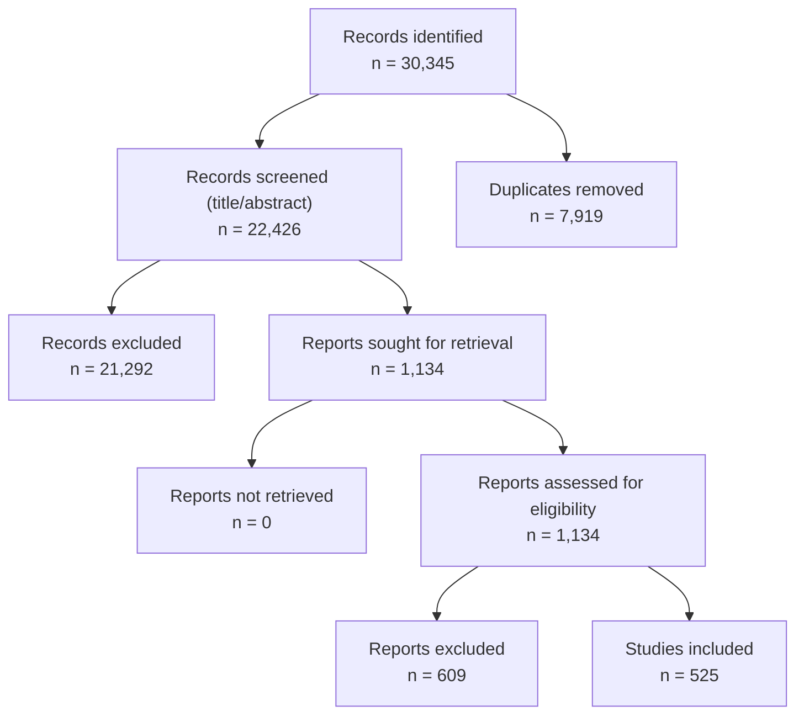

# PRISMA 2020 report — misinformation-intervention meta-analysis

_Generated by `Scripts/build_manuscript_report.py` from the frozen `Results/` outputs and the report-level PRISMA closure. No value is invented: every number is traced to its source._

## Provenance of the flow numbers

- Primary source: `Scripts/prisma_report.py (generator of Scripts/PRISMA_CLOSURE.md)` — the generator of `Scripts/PRISMA_CLOSURE.md`.
- `PRISMA_CLOSURE.md` and the regenerated report-level flow agree on every box and reason (no discrepancies).

## Identification

- Records identified: **30,345**.
- Duplicates removed: 7,919.
- Reports after deduplication: 22,426.

## Screening

- Reports screened (title/abstract): 22,426.
- Records excluded at title/abstract: 21,292.
  - No misinformation intervention (C1): 20,968.
  - No control/comparison group (C2): 255.
  - Not a primary experimental study (C4): 45.
  - Not English (C3): 24.

## Eligibility

- Reports sought for retrieval: 1,134.
- Reports not retrieved: 0 (sought-but-unobtained reports are stored as `Fulltext irretrievable` exclusions, so this box is 0).
- Reports assessed for eligibility: 1,134.
- Reports excluded: 609.
  - No misinformation intervention (C1): 239.
  - No control/comparison group (C2): 112.
  - Not a primary experimental study (C4): 38.
  - Intervention targets alcohol/tobacco/substance use (or their advertising) rather than misinformation susceptibility: 37.
  - Intervention/outcome concerns a non-information behaviour or a non-misinformation experiment: 29.
  - Intervention targets body image/eating/appearance rather than misinformation susceptibility: 28.
  - No eligible contrast reported: 20.
  - Intervention targets commercial advertising/persuasion literacy (general persuasion) rather than misinformation susceptibility: 20.
  - Duplicate/non-independent report of an included study: 17.
  - Intervention targets sexual-health behaviour/communication rather than misinformation susceptibility: 16.
  - Fulltext irretrievable: 13.
  - Intervention targets prejudice/stereotypes/intergroup contact rather than misinformation susceptibility: 11.
  - Outcome is eyewitness/memory performance, not misinformation susceptibility: 10.
  - Not English (C3): 7.
  - No experimental intervention (observational): 5.
  - Intervention targets media violence/aggression rather than misinformation susceptibility: 5.
  - No manipulated intervention; qualitative/observational: 1.
  - No eligible contrast reported (C2): 1.

## Inclusion

- **Studies included in the synthesis: 525**.
- Included records: 780; duplicate / non-independent included records: 255.
- Distinct coded papers in `Extraction/`: 531.
- Coded papers in an included report: 525.
- Included reports without a matching coding: 0 (the reconciliation gap against the analysis set).

## PRISMA 2020 flow diagram

- PNG (300 dpi): `Results/figures/PRISMA_2020_flow.png`
- SVG: `Results/figures/PRISMA_2020_flow.svg`
- Mermaid: `Scripts/PRISMA_flow.mmd`
- ASCII: `Scripts/PRISMA_flow_ascii.txt`

```
PRISMA 2020 flow (report level, ASCII)
==============================================================================
[Identification]
  Records identified: 30,345
  Duplicates removed: 7,919
[Screening]
  Reports screened (title/abstract): 22,426
  Records excluded at title/abstract: 21,292
      - No misinformation intervention (C1): 20,968
      - No control/comparison group (C2): 255
      - Not a primary experimental study (C4): 45
      - Not English (C3): 24
[Eligibility]
  Reports sought for retrieval: 1,134
  Reports not retrieved: 0
  Reports assessed for eligibility: 1,134
  Reports excluded: 609
      - No misinformation intervention (C1): 239
      - No control/comparison group (C2): 112
      - Not a primary experimental study (C4): 38
      - Intervention targets alcohol/tobacco/substance use (or their advertising) rather than misinformation susceptibility: 37
      - Intervention/outcome concerns a non-information behaviour or a non-misinformation experiment: 29
      - Intervention targets body image/eating/appearance rather than misinformation susceptibility: 28
      - No eligible contrast reported: 20
      - Intervention targets commercial advertising/persuasion literacy (general persuasion) rather than misinformation susceptibility: 20
      - Duplicate/non-independent report of an included study: 17
      - Intervention targets sexual-health behaviour/communication rather than misinformation susceptibility: 16
      - Fulltext irretrievable: 13
      - Intervention targets prejudice/stereotypes/intergroup contact rather than misinformation susceptibility: 11
      - Outcome is eyewitness/memory performance, not misinformation susceptibility: 10
      - Not English (C3): 7
      - No experimental intervention (observational): 5
      - Intervention targets media violence/aggression rather than misinformation susceptibility: 5
      - No manipulated intervention; qualitative/observational: 1
      - No eligible contrast reported (C2): 1
[Included]
  Studies included in synthesis: 525
  Included records: 780; duplicate/non-independent included records: 255
  Coded papers: 531; coded papers in included reports: 525; included reports without a coding: 0
```



## Manuscript tables

Workbook: `Results/manuscript_tables.xlsx` (sheets: Table_1_Study_Characteristics, Table_1b_Studies, Table_2_Posttest, Table_3_Persistence, Table_4_DiD, Table_S1_Derived_Specs, Table_5_Publication_Bias, Table_6_Moderators).

### Table 1. Study characteristics

| Section | Characteristic | Value |
| --- | --- | --- |
| Sample | Studies (k) | 531 |
| Sample | Experiments (coded) | 882 |
| Sample | Participants (sum of analysed N) | 2,181,773 |
| Sample | Experiments with analysable N | 866 |
| Publication year | Median | 2023 |
| Publication year | Range | 2002–2026 |
| Publication year | Experiments with year | 882 |
| Age group | Adults | 758 |
| Age group | Adolescents | 39 |
| Age group | Children | 28 |
| Age group | Mixed | 23 |
| Setting | Online experiment | 620 |
| Setting | Classroom | 79 |
| Setting | Field | 59 |
| Setting | Online panel survey | 49 |
| Setting | Lab | 48 |
| Setting | Simulated field | 12 |
| Setting | Other | 11 |
| Design | Between-subjects | 462 |
| Design | Mixed | 317 |
| Design | Within-subjects | 85 |
| Control group type | No-treatment/Passive | 413 |
| Control group type | Placebo (unrelated content) | 219 |
| Control group type | Other | 57 |
| Control group type | Active (alternative intervention) | 57 |
| Control group type | Misinformation-only | 44 |
| Control group type | Waitlist | 12 |
| Western sample | Western | 747 |
| Western sample | not | 105 |
| Intervention type | debunking_and_rebuttals | 225 |
| Intervention type | inoculation | 198 |
| Intervention type | media_literacy_tips | 133 |
| Intervention type | credibility_labels | 78 |
| Intervention type | accuracy_prompts | 75 |
| Intervention type | openmindedness_intervention | 61 |
| Intervention type | other | 58 |
| Intervention type | social_norms | 48 |
| Intervention type | lateral_reading | 41 |
| Intervention type | community_correction | 23 |
| Intervention type | fact_checking_training | 18 |
| Intervention type | prebunking_warning | 13 |
| Intervention type | platform_exposure_reduction | 8 |
| Intervention type | friction | 6 |
| Outcome domain (contrasts) | credibility | 4,752 |
| Outcome domain (contrasts) | sharing_intention | 1,402 |
| Outcome domain (contrasts) | attitude_policy | 1,254 |
| Outcome domain (contrasts) | other | 944 |
| Outcome domain (contrasts) | engagement_behavior | 668 |
| Outcome domain (contrasts) | trust | 371 |
| Outcome domain (contrasts) | critical_thinking | 333 |
| Outcome domain (contrasts) | confidence | 306 |
| Outcome domain (contrasts) | technique_recognition | 295 |
| Outcome domain (contrasts) | search_behavior | 272 |
| Outcome domain (contrasts) | media_literacy_attitudes | 248 |
| Outcome domain (contrasts) | affect | 190 |

Per-study characteristics are in the `Table_1b_Studies` sheet (882 coded experiments).

### Table 2. Pooled immediate-posttest effects

| Layer | Specification | Exclusions | Scope | k | Studies | N (participants) | g | 95% CI | I² (%) | τ² |
| --- | --- | --- | --- | --- | --- | --- | --- | --- | --- | --- |
| Signal detection (re-analysis) | Immediate posttest — all outcomes | on | unrestricted | 240 | 111 | 245,916 | 0.161 | [0.128, 0.194] | 95.1 | 0.0611 |
| Signal detection (re-analysis) | Immediate posttest — all outcomes | on | restricted | 240 | 111 | 245,916 | 0.161 | [0.128, 0.194] | 95.1 | 0.0611 |
| Signal detection (re-analysis) | Immediate posttest — all outcomes | off | unrestricted | 242 | 111 | 249,915 | 0.157 | [0.122, 0.192] | 95.7 | 0.0685 |
| Signal detection (re-analysis) | Immediate posttest — all outcomes | off | restricted | 242 | 111 | 249,915 | 0.157 | [0.122, 0.192] | 95.7 | 0.0685 |
| Signal detection (re-analysis) | Immediate posttest — credibility | on | unrestricted | 171 | 106 | 207,913 | 0.168 | [0.125, 0.211] | 95.2 | 0.0735 |
| Signal detection (re-analysis) | Immediate posttest — credibility | on | restricted | 171 | 106 | 207,913 | 0.168 | [0.125, 0.211] | 95.2 | 0.0735 |
| Signal detection (re-analysis) | Immediate posttest — credibility | off | unrestricted | 172 | 106 | 211,061 | 0.165 | [0.122, 0.207] | 95.2 | 0.0716 |
| Signal detection (re-analysis) | Immediate posttest — credibility | off | restricted | 172 | 106 | 211,061 | 0.165 | [0.122, 0.207] | 95.2 | 0.0716 |

### Table 3. Pooled follow-up persistence effects

| Layer | Specification | Exclusions | Scope | k | Studies | N (participants) | g | 95% CI | I² (%) | τ² |
| --- | --- | --- | --- | --- | --- | --- | --- | --- | --- | --- |
| Signal detection (re-analysis) | Follow-up persistence — all outcomes | on | unrestricted | 43 | 23 | 40,281 | 0.147 | [0.075, 0.219] | 92.5 | 0.0474 |
| Signal detection (re-analysis) | Follow-up persistence — all outcomes | on | restricted | 43 | 23 | 40,281 | 0.147 | [0.075, 0.219] | 92.5 | 0.0474 |
| Signal detection (re-analysis) | Follow-up persistence — all outcomes | off | unrestricted | 43 | 23 | 40,389 | 0.145 | [0.073, 0.216] | 92.5 | 0.0470 |
| Signal detection (re-analysis) | Follow-up persistence — all outcomes | off | restricted | 43 | 23 | 40,389 | 0.145 | [0.073, 0.216] | 92.5 | 0.0470 |
| Signal detection (re-analysis) | Follow-up persistence — credibility | on | unrestricted | 30 | 23 | 33,688 | 0.188 | [0.099, 0.276] | 92.8 | 0.0500 |
| Signal detection (re-analysis) | Follow-up persistence — credibility | on | restricted | 30 | 23 | 33,688 | 0.188 | [0.099, 0.276] | 92.8 | 0.0500 |
| Signal detection (re-analysis) | Follow-up persistence — credibility | off | unrestricted | 30 | 23 | 33,796 | 0.186 | [0.097, 0.274] | 92.8 | 0.0495 |
| Signal detection (re-analysis) | Follow-up persistence — credibility | off | restricted | 30 | 23 | 33,796 | 0.186 | [0.097, 0.274] | 92.8 | 0.0495 |

### Table 4. Pooled pretest-corrected (DiD) effects

| Layer | Specification | Exclusions | Scope | k | Studies | N (participants) | g | 95% CI | I² (%) | τ² |
| --- | --- | --- | --- | --- | --- | --- | --- | --- | --- | --- |
| Signal detection (re-analysis) | Pretest-corrected DiD — all outcomes | on | unrestricted | 47 | 28 | 36,959 | 0.105 | [0.037, 0.173] | 89.6 | 0.0449 |
| Signal detection (re-analysis) | Pretest-corrected DiD — all outcomes | on | restricted | 47 | 28 | 36,959 | 0.105 | [0.037, 0.173] | 89.6 | 0.0449 |
| Signal detection (re-analysis) | Pretest-corrected DiD — all outcomes | off | unrestricted | 49 | 28 | 37,248 | 0.082 | [0.010, 0.154] | 91.0 | 0.0546 |
| Signal detection (re-analysis) | Pretest-corrected DiD — all outcomes | off | restricted | 49 | 28 | 37,248 | 0.082 | [0.010, 0.154] | 91.0 | 0.0546 |
| Signal detection (re-analysis) | Pretest-corrected DiD — credibility | on | unrestricted | 35 | 27 | 36,668 | 0.095 | [0.012, 0.178] | 91.4 | 0.0513 |
| Signal detection (re-analysis) | Pretest-corrected DiD — credibility | on | restricted | 35 | 27 | 36,668 | 0.095 | [0.012, 0.178] | 91.4 | 0.0513 |
| Signal detection (re-analysis) | Pretest-corrected DiD — credibility | off | unrestricted | 36 | 27 | 36,957 | 0.086 | [0.001, 0.170] | 91.7 | 0.0548 |
| Signal detection (re-analysis) | Pretest-corrected DiD — credibility | off | restricted | 36 | 27 | 36,957 | 0.086 | [0.001, 0.170] | 91.7 | 0.0548 |

### Table S1. Derived combined specifications

| Layer | Specification | Exclusions | Scope | k | Studies | N (participants) | g | 95% CI | I² (%) | τ² |
| --- | --- | --- | --- | --- | --- | --- | --- | --- | --- | --- |

### Table 5. Publication-bias tests

| Layer | Specification | Exclusions | k | Studies | Egger intercept | Egger SE | Egger t | Egger p | PET estimate | PET p | PEESE estimate | PEESE p | Preferred | Preferred estimate | Preferred 95% CI | Trim-and-fill k0 | Trim-and-fill adjusted | Trim-and-fill status | p-curve status |
| --- | --- | --- | --- | --- | --- | --- | --- | --- | --- | --- | --- | --- | --- | --- | --- | --- | --- | --- | --- |
| Reported effects (meta-analysis) | Pretest-corrected DiD — all outcomes | on | 355 | 70 | 0.041 | 0.049 | 0.83 | .407 | 0.041 | .407 | 0.226 | < .001 | PET | 0.041 | [-0.055, 0.137] | 23 | 0.497 | ok | ok |
| Reported effects (meta-analysis) | Pretest-corrected DiD — all outcomes | off | 355 | 70 | 0.041 | 0.049 | 0.85 | .398 | 0.041 | .398 | 0.223 | < .001 | PET | 0.041 | [-0.054, 0.137] | 26 | 0.489 | ok | ok |
| Reported effects (meta-analysis) | Pretest-corrected DiD — credibility | on | 180 | 52 | 0.116 | 0.083 | 1.39 | .165 | 0.116 | .165 | 0.305 | < .001 | PET | 0.116 | [-0.047, 0.280] | 9 | 0.498 | ok | ok |
| Reported effects (meta-analysis) | Pretest-corrected DiD — credibility | off | 180 | 52 | 0.124 | 0.083 | 1.49 | .137 | 0.124 | .137 | 0.301 | < .001 | PET | 0.124 | [-0.039, 0.286] | 11 | 0.484 | ok | ok |
| Reported effects (meta-analysis) | Immediate posttest — all outcomes | on | 3088 | 385 | 0.020 | 0.003 | 5.84 | < .001 | 0.020 | < .001 | 0.047 | < .001 | PEESE | 0.047 | [0.041, 0.053] | 79 | 0.229 | ok | ok |
| Reported effects (meta-analysis) | Immediate posttest — all outcomes | off | 3088 | 385 | 0.013 | 0.003 | 3.79 | < .001 | 0.013 | < .001 | 0.040 | < .001 | PEESE | 0.040 | [0.034, 0.046] | 75 | 0.223 | ok | ok |
| Reported effects (meta-analysis) | Immediate posttest — credibility | on | 1606 | 323 | 0.036 | 0.008 | 4.48 | < .001 | 0.036 | < .001 | 0.090 | < .001 | PEESE | 0.090 | [0.078, 0.102] | 73 | 0.268 | ok | ok |
| Reported effects (meta-analysis) | Immediate posttest — credibility | off | 1606 | 323 | -0.002 | 0.009 | -0.23 | .820 | -0.002 | .820 | 0.060 | < .001 | PET | -0.002 | [-0.019, 0.015] | 73 | 0.262 | ok | ok |
| Reported effects (meta-analysis) | Follow-up persistence — all outcomes | on | 489 | 89 | 0.030 | 0.010 | 2.98 | .003 | 0.030 | .003 | 0.076 | < .001 | PEESE | 0.076 | [0.059, 0.092] | 8 | 0.231 | ok | ok |
| Reported effects (meta-analysis) | Follow-up persistence — all outcomes | off | 489 | 89 | 0.030 | 0.010 | 2.99 | .003 | 0.030 | .003 | 0.076 | < .001 | PEESE | 0.076 | [0.059, 0.092] | 9 | 0.230 | ok | ok |
| Reported effects (meta-analysis) | Follow-up persistence — credibility | on | 256 | 72 | 0.021 | 0.012 | 1.77 | .079 | 0.021 | .079 | 0.060 | < .001 | PET | 0.021 | [-0.002, 0.045] | 0 | 0.252 | ok | ok |
| Reported effects (meta-analysis) | Follow-up persistence — credibility | off | 256 | 72 | 0.022 | 0.012 | 1.82 | .070 | 0.022 | .070 | 0.061 | < .001 | PET | 0.022 | [-0.002, 0.045] | 0 | 0.250 | ok | ok |
| Reported effects (meta-analysis) | Pretest-corrected where possible — all outcomes | on | 3129 | 385 | 0.019 | 0.003 | 5.66 | < .001 | 0.019 | < .001 | 0.047 | < .001 | PEESE | 0.047 | [0.041, 0.054] | 97 | 0.239 | ok | ok |
| Reported effects (meta-analysis) | Pretest-corrected where possible — all outcomes | off | 3129 | 385 | 0.013 | 0.004 | 3.66 | < .001 | 0.013 | < .001 | 0.040 | < .001 | PEESE | 0.040 | [0.034, 0.046] | 95 | 0.233 | ok | ok |
| Reported effects (meta-analysis) | Pretest-corrected where possible — credibility | on | 1619 | 323 | 0.034 | 0.008 | 4.15 | < .001 | 0.034 | < .001 | 0.090 | < .001 | PEESE | 0.090 | [0.077, 0.102] | 77 | 0.279 | ok | ok |
| Reported effects (meta-analysis) | Pretest-corrected where possible — credibility | off | 1619 | 323 | -0.004 | 0.009 | -0.46 | .647 | -0.004 | .647 | 0.059 | < .001 | PET | -0.004 | [-0.021, 0.013] | 78 | 0.272 | ok | ok |
| Reported effects (meta-analysis) | Follow-up where available — all outcomes | on | 3240 | 385 | 0.021 | 0.003 | 6.31 | < .001 | 0.021 | < .001 | 0.048 | < .001 | PEESE | 0.048 | [0.042, 0.054] | 72 | 0.220 | ok | ok |
| Reported effects (meta-analysis) | Follow-up where available — all outcomes | off | 3240 | 385 | 0.014 | 0.003 | 4.25 | < .001 | 0.014 | < .001 | 0.041 | < .001 | PEESE | 0.041 | [0.035, 0.047] | 67 | 0.214 | ok | ok |
| Reported effects (meta-analysis) | Follow-up where available — credibility | on | 1697 | 323 | 0.035 | 0.007 | 4.87 | < .001 | 0.035 | < .001 | 0.085 | < .001 | PEESE | 0.085 | [0.074, 0.096] | 58 | 0.251 | ok | ok |
| Reported effects (meta-analysis) | Follow-up where available — credibility | off | 1697 | 323 | 0.004 | 0.008 | 0.51 | .610 | 0.004 | .610 | 0.059 | < .001 | PET | 0.004 | [-0.011, 0.019] | 57 | 0.242 | ok | ok |
| Signal detection (re-analysis) | Pretest-corrected DiD — all outcomes | on | 49 | 28 | -0.036 | 0.024 | -1.51 | .137 | -0.036 | .137 | -0.002 | .865 | PET | -0.036 | [-0.082, 0.011] | 2 | 0.029 | ok | ok |
| Signal detection (re-analysis) | Pretest-corrected DiD — all outcomes | off | 51 | 28 | -0.020 | 0.025 | -0.81 | .419 | -0.020 | .419 | 0.005 | .711 | PET | -0.020 | [-0.069, 0.029] | 2 | 0.026 | ok | ok |
| Signal detection (re-analysis) | Pretest-corrected DiD — credibility | on | 35 | 27 | -0.041 | 0.030 | -1.37 | .180 | -0.041 | .180 | -0.008 | .614 | PET | -0.041 | [-0.099, 0.018] | 1 | 0.031 | ok | ok |
| Signal detection (re-analysis) | Pretest-corrected DiD — credibility | off | 36 | 27 | -0.032 | 0.030 | -1.06 | .295 | -0.032 | .295 | -0.001 | .942 | PET | -0.032 | [-0.091, 0.027] | 0 | 0.036 | ok | ok |
| Signal detection (re-analysis) | Immediate posttest — all outcomes | on | 262 | 113 | 0.008 | 0.009 | 0.82 | .416 | 0.008 | .416 | 0.028 | < .001 | PET | 0.008 | [-0.011, 0.026] | 27 | 0.080 | ok | ok |
| Signal detection (re-analysis) | Immediate posttest — all outcomes | off | 264 | 113 | 0.007 | 0.010 | 0.74 | .460 | 0.007 | .460 | 0.029 | < .001 | PET | 0.007 | [-0.012, 0.027] | 34 | 0.087 | ok | ok |
| Signal detection (re-analysis) | Immediate posttest — credibility | on | 168 | 110 | 0.010 | 0.011 | 0.85 | .396 | 0.010 | .396 | 0.026 | < .001 | PET | 0.010 | [-0.013, 0.032] | 15 | 0.070 | ok | ok |
| Signal detection (re-analysis) | Immediate posttest — credibility | off | 169 | 110 | 0.010 | 0.011 | 0.87 | .386 | 0.010 | .386 | 0.027 | < .001 | PET | 0.010 | [-0.012, 0.032] | 15 | 0.069 | ok | ok |
| Signal detection (re-analysis) | Follow-up persistence — all outcomes | on | 45 | 23 | -0.004 | 0.020 | -0.18 | .858 | -0.004 | .858 | 0.021 | .139 | PET | -0.004 | [-0.044, 0.036] | 2 | 0.076 | ok | ok |
| Signal detection (re-analysis) | Follow-up persistence — all outcomes | off | 45 | 23 | -0.004 | 0.020 | -0.19 | .851 | -0.004 | .851 | 0.022 | .135 | PET | -0.004 | [-0.044, 0.036] | 2 | 0.076 | ok | ok |
| Signal detection (re-analysis) | Follow-up persistence — credibility | on | 30 | 23 | 0.009 | 0.033 | 0.26 | .796 | 0.009 | .796 | 0.044 | .048 | PET | 0.009 | [-0.056, 0.073] | 2 | 0.099 | ok | ok |
| Signal detection (re-analysis) | Follow-up persistence — credibility | off | 30 | 23 | 0.009 | 0.033 | 0.26 | .794 | 0.009 | .794 | 0.044 | .046 | PET | 0.009 | [-0.055, 0.073] | 2 | 0.099 | ok | ok |
| Signal detection (re-analysis) | Pretest-corrected where possible — all outcomes | on | 259 | 113 | 0.011 | 0.009 | 1.17 | .243 | 0.011 | .243 | 0.030 | < .001 | PET | 0.011 | [-0.007, 0.028] | 26 | 0.081 | ok | ok |
| Signal detection (re-analysis) | Pretest-corrected where possible — all outcomes | off | 261 | 113 | 0.010 | 0.010 | 1.04 | .298 | 0.010 | .298 | 0.031 | < .001 | PET | 0.010 | [-0.009, 0.029] | 32 | 0.087 | ok | ok |
| Signal detection (re-analysis) | Pretest-corrected where possible — credibility | on | 165 | 110 | 0.013 | 0.011 | 1.18 | .239 | 0.013 | .239 | 0.029 | < .001 | PET | 0.013 | [-0.009, 0.035] | 14 | 0.073 | ok | ok |
| Signal detection (re-analysis) | Pretest-corrected where possible — credibility | off | 166 | 110 | 0.013 | 0.011 | 1.19 | .238 | 0.013 | .238 | 0.030 | < .001 | PET | 0.013 | [-0.008, 0.034] | 14 | 0.073 | ok | ok |
| Signal detection (re-analysis) | Follow-up where available — all outcomes | on | 264 | 113 | 0.017 | 0.007 | 2.35 | .019 | 0.017 | .019 | 0.033 | < .001 | PEESE | 0.033 | [0.024, 0.043] | 20 | 0.071 | ok | ok |
| Signal detection (re-analysis) | Follow-up where available — all outcomes | off | 266 | 113 | 0.017 | 0.008 | 2.10 | .037 | 0.017 | .037 | 0.034 | < .001 | PEESE | 0.034 | [0.023, 0.044] | 27 | 0.078 | ok | ok |
| Signal detection (re-analysis) | Follow-up where available — credibility | on | 170 | 110 | 0.021 | 0.009 | 2.47 | .014 | 0.021 | .014 | 0.033 | < .001 | PEESE | 0.033 | [0.022, 0.045] | 9 | 0.061 | ok | ok |
| Signal detection (re-analysis) | Follow-up where available — credibility | off | 171 | 110 | 0.021 | 0.009 | 2.51 | .013 | 0.021 | .013 | 0.033 | < .001 | PEESE | 0.033 | [0.022, 0.045] | 9 | 0.061 | ok | ok |

### Table 6. Moderator analyses

| Moderator | Level | Layer | Specification | Exclusions | k | Studies | Estimate | 95% CI | p |
| --- | --- | --- | --- | --- | --- | --- | --- | --- | --- |
| Primary data availability | Paper only | Reported effects (meta-analysis) | Pretest-corrected DiD — all outcomes | on | 216 | 44 | 0.440 | [0.370, 0.510] |  |
| Primary data availability | Primary data available | Reported effects (meta-analysis) | Pretest-corrected DiD — all outcomes | on | 139 | 26 | 0.455 | [0.396, 0.513] |  |
| Primary data availability | Difference (meta-regression) | Reported effects (meta-analysis) | Pretest-corrected DiD — all outcomes | on | 355 | 70 | 0.105 | [-0.111, 0.322] | .335 |
| Primary data availability | Paper only | Reported effects (meta-analysis) | Pretest-corrected DiD — all outcomes | off | 216 | 44 | 0.440 | [0.370, 0.510] |  |
| Primary data availability | Primary data available | Reported effects (meta-analysis) | Pretest-corrected DiD — all outcomes | off | 139 | 26 | 0.426 | [0.370, 0.482] |  |
| Primary data availability | Difference (meta-regression) | Reported effects (meta-analysis) | Pretest-corrected DiD — all outcomes | off | 355 | 70 | 0.085 | [-0.125, 0.295] | .424 |
| Primary data availability | Paper only | Reported effects (meta-analysis) | Pretest-corrected DiD — credibility | on | 94 | 32 | 0.425 | [0.305, 0.544] |  |
| Primary data availability | Primary data available | Reported effects (meta-analysis) | Pretest-corrected DiD — credibility | on | 86 | 20 | 0.477 | [0.399, 0.556] |  |
| Primary data availability | Difference (meta-regression) | Reported effects (meta-analysis) | Pretest-corrected DiD — credibility | on | 180 | 52 | 0.147 | [-0.112, 0.407] | .262 |
| Primary data availability | Paper only | Reported effects (meta-analysis) | Pretest-corrected DiD — credibility | off | 94 | 32 | 0.425 | [0.305, 0.544] |  |
| Primary data availability | Primary data available | Reported effects (meta-analysis) | Pretest-corrected DiD — credibility | off | 86 | 20 | 0.439 | [0.365, 0.513] |  |
| Primary data availability | Difference (meta-regression) | Reported effects (meta-analysis) | Pretest-corrected DiD — credibility | off | 180 | 52 | 0.118 | [-0.136, 0.371] | .357 |
| Primary data availability | Paper only | Reported effects (meta-analysis) | Immediate posttest — all outcomes | on | 1597 | 211 | 0.219 | [0.209, 0.229] |  |
| Primary data availability | Primary data available | Reported effects (meta-analysis) | Immediate posttest — all outcomes | on | 1491 | 174 | 0.199 | [0.187, 0.210] |  |
| Primary data availability | Difference (meta-regression) | Reported effects (meta-analysis) | Immediate posttest — all outcomes | on | 3088 | 385 | 0.059 | [-0.013, 0.130] | .108 |
| Primary data availability | Paper only | Reported effects (meta-analysis) | Immediate posttest — all outcomes | off | 1597 | 211 | 0.219 | [0.209, 0.229] |  |
| Primary data availability | Primary data available | Reported effects (meta-analysis) | Immediate posttest — all outcomes | off | 1491 | 174 | 0.190 | [0.177, 0.202] |  |
| Primary data availability | Difference (meta-regression) | Reported effects (meta-analysis) | Immediate posttest — all outcomes | off | 3088 | 385 | 0.035 | [-0.035, 0.105] | .328 |
| Primary data availability | Paper only | Reported effects (meta-analysis) | Immediate posttest — credibility | on | 785 | 163 | 0.253 | [0.230, 0.276] |  |
| Primary data availability | Primary data available | Reported effects (meta-analysis) | Immediate posttest — credibility | on | 821 | 160 | 0.203 | [0.188, 0.219] |  |
| Primary data availability | Difference (meta-regression) | Reported effects (meta-analysis) | Immediate posttest — credibility | on | 1606 | 323 | -0.111 | [-0.188, -0.034] | .005 |
| Primary data availability | Paper only | Reported effects (meta-analysis) | Immediate posttest — credibility | off | 785 | 163 | 0.253 | [0.230, 0.276] |  |
| Primary data availability | Primary data available | Reported effects (meta-analysis) | Immediate posttest — credibility | off | 821 | 160 | 0.187 | [0.170, 0.204] |  |
| Primary data availability | Difference (meta-regression) | Reported effects (meta-analysis) | Immediate posttest — credibility | off | 1606 | 323 | -0.143 | [-0.218, -0.069] | < .001 |
| Primary data availability | Paper only | Reported effects (meta-analysis) | Follow-up persistence — all outcomes | on | 265 | 39 | 0.176 | [0.154, 0.197] |  |
| Primary data availability | Primary data available | Reported effects (meta-analysis) | Follow-up persistence — all outcomes | on | 224 | 50 | 0.267 | [0.232, 0.302] |  |
| Primary data availability | Difference (meta-regression) | Reported effects (meta-analysis) | Follow-up persistence — all outcomes | on | 489 | 89 | 0.039 | [-0.048, 0.127] | .372 |
| Primary data availability | Paper only | Reported effects (meta-analysis) | Follow-up persistence — all outcomes | off | 265 | 39 | 0.176 | [0.154, 0.197] |  |
| Primary data availability | Primary data available | Reported effects (meta-analysis) | Follow-up persistence — all outcomes | off | 224 | 50 | 0.263 | [0.228, 0.298] |  |
| Primary data availability | Difference (meta-regression) | Reported effects (meta-analysis) | Follow-up persistence — all outcomes | off | 489 | 89 | 0.039 | [-0.048, 0.126] | .376 |
| Primary data availability | Paper only | Reported effects (meta-analysis) | Follow-up persistence — credibility | on | 107 | 27 | 0.139 | [0.110, 0.169] |  |
| Primary data availability | Primary data available | Reported effects (meta-analysis) | Follow-up persistence — credibility | on | 149 | 45 | 0.326 | [0.281, 0.371] |  |
| Primary data availability | Difference (meta-regression) | Reported effects (meta-analysis) | Follow-up persistence — credibility | on | 256 | 72 | 0.056 | [-0.041, 0.152] | .254 |
| Primary data availability | Paper only | Reported effects (meta-analysis) | Follow-up persistence — credibility | off | 107 | 27 | 0.139 | [0.110, 0.169] |  |
| Primary data availability | Primary data available | Reported effects (meta-analysis) | Follow-up persistence — credibility | off | 149 | 45 | 0.321 | [0.276, 0.366] |  |
| Primary data availability | Difference (meta-regression) | Reported effects (meta-analysis) | Follow-up persistence — credibility | off | 256 | 72 | 0.055 | [-0.041, 0.152] | .255 |
| Primary data availability | Paper only | Reported effects (meta-analysis) | Pretest-corrected where possible — all outcomes | on | 1630 | 211 | 0.227 | [0.217, 0.237] |  |
| Primary data availability | Primary data available | Reported effects (meta-analysis) | Pretest-corrected where possible — all outcomes | on | 1499 | 174 | 0.204 | [0.192, 0.216] |  |
| Primary data availability | Difference (meta-regression) | Reported effects (meta-analysis) | Pretest-corrected where possible — all outcomes | on | 3129 | 385 | 0.059 | [-0.013, 0.131] | .109 |
| Primary data availability | Paper only | Reported effects (meta-analysis) | Pretest-corrected where possible — all outcomes | off | 1630 | 211 | 0.227 | [0.217, 0.237] |  |
| Primary data availability | Primary data available | Reported effects (meta-analysis) | Pretest-corrected where possible — all outcomes | off | 1499 | 174 | 0.193 | [0.181, 0.206] |  |
| Primary data availability | Difference (meta-regression) | Reported effects (meta-analysis) | Pretest-corrected where possible — all outcomes | off | 3129 | 385 | 0.035 | [-0.036, 0.106] | .331 |
| Primary data availability | Paper only | Reported effects (meta-analysis) | Pretest-corrected where possible — credibility | on | 793 | 163 | 0.263 | [0.240, 0.286] |  |
| Primary data availability | Primary data available | Reported effects (meta-analysis) | Pretest-corrected where possible — credibility | on | 826 | 160 | 0.212 | [0.196, 0.228] |  |
| Primary data availability | Difference (meta-regression) | Reported effects (meta-analysis) | Pretest-corrected where possible — credibility | on | 1619 | 323 | -0.111 | [-0.188, -0.034] | .005 |
| Primary data availability | Paper only | Reported effects (meta-analysis) | Pretest-corrected where possible — credibility | off | 793 | 163 | 0.263 | [0.240, 0.286] |  |
| Primary data availability | Primary data available | Reported effects (meta-analysis) | Pretest-corrected where possible — credibility | off | 826 | 160 | 0.192 | [0.175, 0.209] |  |
| Primary data availability | Difference (meta-regression) | Reported effects (meta-analysis) | Pretest-corrected where possible — credibility | off | 1619 | 323 | -0.144 | [-0.219, -0.069] | < .001 |
| Primary data availability | Paper only | Reported effects (meta-analysis) | Follow-up where available — all outcomes | on | 1668 | 211 | 0.208 | [0.198, 0.218] |  |
| Primary data availability | Primary data available | Reported effects (meta-analysis) | Follow-up where available — all outcomes | on | 1572 | 174 | 0.196 | [0.185, 0.208] |  |
| Primary data availability | Difference (meta-regression) | Reported effects (meta-analysis) | Follow-up where available — all outcomes | on | 3240 | 385 | 0.057 | [-0.013, 0.126] | .108 |
| Primary data availability | Paper only | Reported effects (meta-analysis) | Follow-up where available — all outcomes | off | 1668 | 211 | 0.208 | [0.198, 0.218] |  |
| Primary data availability | Primary data available | Reported effects (meta-analysis) | Follow-up where available — all outcomes | off | 1572 | 174 | 0.187 | [0.176, 0.199] |  |
| Primary data availability | Difference (meta-regression) | Reported effects (meta-analysis) | Follow-up where available — all outcomes | off | 3240 | 385 | 0.034 | [-0.034, 0.102] | .323 |
| Primary data availability | Paper only | Reported effects (meta-analysis) | Follow-up where available — credibility | on | 815 | 163 | 0.236 | [0.216, 0.256] |  |
| Primary data availability | Primary data available | Reported effects (meta-analysis) | Follow-up where available — credibility | on | 882 | 160 | 0.203 | [0.188, 0.218] |  |
| Primary data availability | Difference (meta-regression) | Reported effects (meta-analysis) | Follow-up where available — credibility | on | 1697 | 323 | -0.071 | [-0.146, 0.003] | .061 |
| Primary data availability | Paper only | Reported effects (meta-analysis) | Follow-up where available — credibility | off | 815 | 163 | 0.236 | [0.216, 0.256] |  |
| Primary data availability | Primary data available | Reported effects (meta-analysis) | Follow-up where available — credibility | off | 882 | 160 | 0.187 | [0.171, 0.203] |  |
| Primary data availability | Difference (meta-regression) | Reported effects (meta-analysis) | Follow-up where available — credibility | off | 1697 | 323 | -0.102 | [-0.175, -0.029] | .006 |
| Primary data availability | Primary data available | Signal detection (re-analysis) | Pretest-corrected DiD — all outcomes | on | 49 | 28 | 0.035 | [0.009, 0.061] |  |
| Primary data availability | Primary data available | Signal detection (re-analysis) | Pretest-corrected DiD — all outcomes | off | 51 | 28 | 0.033 | [0.005, 0.060] |  |
| Primary data availability | Primary data available | Signal detection (re-analysis) | Pretest-corrected DiD — credibility | on | 35 | 27 | 0.034 | [0.000, 0.069] |  |
| Primary data availability | Primary data available | Signal detection (re-analysis) | Pretest-corrected DiD — credibility | off | 36 | 27 | 0.036 | [0.001, 0.071] |  |
| Primary data availability | Primary data available | Signal detection (re-analysis) | Immediate posttest — all outcomes | on | 262 | 113 | 0.058 | [0.047, 0.070] |  |
| Primary data availability | Primary data available | Signal detection (re-analysis) | Immediate posttest — all outcomes | off | 264 | 113 | 0.060 | [0.048, 0.073] |  |
| Primary data availability | Primary data available | Signal detection (re-analysis) | Immediate posttest — credibility | on | 168 | 110 | 0.052 | [0.037, 0.067] |  |
| Primary data availability | Primary data available | Signal detection (re-analysis) | Immediate posttest — credibility | off | 169 | 110 | 0.052 | [0.037, 0.066] |  |
| Primary data availability | Primary data available | Signal detection (re-analysis) | Follow-up persistence — all outcomes | on | 45 | 23 | 0.065 | [0.036, 0.094] |  |
| Primary data availability | Primary data available | Signal detection (re-analysis) | Follow-up persistence — all outcomes | off | 45 | 23 | 0.066 | [0.037, 0.094] |  |
| Primary data availability | Primary data available | Signal detection (re-analysis) | Follow-up persistence — credibility | on | 30 | 23 | 0.085 | [0.042, 0.127] |  |
| Primary data availability | Primary data available | Signal detection (re-analysis) | Follow-up persistence — credibility | off | 30 | 23 | 0.085 | [0.043, 0.127] |  |
| Primary data availability | Primary data available | Signal detection (re-analysis) | Pretest-corrected where possible — all outcomes | on | 259 | 113 | 0.060 | [0.048, 0.073] |  |
| Primary data availability | Primary data available | Signal detection (re-analysis) | Pretest-corrected where possible — all outcomes | off | 261 | 113 | 0.064 | [0.051, 0.076] |  |
| Primary data availability | Primary data available | Signal detection (re-analysis) | Pretest-corrected where possible — credibility | on | 165 | 110 | 0.056 | [0.040, 0.071] |  |
| Primary data availability | Primary data available | Signal detection (re-analysis) | Pretest-corrected where possible — credibility | off | 166 | 110 | 0.056 | [0.041, 0.071] |  |
| Primary data availability | Primary data available | Signal detection (re-analysis) | Follow-up where available — all outcomes | on | 264 | 113 | 0.057 | [0.047, 0.067] |  |
| Primary data availability | Primary data available | Signal detection (re-analysis) | Follow-up where available — all outcomes | off | 266 | 113 | 0.059 | [0.049, 0.070] |  |
| Primary data availability | Primary data available | Signal detection (re-analysis) | Follow-up where available — credibility | on | 170 | 110 | 0.051 | [0.039, 0.063] |  |
| Primary data availability | Primary data available | Signal detection (re-analysis) | Follow-up where available — credibility | off | 171 | 110 | 0.051 | [0.039, 0.062] |  |
| Domain | attitude_policy | Reported effects (meta-analysis) | Pretest-corrected DiD — all outcomes | on | 39 | 11 | 0.256 | [0.173, 0.340] |  |
| Domain | credibility | Reported effects (meta-analysis) | Pretest-corrected DiD — all outcomes | on | 160 | 48 | 0.487 | [0.401, 0.573] |  |
| Domain | critical_thinking | Reported effects (meta-analysis) | Pretest-corrected DiD — all outcomes | on | 37 | 11 | 0.492 | [0.326, 0.657] |  |
| Domain | media_literacy_attitudes | Reported effects (meta-analysis) | Pretest-corrected DiD — all outcomes | on | 10 | 4 | 0.633 | [0.429, 0.837] |  |
| Domain | other | Reported effects (meta-analysis) | Pretest-corrected DiD — all outcomes | on | 40 | 9 | 0.277 | [0.190, 0.364] |  |
| Domain | search_behavior | Reported effects (meta-analysis) | Pretest-corrected DiD — all outcomes | on | 23 | 8 | 1.004 | [0.681, 1.326] |  |
| Domain | sharing_intention | Reported effects (meta-analysis) | Pretest-corrected DiD — all outcomes | on | 34 | 10 | 0.179 | [0.115, 0.243] |  |
| Domain | technique_recognition | Reported effects (meta-analysis) | Pretest-corrected DiD — all outcomes | on | 2 | 2 | 0.519 | [-0.116, 1.155] |  |
| Domain | trust | Reported effects (meta-analysis) | Pretest-corrected DiD — all outcomes | on | 10 | 6 | 0.306 | [0.156, 0.455] |  |
| Domain | attitude_policy | Reported effects (meta-analysis) | Pretest-corrected DiD — all outcomes | off | 39 | 11 | 0.256 | [0.173, 0.340] |  |
| Domain | credibility | Reported effects (meta-analysis) | Pretest-corrected DiD — all outcomes | off | 160 | 48 | 0.465 | [0.381, 0.549] |  |
| Domain | critical_thinking | Reported effects (meta-analysis) | Pretest-corrected DiD — all outcomes | off | 37 | 11 | 0.478 | [0.313, 0.642] |  |
| Domain | media_literacy_attitudes | Reported effects (meta-analysis) | Pretest-corrected DiD — all outcomes | off | 10 | 4 | 0.633 | [0.429, 0.837] |  |
| Domain | other | Reported effects (meta-analysis) | Pretest-corrected DiD — all outcomes | off | 40 | 9 | 0.278 | [0.192, 0.365] |  |
| Domain | search_behavior | Reported effects (meta-analysis) | Pretest-corrected DiD — all outcomes | off | 23 | 8 | 1.004 | [0.681, 1.326] |  |
| Domain | sharing_intention | Reported effects (meta-analysis) | Pretest-corrected DiD — all outcomes | off | 34 | 10 | 0.179 | [0.115, 0.243] |  |
| Domain | technique_recognition | Reported effects (meta-analysis) | Pretest-corrected DiD — all outcomes | off | 2 | 2 | 0.519 | [-0.116, 1.155] |  |
| Domain | trust | Reported effects (meta-analysis) | Pretest-corrected DiD — all outcomes | off | 10 | 6 | 0.288 | [0.128, 0.449] |  |
| Domain | credibility | Reported effects (meta-analysis) | Pretest-corrected DiD — credibility | on | 160 | 48 | 0.487 | [0.401, 0.573] |  |
| Domain | sharing_intention | Reported effects (meta-analysis) | Pretest-corrected DiD — credibility | on | 20 | 4 | 0.175 | [0.083, 0.268] |  |
| Domain | credibility | Reported effects (meta-analysis) | Pretest-corrected DiD — credibility | off | 160 | 48 | 0.465 | [0.381, 0.549] |  |
| Domain | sharing_intention | Reported effects (meta-analysis) | Pretest-corrected DiD — credibility | off | 20 | 4 | 0.175 | [0.083, 0.268] |  |
| Domain | attitude_policy | Reported effects (meta-analysis) | Immediate posttest — all outcomes | on | 392 | 90 | 0.166 | [0.145, 0.187] |  |
| Domain | credibility | Reported effects (meta-analysis) | Immediate posttest — all outcomes | on | 1319 | 276 | 0.242 | [0.227, 0.257] |  |
| Domain | critical_thinking | Reported effects (meta-analysis) | Immediate posttest — all outcomes | on | 149 | 34 | 0.303 | [0.262, 0.344] |  |
| Domain | media_literacy_attitudes | Reported effects (meta-analysis) | Immediate posttest — all outcomes | on | 67 | 22 | 0.176 | [0.127, 0.226] |  |
| Domain | other | Reported effects (meta-analysis) | Immediate posttest — all outcomes | on | 310 | 82 | 0.212 | [0.177, 0.248] |  |
| Domain | search_behavior | Reported effects (meta-analysis) | Immediate posttest — all outcomes | on | 103 | 20 | 0.312 | [0.229, 0.395] |  |
| Domain | sharing_intention | Reported effects (meta-analysis) | Immediate posttest — all outcomes | on | 529 | 110 | 0.142 | [0.132, 0.153] |  |
| Domain | technique_recognition | Reported effects (meta-analysis) | Immediate posttest — all outcomes | on | 111 | 26 | 0.272 | [0.231, 0.312] |  |
| Domain | trust | Reported effects (meta-analysis) | Immediate posttest — all outcomes | on | 108 | 31 | 0.169 | [0.122, 0.216] |  |
| Domain | attitude_policy | Reported effects (meta-analysis) | Immediate posttest — all outcomes | off | 392 | 90 | 0.164 | [0.144, 0.185] |  |
| Domain | credibility | Reported effects (meta-analysis) | Immediate posttest — all outcomes | off | 1319 | 276 | 0.231 | [0.215, 0.247] |  |
| Domain | critical_thinking | Reported effects (meta-analysis) | Immediate posttest — all outcomes | off | 149 | 34 | 0.296 | [0.256, 0.336] |  |
| Domain | media_literacy_attitudes | Reported effects (meta-analysis) | Immediate posttest — all outcomes | off | 67 | 22 | 0.176 | [0.127, 0.226] |  |
| Domain | other | Reported effects (meta-analysis) | Immediate posttest — all outcomes | off | 310 | 82 | 0.213 | [0.178, 0.248] |  |
| Domain | search_behavior | Reported effects (meta-analysis) | Immediate posttest — all outcomes | off | 103 | 20 | 0.312 | [0.229, 0.395] |  |
| Domain | sharing_intention | Reported effects (meta-analysis) | Immediate posttest — all outcomes | off | 529 | 110 | 0.142 | [0.132, 0.153] |  |
| Domain | technique_recognition | Reported effects (meta-analysis) | Immediate posttest — all outcomes | off | 111 | 26 | 0.272 | [0.231, 0.312] |  |
| Domain | trust | Reported effects (meta-analysis) | Immediate posttest — all outcomes | off | 108 | 31 | 0.169 | [0.122, 0.216] |  |
| Domain | credibility | Reported effects (meta-analysis) | Immediate posttest — credibility | on | 1319 | 276 | 0.242 | [0.227, 0.257] |  |
| Domain | sharing_intention | Reported effects (meta-analysis) | Immediate posttest — credibility | on | 287 | 47 | 0.169 | [0.142, 0.195] |  |
| Domain | credibility | Reported effects (meta-analysis) | Immediate posttest — credibility | off | 1319 | 276 | 0.231 | [0.215, 0.247] |  |
| Domain | sharing_intention | Reported effects (meta-analysis) | Immediate posttest — credibility | off | 287 | 47 | 0.169 | [0.142, 0.195] |  |
| Domain | attitude_policy | Reported effects (meta-analysis) | Follow-up persistence — all outcomes | on | 70 | 21 | 0.142 | [0.086, 0.198] |  |
| Domain | credibility | Reported effects (meta-analysis) | Follow-up persistence — all outcomes | on | 235 | 64 | 0.286 | [0.247, 0.324] |  |
| Domain | critical_thinking | Reported effects (meta-analysis) | Follow-up persistence — all outcomes | on | 19 | 7 | 0.233 | [0.115, 0.352] |  |
| Domain | media_literacy_attitudes | Reported effects (meta-analysis) | Follow-up persistence — all outcomes | on | 11 | 5 | 0.427 | [0.176, 0.677] |  |
| Domain | other | Reported effects (meta-analysis) | Follow-up persistence — all outcomes | on | 53 | 18 | 0.165 | [0.098, 0.231] |  |
| Domain | search_behavior | Reported effects (meta-analysis) | Follow-up persistence — all outcomes | on | 22 | 6 | 0.271 | [0.207, 0.334] |  |
| Domain | sharing_intention | Reported effects (meta-analysis) | Follow-up persistence — all outcomes | on | 56 | 23 | 0.131 | [0.102, 0.159] |  |
| Domain | technique_recognition | Reported effects (meta-analysis) | Follow-up persistence — all outcomes | on | 12 | 5 | 0.172 | [0.061, 0.284] |  |
| Domain | trust | Reported effects (meta-analysis) | Follow-up persistence — all outcomes | on | 11 | 6 | 0.083 | [0.040, 0.126] |  |
| Domain | attitude_policy | Reported effects (meta-analysis) | Follow-up persistence — all outcomes | off | 70 | 21 | 0.139 | [0.083, 0.196] |  |
| Domain | credibility | Reported effects (meta-analysis) | Follow-up persistence — all outcomes | off | 235 | 64 | 0.282 | [0.244, 0.321] |  |
| Domain | critical_thinking | Reported effects (meta-analysis) | Follow-up persistence — all outcomes | off | 19 | 7 | 0.234 | [0.116, 0.352] |  |
| Domain | media_literacy_attitudes | Reported effects (meta-analysis) | Follow-up persistence — all outcomes | off | 11 | 5 | 0.427 | [0.176, 0.677] |  |
| Domain | other | Reported effects (meta-analysis) | Follow-up persistence — all outcomes | off | 53 | 18 | 0.167 | [0.100, 0.233] |  |
| Domain | search_behavior | Reported effects (meta-analysis) | Follow-up persistence — all outcomes | off | 22 | 6 | 0.271 | [0.207, 0.334] |  |
| Domain | sharing_intention | Reported effects (meta-analysis) | Follow-up persistence — all outcomes | off | 56 | 23 | 0.131 | [0.102, 0.159] |  |
| Domain | technique_recognition | Reported effects (meta-analysis) | Follow-up persistence — all outcomes | off | 12 | 5 | 0.172 | [0.061, 0.284] |  |
| Domain | trust | Reported effects (meta-analysis) | Follow-up persistence — all outcomes | off | 11 | 6 | 0.077 | [0.035, 0.119] |  |
| Domain | credibility | Reported effects (meta-analysis) | Follow-up persistence — credibility | on | 235 | 64 | 0.286 | [0.247, 0.324] |  |
| Domain | sharing_intention | Reported effects (meta-analysis) | Follow-up persistence — credibility | on | 21 | 8 | 0.080 | [0.046, 0.113] |  |
| Domain | credibility | Reported effects (meta-analysis) | Follow-up persistence — credibility | off | 235 | 64 | 0.282 | [0.244, 0.321] |  |
| Domain | sharing_intention | Reported effects (meta-analysis) | Follow-up persistence — credibility | off | 21 | 8 | 0.080 | [0.046, 0.113] |  |
| Domain | attitude_policy | Reported effects (meta-analysis) | Pretest-corrected where possible — all outcomes | on | 404 | 91 | 0.166 | [0.145, 0.187] |  |
| Domain | credibility | Reported effects (meta-analysis) | Pretest-corrected where possible — all outcomes | on | 1334 | 277 | 0.253 | [0.237, 0.268] |  |
| Domain | critical_thinking | Reported effects (meta-analysis) | Pretest-corrected where possible — all outcomes | on | 152 | 34 | 0.308 | [0.265, 0.350] |  |
| Domain | media_literacy_attitudes | Reported effects (meta-analysis) | Pretest-corrected where possible — all outcomes | on | 67 | 22 | 0.183 | [0.132, 0.233] |  |
| Domain | other | Reported effects (meta-analysis) | Pretest-corrected where possible — all outcomes | on | 315 | 82 | 0.210 | [0.175, 0.245] |  |
| Domain | search_behavior | Reported effects (meta-analysis) | Pretest-corrected where possible — all outcomes | on | 108 | 20 | 0.373 | [0.284, 0.462] |  |
| Domain | sharing_intention | Reported effects (meta-analysis) | Pretest-corrected where possible — all outcomes | on | 529 | 110 | 0.143 | [0.133, 0.154] |  |
| Domain | technique_recognition | Reported effects (meta-analysis) | Pretest-corrected where possible — all outcomes | on | 111 | 26 | 0.271 | [0.230, 0.311] |  |
| Domain | trust | Reported effects (meta-analysis) | Pretest-corrected where possible — all outcomes | on | 109 | 32 | 0.170 | [0.124, 0.216] |  |
| Domain | attitude_policy | Reported effects (meta-analysis) | Pretest-corrected where possible — all outcomes | off | 404 | 91 | 0.164 | [0.144, 0.185] |  |
| Domain | credibility | Reported effects (meta-analysis) | Pretest-corrected where possible — all outcomes | off | 1334 | 277 | 0.240 | [0.224, 0.256] |  |
| Domain | critical_thinking | Reported effects (meta-analysis) | Pretest-corrected where possible — all outcomes | off | 152 | 34 | 0.298 | [0.257, 0.339] |  |
| Domain | media_literacy_attitudes | Reported effects (meta-analysis) | Pretest-corrected where possible — all outcomes | off | 67 | 22 | 0.183 | [0.132, 0.233] |  |
| Domain | other | Reported effects (meta-analysis) | Pretest-corrected where possible — all outcomes | off | 315 | 82 | 0.211 | [0.176, 0.246] |  |
| Domain | search_behavior | Reported effects (meta-analysis) | Pretest-corrected where possible — all outcomes | off | 108 | 20 | 0.373 | [0.284, 0.462] |  |
| Domain | sharing_intention | Reported effects (meta-analysis) | Pretest-corrected where possible — all outcomes | off | 529 | 110 | 0.143 | [0.133, 0.153] |  |
| Domain | technique_recognition | Reported effects (meta-analysis) | Pretest-corrected where possible — all outcomes | off | 111 | 26 | 0.271 | [0.230, 0.312] |  |
| Domain | trust | Reported effects (meta-analysis) | Pretest-corrected where possible — all outcomes | off | 109 | 32 | 0.168 | [0.122, 0.214] |  |
| Domain | credibility | Reported effects (meta-analysis) | Pretest-corrected where possible — credibility | on | 1332 | 276 | 0.252 | [0.237, 0.268] |  |
| Domain | sharing_intention | Reported effects (meta-analysis) | Pretest-corrected where possible — credibility | on | 287 | 47 | 0.170 | [0.143, 0.196] |  |
| Domain | credibility | Reported effects (meta-analysis) | Pretest-corrected where possible — credibility | off | 1332 | 276 | 0.240 | [0.224, 0.256] |  |
| Domain | sharing_intention | Reported effects (meta-analysis) | Pretest-corrected where possible — credibility | off | 287 | 47 | 0.170 | [0.143, 0.197] |  |
| Domain | attitude_policy | Reported effects (meta-analysis) | Follow-up where available — all outcomes | on | 417 | 90 | 0.164 | [0.143, 0.185] |  |
| Domain | credibility | Reported effects (meta-analysis) | Follow-up where available — all outcomes | on | 1398 | 277 | 0.233 | [0.219, 0.247] |  |
| Domain | critical_thinking | Reported effects (meta-analysis) | Follow-up where available — all outcomes | on | 157 | 34 | 0.293 | [0.253, 0.333] |  |
| Domain | media_literacy_attitudes | Reported effects (meta-analysis) | Follow-up where available — all outcomes | on | 68 | 22 | 0.186 | [0.135, 0.237] |  |
| Domain | other | Reported effects (meta-analysis) | Follow-up where available — all outcomes | on | 315 | 84 | 0.204 | [0.169, 0.239] |  |
| Domain | search_behavior | Reported effects (meta-analysis) | Follow-up where available — all outcomes | on | 105 | 21 | 0.307 | [0.224, 0.389] |  |
| Domain | sharing_intention | Reported effects (meta-analysis) | Follow-up where available — all outcomes | on | 554 | 113 | 0.138 | [0.128, 0.148] |  |
| Domain | technique_recognition | Reported effects (meta-analysis) | Follow-up where available — all outcomes | on | 118 | 26 | 0.259 | [0.220, 0.299] |  |
| Domain | trust | Reported effects (meta-analysis) | Follow-up where available — all outcomes | on | 108 | 31 | 0.158 | [0.111, 0.205] |  |
| Domain | attitude_policy | Reported effects (meta-analysis) | Follow-up where available — all outcomes | off | 417 | 90 | 0.162 | [0.141, 0.183] |  |
| Domain | credibility | Reported effects (meta-analysis) | Follow-up where available — all outcomes | off | 1398 | 277 | 0.222 | [0.207, 0.237] |  |
| Domain | critical_thinking | Reported effects (meta-analysis) | Follow-up where available — all outcomes | off | 157 | 34 | 0.288 | [0.249, 0.327] |  |
| Domain | media_literacy_attitudes | Reported effects (meta-analysis) | Follow-up where available — all outcomes | off | 68 | 22 | 0.186 | [0.135, 0.237] |  |
| Domain | other | Reported effects (meta-analysis) | Follow-up where available — all outcomes | off | 315 | 84 | 0.205 | [0.170, 0.240] |  |
| Domain | search_behavior | Reported effects (meta-analysis) | Follow-up where available — all outcomes | off | 105 | 21 | 0.307 | [0.224, 0.389] |  |
| Domain | sharing_intention | Reported effects (meta-analysis) | Follow-up where available — all outcomes | off | 554 | 113 | 0.138 | [0.128, 0.148] |  |
| Domain | technique_recognition | Reported effects (meta-analysis) | Follow-up where available — all outcomes | off | 118 | 26 | 0.259 | [0.220, 0.299] |  |
| Domain | trust | Reported effects (meta-analysis) | Follow-up where available — all outcomes | off | 108 | 31 | 0.157 | [0.110, 0.203] |  |
| Domain | credibility | Reported effects (meta-analysis) | Follow-up where available — credibility | on | 1397 | 276 | 0.233 | [0.219, 0.247] |  |
| Domain | sharing_intention | Reported effects (meta-analysis) | Follow-up where available — credibility | on | 300 | 48 | 0.163 | [0.141, 0.186] |  |
| Domain | credibility | Reported effects (meta-analysis) | Follow-up where available — credibility | off | 1397 | 276 | 0.222 | [0.207, 0.237] |  |
| Domain | sharing_intention | Reported effects (meta-analysis) | Follow-up where available — credibility | off | 300 | 48 | 0.163 | [0.141, 0.186] |  |
| Domain | credibility | Signal detection (re-analysis) | Pretest-corrected DiD — all outcomes | on | 31 | 23 | 0.034 | [-0.006, 0.074] |  |
| Domain | other | Signal detection (re-analysis) | Pretest-corrected DiD — all outcomes | on | 1 | 1 | -0.101 | [-0.317, 0.115] |  |
| Domain | search_behavior | Signal detection (re-analysis) | Pretest-corrected DiD — all outcomes | on | 1 | 1 | 0.143 | [-0.107, 0.393] |  |
| Domain | sharing_intention | Signal detection (re-analysis) | Pretest-corrected DiD — all outcomes | on | 14 | 12 | 0.032 | [0.008, 0.056] |  |
| Domain | technique_recognition | Signal detection (re-analysis) | Pretest-corrected DiD — all outcomes | on | 2 | 2 | 0.086 | [-0.063, 0.235] |  |
| Domain | credibility | Signal detection (re-analysis) | Pretest-corrected DiD — all outcomes | off | 32 | 23 | 0.036 | [-0.005, 0.077] |  |
| Domain | other | Signal detection (re-analysis) | Pretest-corrected DiD — all outcomes | off | 1 | 1 | -0.101 | [-0.317, 0.115] |  |
| Domain | search_behavior | Signal detection (re-analysis) | Pretest-corrected DiD — all outcomes | off | 1 | 1 | 0.143 | [-0.107, 0.393] |  |
| Domain | sharing_intention | Signal detection (re-analysis) | Pretest-corrected DiD — all outcomes | off | 15 | 12 | 0.029 | [-0.005, 0.064] |  |
| Domain | technique_recognition | Signal detection (re-analysis) | Pretest-corrected DiD — all outcomes | off | 2 | 2 | 0.086 | [-0.063, 0.235] |  |
| Domain | credibility | Signal detection (re-analysis) | Pretest-corrected DiD — credibility | on | 31 | 23 | 0.034 | [-0.006, 0.074] |  |
| Domain | sharing_intention | Signal detection (re-analysis) | Pretest-corrected DiD — credibility | on | 4 | 4 | 0.041 | [-0.010, 0.093] |  |
| Domain | credibility | Signal detection (re-analysis) | Pretest-corrected DiD — credibility | off | 32 | 23 | 0.036 | [-0.005, 0.077] |  |
| Domain | sharing_intention | Signal detection (re-analysis) | Pretest-corrected DiD — credibility | off | 4 | 4 | 0.041 | [-0.010, 0.091] |  |
| Domain | credibility | Signal detection (re-analysis) | Immediate posttest — all outcomes | on | 141 | 90 | 0.044 | [0.024, 0.063] |  |
| Domain | other | Signal detection (re-analysis) | Immediate posttest — all outcomes | on | 10 | 7 | 0.031 | [-0.049, 0.110] |  |
| Domain | search_behavior | Signal detection (re-analysis) | Immediate posttest — all outcomes | on | 3 | 2 | 0.832 | [0.151, 1.513] |  |
| Domain | sharing_intention | Signal detection (re-analysis) | Immediate posttest — all outcomes | on | 81 | 51 | 0.060 | [0.047, 0.072] |  |
| Domain | technique_recognition | Signal detection (re-analysis) | Immediate posttest — all outcomes | on | 27 | 14 | 0.065 | [0.013, 0.117] |  |
| Domain | credibility | Signal detection (re-analysis) | Immediate posttest — all outcomes | off | 142 | 90 | 0.044 | [0.025, 0.063] |  |
| Domain | other | Signal detection (re-analysis) | Immediate posttest — all outcomes | off | 10 | 7 | 0.031 | [-0.049, 0.110] |  |
| Domain | search_behavior | Signal detection (re-analysis) | Immediate posttest — all outcomes | off | 3 | 2 | 0.832 | [0.151, 1.513] |  |
| Domain | sharing_intention | Signal detection (re-analysis) | Immediate posttest — all outcomes | off | 82 | 51 | 0.056 | [0.043, 0.069] |  |
| Domain | technique_recognition | Signal detection (re-analysis) | Immediate posttest — all outcomes | off | 27 | 14 | 0.097 | [0.026, 0.168] |  |
| Domain | credibility | Signal detection (re-analysis) | Immediate posttest — credibility | on | 141 | 90 | 0.044 | [0.024, 0.063] |  |
| Domain | sharing_intention | Signal detection (re-analysis) | Immediate posttest — credibility | on | 27 | 20 | 0.083 | [0.062, 0.104] |  |
| Domain | credibility | Signal detection (re-analysis) | Immediate posttest — credibility | off | 142 | 90 | 0.044 | [0.025, 0.063] |  |
| Domain | sharing_intention | Signal detection (re-analysis) | Immediate posttest — credibility | off | 27 | 20 | 0.083 | [0.062, 0.104] |  |
| Domain | credibility | Signal detection (re-analysis) | Follow-up persistence — all outcomes | on | 29 | 22 | 0.086 | [0.042, 0.130] |  |
| Domain | other | Signal detection (re-analysis) | Follow-up persistence — all outcomes | on | 1 | 1 | 0.088 | [-0.017, 0.194] |  |
| Domain | sharing_intention | Signal detection (re-analysis) | Follow-up persistence — all outcomes | on | 9 | 7 | 0.032 | [0.002, 0.062] |  |
| Domain | technique_recognition | Signal detection (re-analysis) | Follow-up persistence — all outcomes | on | 6 | 3 | 0.004 | [-0.058, 0.067] |  |
| Domain | credibility | Signal detection (re-analysis) | Follow-up persistence — all outcomes | off | 29 | 22 | 0.086 | [0.043, 0.130] |  |
| Domain | other | Signal detection (re-analysis) | Follow-up persistence — all outcomes | off | 1 | 1 | 0.088 | [-0.017, 0.194] |  |
| Domain | sharing_intention | Signal detection (re-analysis) | Follow-up persistence — all outcomes | off | 9 | 7 | 0.032 | [0.002, 0.062] |  |
| Domain | technique_recognition | Signal detection (re-analysis) | Follow-up persistence — all outcomes | off | 6 | 3 | 0.005 | [-0.058, 0.068] |  |
| Domain | credibility | Signal detection (re-analysis) | Follow-up persistence — credibility | on | 29 | 22 | 0.086 | [0.042, 0.130] |  |
| Domain | sharing_intention | Signal detection (re-analysis) | Follow-up persistence — credibility | on | 1 | 1 | 0.052 | [0.001, 0.103] |  |
| Domain | credibility | Signal detection (re-analysis) | Follow-up persistence — credibility | off | 29 | 22 | 0.086 | [0.043, 0.130] |  |
| Domain | sharing_intention | Signal detection (re-analysis) | Follow-up persistence — credibility | off | 1 | 1 | 0.052 | [0.001, 0.103] |  |
| Domain | credibility | Signal detection (re-analysis) | Pretest-corrected where possible — all outcomes | on | 138 | 90 | 0.048 | [0.028, 0.068] |  |
| Domain | other | Signal detection (re-analysis) | Pretest-corrected where possible — all outcomes | on | 10 | 7 | 0.038 | [-0.041, 0.116] |  |
| Domain | search_behavior | Signal detection (re-analysis) | Pretest-corrected where possible — all outcomes | on | 3 | 2 | 0.839 | [0.237, 1.441] |  |
| Domain | sharing_intention | Signal detection (re-analysis) | Pretest-corrected where possible — all outcomes | on | 81 | 51 | 0.059 | [0.047, 0.072] |  |
| Domain | technique_recognition | Signal detection (re-analysis) | Pretest-corrected where possible — all outcomes | on | 27 | 14 | 0.061 | [0.009, 0.114] |  |
| Domain | credibility | Signal detection (re-analysis) | Pretest-corrected where possible — all outcomes | off | 139 | 90 | 0.049 | [0.029, 0.068] |  |
| Domain | other | Signal detection (re-analysis) | Pretest-corrected where possible — all outcomes | off | 10 | 7 | 0.038 | [-0.041, 0.116] |  |
| Domain | search_behavior | Signal detection (re-analysis) | Pretest-corrected where possible — all outcomes | off | 3 | 2 | 0.839 | [0.237, 1.441] |  |
| Domain | sharing_intention | Signal detection (re-analysis) | Pretest-corrected where possible — all outcomes | off | 82 | 51 | 0.058 | [0.045, 0.071] |  |
| Domain | technique_recognition | Signal detection (re-analysis) | Pretest-corrected where possible — all outcomes | off | 27 | 14 | 0.093 | [0.021, 0.165] |  |
| Domain | credibility | Signal detection (re-analysis) | Pretest-corrected where possible — credibility | on | 138 | 90 | 0.048 | [0.028, 0.068] |  |
| Domain | sharing_intention | Signal detection (re-analysis) | Pretest-corrected where possible — credibility | on | 27 | 20 | 0.084 | [0.062, 0.105] |  |
| Domain | credibility | Signal detection (re-analysis) | Pretest-corrected where possible — credibility | off | 139 | 90 | 0.049 | [0.029, 0.068] |  |
| Domain | sharing_intention | Signal detection (re-analysis) | Pretest-corrected where possible — credibility | off | 27 | 20 | 0.084 | [0.062, 0.106] |  |
| Domain | credibility | Signal detection (re-analysis) | Follow-up where available — all outcomes | on | 143 | 90 | 0.043 | [0.028, 0.058] |  |
| Domain | other | Signal detection (re-analysis) | Follow-up where available — all outcomes | on | 10 | 7 | 0.015 | [-0.044, 0.074] |  |
| Domain | search_behavior | Signal detection (re-analysis) | Follow-up where available — all outcomes | on | 3 | 2 | 0.832 | [0.151, 1.513] |  |
| Domain | sharing_intention | Signal detection (re-analysis) | Follow-up where available — all outcomes | on | 81 | 51 | 0.059 | [0.046, 0.072] |  |
| Domain | technique_recognition | Signal detection (re-analysis) | Follow-up where available — all outcomes | on | 27 | 14 | 0.078 | [0.038, 0.117] |  |
| Domain | credibility | Signal detection (re-analysis) | Follow-up where available — all outcomes | off | 144 | 90 | 0.043 | [0.028, 0.057] |  |
| Domain | other | Signal detection (re-analysis) | Follow-up where available — all outcomes | off | 10 | 7 | 0.015 | [-0.044, 0.074] |  |
| Domain | search_behavior | Signal detection (re-analysis) | Follow-up where available — all outcomes | off | 3 | 2 | 0.832 | [0.151, 1.513] |  |
| Domain | sharing_intention | Signal detection (re-analysis) | Follow-up where available — all outcomes | off | 82 | 51 | 0.055 | [0.042, 0.068] |  |
| Domain | technique_recognition | Signal detection (re-analysis) | Follow-up where available — all outcomes | off | 27 | 14 | 0.109 | [0.045, 0.173] |  |
| Domain | credibility | Signal detection (re-analysis) | Follow-up where available — credibility | on | 143 | 90 | 0.043 | [0.028, 0.058] |  |
| Domain | sharing_intention | Signal detection (re-analysis) | Follow-up where available — credibility | on | 27 | 20 | 0.086 | [0.064, 0.107] |  |
| Domain | credibility | Signal detection (re-analysis) | Follow-up where available — credibility | off | 144 | 90 | 0.043 | [0.028, 0.057] |  |
| Domain | sharing_intention | Signal detection (re-analysis) | Follow-up where available — credibility | off | 27 | 20 | 0.086 | [0.064, 0.107] |  |
| Metric Family | g | Reported effects (meta-analysis) | Pretest-corrected DiD — all outcomes | on | 345 | 68 | 0.435 | [0.389, 0.480] |  |
| Metric Family | reported | Reported effects (meta-analysis) | Pretest-corrected DiD — all outcomes | on | 10 | 6 | 0.693 | [0.141, 1.245] |  |
| Metric Family | reported | Reported effects (meta-analysis) | Pretest-corrected DiD — all outcomes | off | 355 | 70 | 0.433 | [0.385, 0.482] |  |
| Metric Family | g | Reported effects (meta-analysis) | Pretest-corrected DiD — credibility | on | 171 | 49 | 0.430 | [0.363, 0.497] |  |
| Metric Family | reported | Reported effects (meta-analysis) | Pretest-corrected DiD — credibility | on | 9 | 6 | 0.778 | [0.194, 1.361] |  |
| Metric Family | reported | Reported effects (meta-analysis) | Pretest-corrected DiD — credibility | off | 180 | 52 | 0.430 | [0.356, 0.504] |  |
| Metric Family | d | Reported effects (meta-analysis) | Immediate posttest — all outcomes | on | 65 | 12 | 0.267 | [0.192, 0.342] |  |
| Metric Family | g | Reported effects (meta-analysis) | Immediate posttest — all outcomes | on | 119 | 21 | 0.264 | [0.213, 0.315] |  |
| Metric Family | reported | Reported effects (meta-analysis) | Immediate posttest — all outcomes | on | 2904 | 366 | 0.204 | [0.197, 0.212] |  |
| Metric Family | reported | Reported effects (meta-analysis) | Immediate posttest — all outcomes | off | 3088 | 385 | 0.202 | [0.195, 0.209] |  |
| Metric Family | d | Reported effects (meta-analysis) | Immediate posttest — credibility | on | 35 | 9 | 0.281 | [0.179, 0.383] |  |
| Metric Family | g | Reported effects (meta-analysis) | Immediate posttest — credibility | on | 71 | 18 | 0.299 | [0.223, 0.374] |  |
| Metric Family | reported | Reported effects (meta-analysis) | Immediate posttest — credibility | on | 1500 | 305 | 0.222 | [0.209, 0.235] |  |
| Metric Family | reported | Reported effects (meta-analysis) | Immediate posttest — credibility | off | 1606 | 323 | 0.218 | [0.204, 0.231] |  |
| Metric Family | reported | Reported effects (meta-analysis) | Follow-up persistence — all outcomes | on | 489 | 89 | 0.220 | [0.201, 0.239] |  |
| Metric Family | reported | Reported effects (meta-analysis) | Follow-up persistence — all outcomes | off | 489 | 89 | 0.219 | [0.200, 0.237] |  |
| Metric Family | reported | Reported effects (meta-analysis) | Follow-up persistence — credibility | on | 256 | 72 | 0.252 | [0.226, 0.277] |  |
| Metric Family | reported | Reported effects (meta-analysis) | Follow-up persistence — credibility | off | 256 | 72 | 0.250 | [0.224, 0.275] |  |
| Metric Family | d | Reported effects (meta-analysis) | Pretest-corrected where possible — all outcomes | on | 65 | 12 | 0.267 | [0.192, 0.342] |  |
| Metric Family | g | Reported effects (meta-analysis) | Pretest-corrected where possible — all outcomes | on | 232 | 44 | 0.452 | [0.390, 0.515] |  |
| Metric Family | reported | Reported effects (meta-analysis) | Pretest-corrected where possible — all outcomes | on | 2832 | 356 | 0.199 | [0.191, 0.206] |  |
| Metric Family | reported | Reported effects (meta-analysis) | Pretest-corrected where possible — all outcomes | off | 3129 | 385 | 0.208 | [0.200, 0.215] |  |
| Metric Family | d | Reported effects (meta-analysis) | Pretest-corrected where possible — credibility | on | 35 | 9 | 0.281 | [0.179, 0.383] |  |
| Metric Family | g | Reported effects (meta-analysis) | Pretest-corrected where possible — credibility | on | 104 | 31 | 0.481 | [0.386, 0.576] |  |
| Metric Family | reported | Reported effects (meta-analysis) | Pretest-corrected where possible — credibility | on | 1480 | 299 | 0.220 | [0.206, 0.233] |  |
| Metric Family | reported | Reported effects (meta-analysis) | Pretest-corrected where possible — credibility | off | 1619 | 323 | 0.225 | [0.211, 0.239] |  |
| Metric Family | d | Reported effects (meta-analysis) | Follow-up where available — all outcomes | on | 65 | 12 | 0.267 | [0.192, 0.342] |  |
| Metric Family | g | Reported effects (meta-analysis) | Follow-up where available — all outcomes | on | 88 | 16 | 0.203 | [0.146, 0.261] |  |
| Metric Family | reported | Reported effects (meta-analysis) | Follow-up where available — all outcomes | on | 3087 | 369 | 0.199 | [0.192, 0.207] |  |
| Metric Family | reported | Reported effects (meta-analysis) | Follow-up where available — all outcomes | off | 3240 | 385 | 0.195 | [0.188, 0.203] |  |
| Metric Family | d | Reported effects (meta-analysis) | Follow-up where available — credibility | on | 35 | 9 | 0.281 | [0.179, 0.383] |  |
| Metric Family | g | Reported effects (meta-analysis) | Follow-up where available — credibility | on | 51 | 13 | 0.242 | [0.151, 0.333] |  |
| Metric Family | reported | Reported effects (meta-analysis) | Follow-up where available — credibility | on | 1611 | 307 | 0.216 | [0.204, 0.228] |  |
| Metric Family | reported | Reported effects (meta-analysis) | Follow-up where available — credibility | off | 1697 | 323 | 0.209 | [0.197, 0.222] |  |
| Metric Family | d_sdt_did | Signal detection (re-analysis) | Pretest-corrected DiD — all outcomes | on | 49 | 28 | 0.035 | [0.009, 0.061] |  |
| Metric Family | d_sdt_did | Signal detection (re-analysis) | Pretest-corrected DiD — all outcomes | off | 51 | 28 | 0.033 | [0.005, 0.060] |  |
| Metric Family | d_sdt_did | Signal detection (re-analysis) | Pretest-corrected DiD — credibility | on | 35 | 27 | 0.034 | [0.000, 0.069] |  |
| Metric Family | d_sdt_did | Signal detection (re-analysis) | Pretest-corrected DiD — credibility | off | 36 | 27 | 0.036 | [0.001, 0.071] |  |
| Metric Family | d_sdt | Signal detection (re-analysis) | Immediate posttest — all outcomes | on | 262 | 113 | 0.058 | [0.047, 0.070] |  |
| Metric Family | d_sdt | Signal detection (re-analysis) | Immediate posttest — all outcomes | off | 264 | 113 | 0.060 | [0.048, 0.073] |  |
| Metric Family | d_sdt | Signal detection (re-analysis) | Immediate posttest — credibility | on | 168 | 110 | 0.052 | [0.037, 0.067] |  |
| Metric Family | d_sdt | Signal detection (re-analysis) | Immediate posttest — credibility | off | 169 | 110 | 0.052 | [0.037, 0.066] |  |
| Metric Family | d_sdt | Signal detection (re-analysis) | Follow-up persistence — all outcomes | on | 45 | 23 | 0.065 | [0.036, 0.094] |  |
| Metric Family | d_sdt | Signal detection (re-analysis) | Follow-up persistence — all outcomes | off | 45 | 23 | 0.066 | [0.037, 0.094] |  |
| Metric Family | d_sdt | Signal detection (re-analysis) | Follow-up persistence — credibility | on | 30 | 23 | 0.085 | [0.042, 0.127] |  |
| Metric Family | d_sdt | Signal detection (re-analysis) | Follow-up persistence — credibility | off | 30 | 23 | 0.085 | [0.043, 0.127] |  |
| Metric Family | d_sdt | Signal detection (re-analysis) | Pretest-corrected where possible — all outcomes | on | 210 | 87 | 0.065 | [0.052, 0.078] |  |
| Metric Family | d_sdt_did | Signal detection (re-analysis) | Pretest-corrected where possible — all outcomes | on | 49 | 28 | 0.035 | [0.009, 0.061] |  |
| Metric Family | d_sdt | Signal detection (re-analysis) | Pretest-corrected where possible — all outcomes | off | 210 | 87 | 0.070 | [0.056, 0.084] |  |
| Metric Family | d_sdt_did | Signal detection (re-analysis) | Pretest-corrected where possible — all outcomes | off | 51 | 28 | 0.033 | [0.005, 0.060] |  |
| Metric Family | d_sdt | Signal detection (re-analysis) | Pretest-corrected where possible — credibility | on | 130 | 85 | 0.060 | [0.043, 0.078] |  |
| Metric Family | d_sdt_did | Signal detection (re-analysis) | Pretest-corrected where possible — credibility | on | 35 | 27 | 0.034 | [0.000, 0.069] |  |
| Metric Family | d_sdt | Signal detection (re-analysis) | Pretest-corrected where possible — credibility | off | 130 | 85 | 0.061 | [0.044, 0.078] |  |
| Metric Family | d_sdt_did | Signal detection (re-analysis) | Pretest-corrected where possible — credibility | off | 36 | 27 | 0.036 | [0.001, 0.071] |  |
| Metric Family | d_sdt | Signal detection (re-analysis) | Follow-up where available — all outcomes | on | 264 | 113 | 0.057 | [0.047, 0.067] |  |
| Metric Family | d_sdt | Signal detection (re-analysis) | Follow-up where available — all outcomes | off | 266 | 113 | 0.059 | [0.049, 0.070] |  |
| Metric Family | d_sdt | Signal detection (re-analysis) | Follow-up where available — credibility | on | 170 | 110 | 0.051 | [0.039, 0.063] |  |
| Metric Family | d_sdt | Signal detection (re-analysis) | Follow-up where available — credibility | off | 171 | 110 | 0.051 | [0.039, 0.062] |  |
| Intervention Type | Accuracy prompt | Reported effects (meta-analysis) | Pretest-corrected DiD — all outcomes | on | 28 | 3 | 0.299 | [0.137, 0.460] |  |
| Intervention Type | Community correction | Reported effects (meta-analysis) | Pretest-corrected DiD — all outcomes | on | 1 | 1 | 0.827 | [0.394, 1.261] |  |
| Intervention Type | Credibility labels | Reported effects (meta-analysis) | Pretest-corrected DiD — all outcomes | on | 27 | 2 | 0.288 | [0.123, 0.453] |  |
| Intervention Type | Debunking / rebuttals | Reported effects (meta-analysis) | Pretest-corrected DiD — all outcomes | on | 104 | 18 | 0.415 | [0.324, 0.505] |  |
| Intervention Type | Fact-checking training | Reported effects (meta-analysis) | Pretest-corrected DiD — all outcomes | on | 14 | 3 | 1.026 | [0.761, 1.292] |  |
| Intervention Type | Inoculation / prebunking | Reported effects (meta-analysis) | Pretest-corrected DiD — all outcomes | on | 69 | 18 | 0.281 | [0.215, 0.347] |  |
| Intervention Type | Lateral reading | Reported effects (meta-analysis) | Pretest-corrected DiD — all outcomes | on | 67 | 13 | 0.701 | [0.558, 0.845] |  |
| Intervention Type | Media-literacy tips | Reported effects (meta-analysis) | Pretest-corrected DiD — all outcomes | on | 84 | 15 | 0.331 | [0.255, 0.407] |  |
| Intervention Type | Open-mindedness | Reported effects (meta-analysis) | Pretest-corrected DiD — all outcomes | on | 13 | 2 | -0.104 | [-0.341, 0.133] |  |
| Intervention Type | Social norms | Reported effects (meta-analysis) | Pretest-corrected DiD — all outcomes | on | 44 | 4 | 0.448 | [0.341, 0.554] |  |
| Intervention Type | All interventions | Reported effects (meta-analysis) | Pretest-corrected DiD — all outcomes | on | 355 | 70 | 0.445 | [0.396, 0.494] |  |
| Intervention Type | Accuracy prompt | Reported effects (meta-analysis) | Pretest-corrected DiD — all outcomes | off | 28 | 3 | 0.299 | [0.137, 0.460] |  |
| Intervention Type | Community correction | Reported effects (meta-analysis) | Pretest-corrected DiD — all outcomes | off | 1 | 1 | 0.827 | [0.394, 1.261] |  |
| Intervention Type | Credibility labels | Reported effects (meta-analysis) | Pretest-corrected DiD — all outcomes | off | 27 | 2 | 0.288 | [0.123, 0.453] |  |
| Intervention Type | Debunking / rebuttals | Reported effects (meta-analysis) | Pretest-corrected DiD — all outcomes | off | 104 | 18 | 0.413 | [0.324, 0.503] |  |
| Intervention Type | Fact-checking training | Reported effects (meta-analysis) | Pretest-corrected DiD — all outcomes | off | 14 | 3 | 1.026 | [0.761, 1.292] |  |
| Intervention Type | Inoculation / prebunking | Reported effects (meta-analysis) | Pretest-corrected DiD — all outcomes | off | 69 | 18 | 0.276 | [0.208, 0.345] |  |
| Intervention Type | Lateral reading | Reported effects (meta-analysis) | Pretest-corrected DiD — all outcomes | off | 67 | 13 | 0.644 | [0.505, 0.784] |  |
| Intervention Type | Media-literacy tips | Reported effects (meta-analysis) | Pretest-corrected DiD — all outcomes | off | 84 | 15 | 0.331 | [0.255, 0.407] |  |
| Intervention Type | Open-mindedness | Reported effects (meta-analysis) | Pretest-corrected DiD — all outcomes | off | 13 | 2 | -0.104 | [-0.341, 0.133] |  |
| Intervention Type | Social norms | Reported effects (meta-analysis) | Pretest-corrected DiD — all outcomes | off | 44 | 4 | 0.448 | [0.341, 0.554] |  |
| Intervention Type | All interventions | Reported effects (meta-analysis) | Pretest-corrected DiD — all outcomes | off | 355 | 70 | 0.433 | [0.385, 0.482] |  |
| Intervention Type | Accuracy prompt | Reported effects (meta-analysis) | Pretest-corrected DiD — credibility | on | 15 | 2 | 0.352 | [0.094, 0.609] |  |
| Intervention Type | Community correction | Reported effects (meta-analysis) | Pretest-corrected DiD — credibility | on | 1 | 1 | 0.827 | [0.394, 1.261] |  |
| Intervention Type | Credibility labels | Reported effects (meta-analysis) | Pretest-corrected DiD — credibility | on | 15 | 2 | 0.352 | [0.094, 0.609] |  |
| Intervention Type | Debunking / rebuttals | Reported effects (meta-analysis) | Pretest-corrected DiD — credibility | on | 74 | 16 | 0.442 | [0.316, 0.568] |  |
| Intervention Type | Fact-checking training | Reported effects (meta-analysis) | Pretest-corrected DiD — credibility | on | 4 | 2 | 0.366 | [0.094, 0.638] |  |
| Intervention Type | Inoculation / prebunking | Reported effects (meta-analysis) | Pretest-corrected DiD — credibility | on | 36 | 12 | 0.351 | [0.249, 0.453] |  |
| Intervention Type | Lateral reading | Reported effects (meta-analysis) | Pretest-corrected DiD — credibility | on | 38 | 12 | 0.663 | [0.479, 0.847] |  |
| Intervention Type | Media-literacy tips | Reported effects (meta-analysis) | Pretest-corrected DiD — credibility | on | 21 | 8 | 0.203 | [0.087, 0.319] |  |
| Intervention Type | Open-mindedness | Reported effects (meta-analysis) | Pretest-corrected DiD — credibility | on | 5 | 2 | -0.318 | [-0.967, 0.332] |  |
| Intervention Type | Social norms | Reported effects (meta-analysis) | Pretest-corrected DiD — credibility | on | 29 | 4 | 0.564 | [0.435, 0.693] |  |
| Intervention Type | All interventions | Reported effects (meta-analysis) | Pretest-corrected DiD — credibility | on | 180 | 52 | 0.450 | [0.374, 0.525] |  |
| Intervention Type | Accuracy prompt | Reported effects (meta-analysis) | Pretest-corrected DiD — credibility | off | 15 | 2 | 0.352 | [0.094, 0.609] |  |
| Intervention Type | Community correction | Reported effects (meta-analysis) | Pretest-corrected DiD — credibility | off | 1 | 1 | 0.827 | [0.394, 1.261] |  |
| Intervention Type | Credibility labels | Reported effects (meta-analysis) | Pretest-corrected DiD — credibility | off | 15 | 2 | 0.352 | [0.094, 0.609] |  |
| Intervention Type | Debunking / rebuttals | Reported effects (meta-analysis) | Pretest-corrected DiD — credibility | off | 74 | 16 | 0.440 | [0.315, 0.564] |  |
| Intervention Type | Fact-checking training | Reported effects (meta-analysis) | Pretest-corrected DiD — credibility | off | 4 | 2 | 0.366 | [0.094, 0.638] |  |
| Intervention Type | Inoculation / prebunking | Reported effects (meta-analysis) | Pretest-corrected DiD — credibility | off | 36 | 12 | 0.351 | [0.249, 0.453] |  |
| Intervention Type | Lateral reading | Reported effects (meta-analysis) | Pretest-corrected DiD — credibility | off | 38 | 12 | 0.574 | [0.401, 0.748] |  |
| Intervention Type | Media-literacy tips | Reported effects (meta-analysis) | Pretest-corrected DiD — credibility | off | 21 | 8 | 0.203 | [0.087, 0.319] |  |
| Intervention Type | Open-mindedness | Reported effects (meta-analysis) | Pretest-corrected DiD — credibility | off | 5 | 2 | -0.318 | [-0.967, 0.332] |  |
| Intervention Type | Social norms | Reported effects (meta-analysis) | Pretest-corrected DiD — credibility | off | 29 | 4 | 0.564 | [0.435, 0.693] |  |
| Intervention Type | All interventions | Reported effects (meta-analysis) | Pretest-corrected DiD — credibility | off | 180 | 52 | 0.430 | [0.356, 0.504] |  |
| Intervention Type | Accuracy prompt | Reported effects (meta-analysis) | Immediate posttest — all outcomes | on | 228 | 30 | 0.135 | [0.115, 0.155] |  |
| Intervention Type | Community correction | Reported effects (meta-analysis) | Immediate posttest — all outcomes | on | 75 | 13 | 0.246 | [0.139, 0.354] |  |
| Intervention Type | Credibility labels | Reported effects (meta-analysis) | Immediate posttest — all outcomes | on | 288 | 29 | 0.176 | [0.141, 0.211] |  |
| Intervention Type | Debunking / rebuttals | Reported effects (meta-analysis) | Immediate posttest — all outcomes | on | 929 | 114 | 0.240 | [0.222, 0.258] |  |
| Intervention Type | Fact-checking training | Reported effects (meta-analysis) | Immediate posttest — all outcomes | on | 82 | 10 | 0.348 | [0.276, 0.420] |  |
| Intervention Type | Friction | Reported effects (meta-analysis) | Immediate posttest — all outcomes | on | 28 | 2 | 0.284 | [0.148, 0.420] |  |
| Intervention Type | Inoculation / prebunking | Reported effects (meta-analysis) | Immediate posttest — all outcomes | on | 731 | 83 | 0.171 | [0.162, 0.180] |  |
| Intervention Type | Lateral reading | Reported effects (meta-analysis) | Immediate posttest — all outcomes | on | 166 | 22 | 0.446 | [0.388, 0.504] |  |
| Intervention Type | Media-literacy tips | Reported effects (meta-analysis) | Immediate posttest — all outcomes | on | 583 | 85 | 0.190 | [0.174, 0.207] |  |
| Intervention Type | Open-mindedness | Reported effects (meta-analysis) | Immediate posttest — all outcomes | on | 213 | 29 | 0.155 | [0.125, 0.186] |  |
| Intervention Type | Other | Reported effects (meta-analysis) | Immediate posttest — all outcomes | on | 87 | 11 | 0.118 | [0.077, 0.159] |  |
| Intervention Type | Platform exposure reduction | Reported effects (meta-analysis) | Immediate posttest — all outcomes | on | 77 | 7 | 0.095 | [0.047, 0.143] |  |
| Intervention Type | Prebunking warning | Reported effects (meta-analysis) | Immediate posttest — all outcomes | on | 41 | 8 | 0.081 | [-0.005, 0.167] |  |
| Intervention Type | Social norms | Reported effects (meta-analysis) | Immediate posttest — all outcomes | on | 284 | 19 | 0.173 | [0.140, 0.205] |  |
| Intervention Type | All interventions | Reported effects (meta-analysis) | Immediate posttest — all outcomes | on | 3088 | 385 | 0.207 | [0.200, 0.215] |  |
| Intervention Type | Accuracy prompt | Reported effects (meta-analysis) | Immediate posttest — all outcomes | off | 228 | 30 | 0.135 | [0.115, 0.155] |  |
| Intervention Type | Community correction | Reported effects (meta-analysis) | Immediate posttest — all outcomes | off | 75 | 13 | 0.246 | [0.139, 0.354] |  |
| Intervention Type | Credibility labels | Reported effects (meta-analysis) | Immediate posttest — all outcomes | off | 288 | 29 | 0.176 | [0.141, 0.211] |  |
| Intervention Type | Debunking / rebuttals | Reported effects (meta-analysis) | Immediate posttest — all outcomes | off | 929 | 114 | 0.227 | [0.207, 0.248] |  |
| Intervention Type | Fact-checking training | Reported effects (meta-analysis) | Immediate posttest — all outcomes | off | 82 | 10 | 0.348 | [0.276, 0.420] |  |
| Intervention Type | Friction | Reported effects (meta-analysis) | Immediate posttest — all outcomes | off | 28 | 2 | 0.284 | [0.148, 0.420] |  |
| Intervention Type | Inoculation / prebunking | Reported effects (meta-analysis) | Immediate posttest — all outcomes | off | 731 | 83 | 0.171 | [0.162, 0.180] |  |
| Intervention Type | Lateral reading | Reported effects (meta-analysis) | Immediate posttest — all outcomes | off | 166 | 22 | 0.433 | [0.380, 0.486] |  |
| Intervention Type | Media-literacy tips | Reported effects (meta-analysis) | Immediate posttest — all outcomes | off | 583 | 85 | 0.191 | [0.174, 0.208] |  |
| Intervention Type | Open-mindedness | Reported effects (meta-analysis) | Immediate posttest — all outcomes | off | 213 | 29 | 0.146 | [0.118, 0.174] |  |
| Intervention Type | Other | Reported effects (meta-analysis) | Immediate posttest — all outcomes | off | 87 | 11 | 0.118 | [0.077, 0.159] |  |
| Intervention Type | Platform exposure reduction | Reported effects (meta-analysis) | Immediate posttest — all outcomes | off | 77 | 7 | 0.095 | [0.047, 0.143] |  |
| Intervention Type | Prebunking warning | Reported effects (meta-analysis) | Immediate posttest — all outcomes | off | 41 | 8 | 0.081 | [-0.005, 0.167] |  |
| Intervention Type | Social norms | Reported effects (meta-analysis) | Immediate posttest — all outcomes | off | 284 | 19 | 0.173 | [0.141, 0.205] |  |
| Intervention Type | All interventions | Reported effects (meta-analysis) | Immediate posttest — all outcomes | off | 3088 | 385 | 0.202 | [0.195, 0.209] |  |
| Intervention Type | Accuracy prompt | Reported effects (meta-analysis) | Immediate posttest — credibility | on | 204 | 29 | 0.125 | [0.105, 0.144] |  |
| Intervention Type | Community correction | Reported effects (meta-analysis) | Immediate posttest — credibility | on | 43 | 11 | 0.362 | [0.185, 0.539] |  |
| Intervention Type | Credibility labels | Reported effects (meta-analysis) | Immediate posttest — credibility | on | 190 | 24 | 0.199 | [0.157, 0.241] |  |
| Intervention Type | Debunking / rebuttals | Reported effects (meta-analysis) | Immediate posttest — credibility | on | 614 | 99 | 0.235 | [0.213, 0.257] |  |
| Intervention Type | Fact-checking training | Reported effects (meta-analysis) | Immediate posttest — credibility | on | 35 | 8 | 0.368 | [0.268, 0.469] |  |
| Intervention Type | Friction | Reported effects (meta-analysis) | Immediate posttest — credibility | on | 8 | 2 | 0.108 | [-0.036, 0.251] |  |
| Intervention Type | Inoculation / prebunking | Reported effects (meta-analysis) | Immediate posttest — credibility | on | 284 | 72 | 0.232 | [0.204, 0.260] |  |
| Intervention Type | Lateral reading | Reported effects (meta-analysis) | Immediate posttest — credibility | on | 81 | 20 | 0.479 | [0.398, 0.559] |  |
| Intervention Type | Media-literacy tips | Reported effects (meta-analysis) | Immediate posttest — credibility | on | 326 | 63 | 0.158 | [0.138, 0.178] |  |
| Intervention Type | Open-mindedness | Reported effects (meta-analysis) | Immediate posttest — credibility | on | 102 | 25 | 0.146 | [0.094, 0.198] |  |
| Intervention Type | Other | Reported effects (meta-analysis) | Immediate posttest — credibility | on | 32 | 9 | 0.119 | [0.053, 0.186] |  |
| Intervention Type | Platform exposure reduction | Reported effects (meta-analysis) | Immediate posttest — credibility | on | 38 | 6 | 0.043 | [-0.000, 0.086] |  |
| Intervention Type | Prebunking warning | Reported effects (meta-analysis) | Immediate posttest — credibility | on | 30 | 8 | 0.034 | [-0.051, 0.119] |  |
| Intervention Type | Social norms | Reported effects (meta-analysis) | Immediate posttest — credibility | on | 90 | 17 | 0.165 | [0.119, 0.211] |  |
| Intervention Type | All interventions | Reported effects (meta-analysis) | Immediate posttest — credibility | on | 1606 | 323 | 0.226 | [0.213, 0.239] |  |
| Intervention Type | Accuracy prompt | Reported effects (meta-analysis) | Immediate posttest — credibility | off | 204 | 29 | 0.125 | [0.105, 0.145] |  |
| Intervention Type | Community correction | Reported effects (meta-analysis) | Immediate posttest — credibility | off | 43 | 11 | 0.362 | [0.185, 0.539] |  |
| Intervention Type | Credibility labels | Reported effects (meta-analysis) | Immediate posttest — credibility | off | 190 | 24 | 0.199 | [0.157, 0.241] |  |
| Intervention Type | Debunking / rebuttals | Reported effects (meta-analysis) | Immediate posttest — credibility | off | 614 | 99 | 0.216 | [0.191, 0.241] |  |
| Intervention Type | Fact-checking training | Reported effects (meta-analysis) | Immediate posttest — credibility | off | 35 | 8 | 0.368 | [0.268, 0.469] |  |
| Intervention Type | Friction | Reported effects (meta-analysis) | Immediate posttest — credibility | off | 8 | 2 | 0.108 | [-0.036, 0.251] |  |
| Intervention Type | Inoculation / prebunking | Reported effects (meta-analysis) | Immediate posttest — credibility | off | 284 | 72 | 0.231 | [0.204, 0.259] |  |
| Intervention Type | Lateral reading | Reported effects (meta-analysis) | Immediate posttest — credibility | off | 81 | 20 | 0.466 | [0.391, 0.541] |  |
| Intervention Type | Media-literacy tips | Reported effects (meta-analysis) | Immediate posttest — credibility | off | 326 | 63 | 0.157 | [0.138, 0.177] |  |
| Intervention Type | Open-mindedness | Reported effects (meta-analysis) | Immediate posttest — credibility | off | 102 | 25 | 0.141 | [0.092, 0.191] |  |
| Intervention Type | Other | Reported effects (meta-analysis) | Immediate posttest — credibility | off | 32 | 9 | 0.119 | [0.053, 0.186] |  |
| Intervention Type | Platform exposure reduction | Reported effects (meta-analysis) | Immediate posttest — credibility | off | 38 | 6 | 0.043 | [-0.000, 0.086] |  |
| Intervention Type | Prebunking warning | Reported effects (meta-analysis) | Immediate posttest — credibility | off | 30 | 8 | 0.034 | [-0.051, 0.119] |  |
| Intervention Type | Social norms | Reported effects (meta-analysis) | Immediate posttest — credibility | off | 90 | 17 | 0.164 | [0.118, 0.209] |  |
| Intervention Type | All interventions | Reported effects (meta-analysis) | Immediate posttest — credibility | off | 1606 | 323 | 0.218 | [0.204, 0.231] |  |
| Intervention Type | Accuracy prompt | Reported effects (meta-analysis) | Follow-up persistence — all outcomes | on | 27 | 4 | 0.219 | [0.162, 0.277] |  |
| Intervention Type | Community correction | Reported effects (meta-analysis) | Follow-up persistence — all outcomes | on | 27 | 3 | 0.114 | [0.083, 0.145] |  |
| Intervention Type | Credibility labels | Reported effects (meta-analysis) | Follow-up persistence — all outcomes | on | 14 | 3 | 0.320 | [0.172, 0.468] |  |
| Intervention Type | Debunking / rebuttals | Reported effects (meta-analysis) | Follow-up persistence — all outcomes | on | 179 | 30 | 0.238 | [0.195, 0.281] |  |
| Intervention Type | Fact-checking training | Reported effects (meta-analysis) | Follow-up persistence — all outcomes | on | 3 | 2 | 0.045 | [-0.027, 0.117] |  |
| Intervention Type | Inoculation / prebunking | Reported effects (meta-analysis) | Follow-up persistence — all outcomes | on | 78 | 22 | 0.232 | [0.183, 0.282] |  |
| Intervention Type | Lateral reading | Reported effects (meta-analysis) | Follow-up persistence — all outcomes | on | 83 | 9 | 0.271 | [0.229, 0.314] |  |
| Intervention Type | Media-literacy tips | Reported effects (meta-analysis) | Follow-up persistence — all outcomes | on | 131 | 24 | 0.184 | [0.141, 0.227] |  |
| Intervention Type | Open-mindedness | Reported effects (meta-analysis) | Follow-up persistence — all outcomes | on | 3 | 2 | 0.221 | [-0.117, 0.560] |  |
| Intervention Type | Other | Reported effects (meta-analysis) | Follow-up persistence — all outcomes | on | 2 | 1 | 0.103 | [-0.018, 0.224] |  |
| Intervention Type | Platform exposure reduction | Reported effects (meta-analysis) | Follow-up persistence — all outcomes | on | 8 | 1 | 0.060 | [0.016, 0.104] |  |
| Intervention Type | Prebunking warning | Reported effects (meta-analysis) | Follow-up persistence — all outcomes | on | 3 | 1 | 0.241 | [0.068, 0.413] |  |
| Intervention Type | Social norms | Reported effects (meta-analysis) | Follow-up persistence — all outcomes | on | 10 | 3 | 0.074 | [-0.010, 0.158] |  |
| Intervention Type | All interventions | Reported effects (meta-analysis) | Follow-up persistence — all outcomes | on | 489 | 89 | 0.220 | [0.201, 0.239] |  |
| Intervention Type | Accuracy prompt | Reported effects (meta-analysis) | Follow-up persistence — all outcomes | off | 27 | 4 | 0.219 | [0.162, 0.277] |  |
| Intervention Type | Community correction | Reported effects (meta-analysis) | Follow-up persistence — all outcomes | off | 27 | 3 | 0.114 | [0.083, 0.145] |  |
| Intervention Type | Credibility labels | Reported effects (meta-analysis) | Follow-up persistence — all outcomes | off | 14 | 3 | 0.320 | [0.172, 0.468] |  |
| Intervention Type | Debunking / rebuttals | Reported effects (meta-analysis) | Follow-up persistence — all outcomes | off | 179 | 30 | 0.238 | [0.195, 0.280] |  |
| Intervention Type | Fact-checking training | Reported effects (meta-analysis) | Follow-up persistence — all outcomes | off | 3 | 2 | 0.045 | [-0.027, 0.117] |  |
| Intervention Type | Inoculation / prebunking | Reported effects (meta-analysis) | Follow-up persistence — all outcomes | off | 78 | 22 | 0.235 | [0.186, 0.284] |  |
| Intervention Type | Lateral reading | Reported effects (meta-analysis) | Follow-up persistence — all outcomes | off | 83 | 9 | 0.269 | [0.226, 0.311] |  |
| Intervention Type | Media-literacy tips | Reported effects (meta-analysis) | Follow-up persistence — all outcomes | off | 131 | 24 | 0.182 | [0.139, 0.226] |  |
| Intervention Type | Open-mindedness | Reported effects (meta-analysis) | Follow-up persistence — all outcomes | off | 3 | 2 | 0.026 | [-0.172, 0.224] |  |
| Intervention Type | Other | Reported effects (meta-analysis) | Follow-up persistence — all outcomes | off | 2 | 1 | 0.103 | [-0.018, 0.224] |  |
| Intervention Type | Platform exposure reduction | Reported effects (meta-analysis) | Follow-up persistence — all outcomes | off | 8 | 1 | 0.060 | [0.016, 0.104] |  |
| Intervention Type | Prebunking warning | Reported effects (meta-analysis) | Follow-up persistence — all outcomes | off | 3 | 1 | 0.241 | [0.068, 0.413] |  |
| Intervention Type | Social norms | Reported effects (meta-analysis) | Follow-up persistence — all outcomes | off | 10 | 3 | 0.074 | [-0.010, 0.158] |  |
| Intervention Type | All interventions | Reported effects (meta-analysis) | Follow-up persistence — all outcomes | off | 489 | 89 | 0.219 | [0.200, 0.237] |  |
| Intervention Type | Accuracy prompt | Reported effects (meta-analysis) | Follow-up persistence — credibility | on | 27 | 4 | 0.219 | [0.162, 0.277] |  |
| Intervention Type | Community correction | Reported effects (meta-analysis) | Follow-up persistence — credibility | on | 2 | 2 | 0.053 | [-0.071, 0.176] |  |
| Intervention Type | Credibility labels | Reported effects (meta-analysis) | Follow-up persistence — credibility | on | 12 | 3 | 0.228 | [0.099, 0.357] |  |
| Intervention Type | Debunking / rebuttals | Reported effects (meta-analysis) | Follow-up persistence — credibility | on | 118 | 27 | 0.294 | [0.237, 0.351] |  |
| Intervention Type | Fact-checking training | Reported effects (meta-analysis) | Follow-up persistence — credibility | on | 2 | 2 | 0.043 | [-0.057, 0.143] |  |
| Intervention Type | Inoculation / prebunking | Reported effects (meta-analysis) | Follow-up persistence — credibility | on | 47 | 17 | 0.280 | [0.215, 0.346] |  |
| Intervention Type | Lateral reading | Reported effects (meta-analysis) | Follow-up persistence — credibility | on | 28 | 9 | 0.356 | [0.259, 0.453] |  |
| Intervention Type | Media-literacy tips | Reported effects (meta-analysis) | Follow-up persistence — credibility | on | 69 | 17 | 0.124 | [0.079, 0.169] |  |
| Intervention Type | Open-mindedness | Reported effects (meta-analysis) | Follow-up persistence — credibility | on | 2 | 1 | 0.245 | [-0.313, 0.804] |  |
| Intervention Type | Other | Reported effects (meta-analysis) | Follow-up persistence — credibility | on | 1 | 1 | -0.207 | [-0.904, 0.491] |  |
| Intervention Type | Platform exposure reduction | Reported effects (meta-analysis) | Follow-up persistence — credibility | on | 8 | 1 | 0.060 | [0.016, 0.104] |  |
| Intervention Type | Prebunking warning | Reported effects (meta-analysis) | Follow-up persistence — credibility | on | 3 | 1 | 0.241 | [0.068, 0.413] |  |
| Intervention Type | Social norms | Reported effects (meta-analysis) | Follow-up persistence — credibility | on | 7 | 3 | 0.087 | [-0.023, 0.197] |  |
| Intervention Type | All interventions | Reported effects (meta-analysis) | Follow-up persistence — credibility | on | 256 | 72 | 0.252 | [0.226, 0.277] |  |
| Intervention Type | Accuracy prompt | Reported effects (meta-analysis) | Follow-up persistence — credibility | off | 27 | 4 | 0.219 | [0.162, 0.277] |  |
| Intervention Type | Community correction | Reported effects (meta-analysis) | Follow-up persistence — credibility | off | 2 | 2 | 0.053 | [-0.071, 0.176] |  |
| Intervention Type | Credibility labels | Reported effects (meta-analysis) | Follow-up persistence — credibility | off | 12 | 3 | 0.228 | [0.099, 0.357] |  |
| Intervention Type | Debunking / rebuttals | Reported effects (meta-analysis) | Follow-up persistence — credibility | off | 118 | 27 | 0.293 | [0.236, 0.350] |  |
| Intervention Type | Fact-checking training | Reported effects (meta-analysis) | Follow-up persistence — credibility | off | 2 | 2 | 0.043 | [-0.057, 0.143] |  |
| Intervention Type | Inoculation / prebunking | Reported effects (meta-analysis) | Follow-up persistence — credibility | off | 47 | 17 | 0.284 | [0.219, 0.349] |  |
| Intervention Type | Lateral reading | Reported effects (meta-analysis) | Follow-up persistence — credibility | off | 28 | 9 | 0.338 | [0.241, 0.435] |  |
| Intervention Type | Media-literacy tips | Reported effects (meta-analysis) | Follow-up persistence — credibility | off | 69 | 17 | 0.124 | [0.079, 0.170] |  |
| Intervention Type | Open-mindedness | Reported effects (meta-analysis) | Follow-up persistence — credibility | off | 2 | 1 | 0.069 | [-0.255, 0.394] |  |
| Intervention Type | Other | Reported effects (meta-analysis) | Follow-up persistence — credibility | off | 1 | 1 | -0.207 | [-0.904, 0.491] |  |
| Intervention Type | Platform exposure reduction | Reported effects (meta-analysis) | Follow-up persistence — credibility | off | 8 | 1 | 0.060 | [0.016, 0.104] |  |
| Intervention Type | Prebunking warning | Reported effects (meta-analysis) | Follow-up persistence — credibility | off | 3 | 1 | 0.241 | [0.068, 0.413] |  |
| Intervention Type | Social norms | Reported effects (meta-analysis) | Follow-up persistence — credibility | off | 7 | 3 | 0.087 | [-0.023, 0.197] |  |
| Intervention Type | All interventions | Reported effects (meta-analysis) | Follow-up persistence — credibility | off | 256 | 72 | 0.250 | [0.224, 0.275] |  |
| Intervention Type | Accuracy prompt | Reported effects (meta-analysis) | Pretest-corrected where possible — all outcomes | on | 228 | 30 | 0.135 | [0.115, 0.155] |  |
| Intervention Type | Community correction | Reported effects (meta-analysis) | Pretest-corrected where possible — all outcomes | on | 76 | 13 | 0.253 | [0.146, 0.360] |  |
| Intervention Type | Credibility labels | Reported effects (meta-analysis) | Pretest-corrected where possible — all outcomes | on | 288 | 29 | 0.176 | [0.141, 0.211] |  |
| Intervention Type | Debunking / rebuttals | Reported effects (meta-analysis) | Pretest-corrected where possible — all outcomes | on | 934 | 114 | 0.247 | [0.228, 0.265] |  |
| Intervention Type | Fact-checking training | Reported effects (meta-analysis) | Pretest-corrected where possible — all outcomes | on | 84 | 10 | 0.371 | [0.298, 0.443] |  |
| Intervention Type | Friction | Reported effects (meta-analysis) | Pretest-corrected where possible — all outcomes | on | 28 | 2 | 0.284 | [0.148, 0.420] |  |
| Intervention Type | Inoculation / prebunking | Reported effects (meta-analysis) | Pretest-corrected where possible — all outcomes | on | 744 | 83 | 0.171 | [0.162, 0.180] |  |
| Intervention Type | Lateral reading | Reported effects (meta-analysis) | Pretest-corrected where possible — all outcomes | on | 175 | 22 | 0.531 | [0.460, 0.601] |  |
| Intervention Type | Media-literacy tips | Reported effects (meta-analysis) | Pretest-corrected where possible — all outcomes | on | 594 | 85 | 0.189 | [0.172, 0.206] |  |
| Intervention Type | Open-mindedness | Reported effects (meta-analysis) | Pretest-corrected where possible — all outcomes | on | 213 | 29 | 0.155 | [0.125, 0.186] |  |
| Intervention Type | Other | Reported effects (meta-analysis) | Pretest-corrected where possible — all outcomes | on | 87 | 11 | 0.118 | [0.077, 0.159] |  |
| Intervention Type | Platform exposure reduction | Reported effects (meta-analysis) | Pretest-corrected where possible — all outcomes | on | 77 | 7 | 0.095 | [0.047, 0.143] |  |
| Intervention Type | Prebunking warning | Reported effects (meta-analysis) | Pretest-corrected where possible — all outcomes | on | 41 | 8 | 0.081 | [-0.005, 0.167] |  |
| Intervention Type | Social norms | Reported effects (meta-analysis) | Pretest-corrected where possible — all outcomes | on | 284 | 19 | 0.173 | [0.141, 0.206] |  |
| Intervention Type | All interventions | Reported effects (meta-analysis) | Pretest-corrected where possible — all outcomes | on | 3129 | 385 | 0.214 | [0.206, 0.221] |  |
| Intervention Type | Accuracy prompt | Reported effects (meta-analysis) | Pretest-corrected where possible — all outcomes | off | 228 | 30 | 0.135 | [0.115, 0.155] |  |
| Intervention Type | Community correction | Reported effects (meta-analysis) | Pretest-corrected where possible — all outcomes | off | 76 | 13 | 0.253 | [0.146, 0.360] |  |
| Intervention Type | Credibility labels | Reported effects (meta-analysis) | Pretest-corrected where possible — all outcomes | off | 288 | 29 | 0.176 | [0.141, 0.211] |  |
| Intervention Type | Debunking / rebuttals | Reported effects (meta-analysis) | Pretest-corrected where possible — all outcomes | off | 934 | 114 | 0.234 | [0.214, 0.255] |  |
| Intervention Type | Fact-checking training | Reported effects (meta-analysis) | Pretest-corrected where possible — all outcomes | off | 84 | 10 | 0.371 | [0.298, 0.443] |  |
| Intervention Type | Friction | Reported effects (meta-analysis) | Pretest-corrected where possible — all outcomes | off | 28 | 2 | 0.284 | [0.148, 0.420] |  |
| Intervention Type | Inoculation / prebunking | Reported effects (meta-analysis) | Pretest-corrected where possible — all outcomes | off | 744 | 83 | 0.171 | [0.162, 0.180] |  |
| Intervention Type | Lateral reading | Reported effects (meta-analysis) | Pretest-corrected where possible — all outcomes | off | 175 | 22 | 0.498 | [0.434, 0.563] |  |
| Intervention Type | Media-literacy tips | Reported effects (meta-analysis) | Pretest-corrected where possible — all outcomes | off | 594 | 85 | 0.190 | [0.173, 0.207] |  |
| Intervention Type | Open-mindedness | Reported effects (meta-analysis) | Pretest-corrected where possible — all outcomes | off | 213 | 29 | 0.146 | [0.118, 0.174] |  |
| Intervention Type | Other | Reported effects (meta-analysis) | Pretest-corrected where possible — all outcomes | off | 87 | 11 | 0.118 | [0.077, 0.159] |  |
| Intervention Type | Platform exposure reduction | Reported effects (meta-analysis) | Pretest-corrected where possible — all outcomes | off | 77 | 7 | 0.095 | [0.047, 0.143] |  |
| Intervention Type | Prebunking warning | Reported effects (meta-analysis) | Pretest-corrected where possible — all outcomes | off | 41 | 8 | 0.081 | [-0.005, 0.167] |  |
| Intervention Type | Social norms | Reported effects (meta-analysis) | Pretest-corrected where possible — all outcomes | off | 284 | 19 | 0.173 | [0.141, 0.205] |  |
| Intervention Type | All interventions | Reported effects (meta-analysis) | Pretest-corrected where possible — all outcomes | off | 3129 | 385 | 0.208 | [0.200, 0.215] |  |
| Intervention Type | Accuracy prompt | Reported effects (meta-analysis) | Pretest-corrected where possible — credibility | on | 204 | 29 | 0.125 | [0.105, 0.144] |  |
| Intervention Type | Community correction | Reported effects (meta-analysis) | Pretest-corrected where possible — credibility | on | 44 | 11 | 0.372 | [0.197, 0.547] |  |
| Intervention Type | Credibility labels | Reported effects (meta-analysis) | Pretest-corrected where possible — credibility | on | 190 | 24 | 0.199 | [0.157, 0.241] |  |
| Intervention Type | Debunking / rebuttals | Reported effects (meta-analysis) | Pretest-corrected where possible — credibility | on | 619 | 99 | 0.245 | [0.222, 0.267] |  |
| Intervention Type | Fact-checking training | Reported effects (meta-analysis) | Pretest-corrected where possible — credibility | on | 37 | 8 | 0.388 | [0.289, 0.486] |  |
| Intervention Type | Friction | Reported effects (meta-analysis) | Pretest-corrected where possible — credibility | on | 8 | 2 | 0.108 | [-0.036, 0.251] |  |
| Intervention Type | Inoculation / prebunking | Reported effects (meta-analysis) | Pretest-corrected where possible — credibility | on | 284 | 72 | 0.233 | [0.205, 0.261] |  |
| Intervention Type | Lateral reading | Reported effects (meta-analysis) | Pretest-corrected where possible — credibility | on | 85 | 20 | 0.577 | [0.477, 0.677] |  |
| Intervention Type | Media-literacy tips | Reported effects (meta-analysis) | Pretest-corrected where possible — credibility | on | 327 | 63 | 0.157 | [0.137, 0.176] |  |
| Intervention Type | Open-mindedness | Reported effects (meta-analysis) | Pretest-corrected where possible — credibility | on | 102 | 25 | 0.146 | [0.093, 0.198] |  |
| Intervention Type | Other | Reported effects (meta-analysis) | Pretest-corrected where possible — credibility | on | 32 | 9 | 0.119 | [0.053, 0.186] |  |
| Intervention Type | Platform exposure reduction | Reported effects (meta-analysis) | Pretest-corrected where possible — credibility | on | 38 | 6 | 0.043 | [-0.000, 0.086] |  |
| Intervention Type | Prebunking warning | Reported effects (meta-analysis) | Pretest-corrected where possible — credibility | on | 30 | 8 | 0.034 | [-0.051, 0.119] |  |
| Intervention Type | Social norms | Reported effects (meta-analysis) | Pretest-corrected where possible — credibility | on | 90 | 17 | 0.165 | [0.119, 0.212] |  |
| Intervention Type | All interventions | Reported effects (meta-analysis) | Pretest-corrected where possible — credibility | on | 1619 | 323 | 0.235 | [0.222, 0.248] |  |
| Intervention Type | Accuracy prompt | Reported effects (meta-analysis) | Pretest-corrected where possible — credibility | off | 204 | 29 | 0.125 | [0.105, 0.145] |  |
| Intervention Type | Community correction | Reported effects (meta-analysis) | Pretest-corrected where possible — credibility | off | 44 | 11 | 0.372 | [0.197, 0.547] |  |
| Intervention Type | Credibility labels | Reported effects (meta-analysis) | Pretest-corrected where possible — credibility | off | 190 | 24 | 0.199 | [0.157, 0.241] |  |
| Intervention Type | Debunking / rebuttals | Reported effects (meta-analysis) | Pretest-corrected where possible — credibility | off | 619 | 99 | 0.226 | [0.201, 0.250] |  |
| Intervention Type | Fact-checking training | Reported effects (meta-analysis) | Pretest-corrected where possible — credibility | off | 37 | 8 | 0.388 | [0.289, 0.486] |  |
| Intervention Type | Friction | Reported effects (meta-analysis) | Pretest-corrected where possible — credibility | off | 8 | 2 | 0.108 | [-0.036, 0.251] |  |
| Intervention Type | Inoculation / prebunking | Reported effects (meta-analysis) | Pretest-corrected where possible — credibility | off | 284 | 72 | 0.232 | [0.204, 0.259] |  |
| Intervention Type | Lateral reading | Reported effects (meta-analysis) | Pretest-corrected where possible — credibility | off | 85 | 20 | 0.527 | [0.437, 0.617] |  |
| Intervention Type | Media-literacy tips | Reported effects (meta-analysis) | Pretest-corrected where possible — credibility | off | 327 | 63 | 0.156 | [0.137, 0.176] |  |
| Intervention Type | Open-mindedness | Reported effects (meta-analysis) | Pretest-corrected where possible — credibility | off | 102 | 25 | 0.141 | [0.091, 0.191] |  |
| Intervention Type | Other | Reported effects (meta-analysis) | Pretest-corrected where possible — credibility | off | 32 | 9 | 0.119 | [0.053, 0.186] |  |
| Intervention Type | Platform exposure reduction | Reported effects (meta-analysis) | Pretest-corrected where possible — credibility | off | 38 | 6 | 0.043 | [-0.000, 0.086] |  |
| Intervention Type | Prebunking warning | Reported effects (meta-analysis) | Pretest-corrected where possible — credibility | off | 30 | 8 | 0.034 | [-0.051, 0.119] |  |
| Intervention Type | Social norms | Reported effects (meta-analysis) | Pretest-corrected where possible — credibility | off | 90 | 17 | 0.165 | [0.119, 0.210] |  |
| Intervention Type | All interventions | Reported effects (meta-analysis) | Pretest-corrected where possible — credibility | off | 1619 | 323 | 0.225 | [0.211, 0.239] |  |
| Intervention Type | Accuracy prompt | Reported effects (meta-analysis) | Follow-up where available — all outcomes | on | 255 | 30 | 0.143 | [0.125, 0.161] |  |
| Intervention Type | Community correction | Reported effects (meta-analysis) | Follow-up where available — all outcomes | on | 75 | 13 | 0.246 | [0.139, 0.354] |  |
| Intervention Type | Credibility labels | Reported effects (meta-analysis) | Follow-up where available — all outcomes | on | 287 | 29 | 0.156 | [0.122, 0.190] |  |
| Intervention Type | Debunking / rebuttals | Reported effects (meta-analysis) | Follow-up where available — all outcomes | on | 1013 | 114 | 0.230 | [0.212, 0.247] |  |
| Intervention Type | Fact-checking training | Reported effects (meta-analysis) | Follow-up where available — all outcomes | on | 82 | 10 | 0.348 | [0.276, 0.420] |  |
| Intervention Type | Friction | Reported effects (meta-analysis) | Follow-up where available — all outcomes | on | 28 | 2 | 0.284 | [0.148, 0.420] |  |
| Intervention Type | Inoculation / prebunking | Reported effects (meta-analysis) | Follow-up where available — all outcomes | on | 768 | 83 | 0.169 | [0.160, 0.178] |  |
| Intervention Type | Lateral reading | Reported effects (meta-analysis) | Follow-up where available — all outcomes | on | 159 | 22 | 0.423 | [0.365, 0.481] |  |
| Intervention Type | Media-literacy tips | Reported effects (meta-analysis) | Follow-up where available — all outcomes | on | 613 | 85 | 0.183 | [0.167, 0.199] |  |
| Intervention Type | Open-mindedness | Reported effects (meta-analysis) | Follow-up where available — all outcomes | on | 216 | 29 | 0.156 | [0.126, 0.187] |  |
| Intervention Type | Other | Reported effects (meta-analysis) | Follow-up where available — all outcomes | on | 87 | 11 | 0.118 | [0.077, 0.159] |  |
| Intervention Type | Platform exposure reduction | Reported effects (meta-analysis) | Follow-up where available — all outcomes | on | 84 | 7 | 0.091 | [0.047, 0.134] |  |
| Intervention Type | Prebunking warning | Reported effects (meta-analysis) | Follow-up where available — all outcomes | on | 41 | 8 | 0.081 | [-0.005, 0.167] |  |
| Intervention Type | Social norms | Reported effects (meta-analysis) | Follow-up where available — all outcomes | on | 288 | 19 | 0.168 | [0.136, 0.200] |  |
| Intervention Type | All interventions | Reported effects (meta-analysis) | Follow-up where available — all outcomes | on | 3240 | 385 | 0.201 | [0.194, 0.208] |  |
| Intervention Type | Accuracy prompt | Reported effects (meta-analysis) | Follow-up where available — all outcomes | off | 255 | 30 | 0.143 | [0.125, 0.161] |  |
| Intervention Type | Community correction | Reported effects (meta-analysis) | Follow-up where available — all outcomes | off | 75 | 13 | 0.246 | [0.139, 0.354] |  |
| Intervention Type | Credibility labels | Reported effects (meta-analysis) | Follow-up where available — all outcomes | off | 287 | 29 | 0.156 | [0.122, 0.190] |  |
| Intervention Type | Debunking / rebuttals | Reported effects (meta-analysis) | Follow-up where available — all outcomes | off | 1013 | 114 | 0.218 | [0.199, 0.237] |  |
| Intervention Type | Fact-checking training | Reported effects (meta-analysis) | Follow-up where available — all outcomes | off | 82 | 10 | 0.348 | [0.276, 0.420] |  |
| Intervention Type | Friction | Reported effects (meta-analysis) | Follow-up where available — all outcomes | off | 28 | 2 | 0.284 | [0.148, 0.420] |  |
| Intervention Type | Inoculation / prebunking | Reported effects (meta-analysis) | Follow-up where available — all outcomes | off | 768 | 83 | 0.169 | [0.161, 0.178] |  |
| Intervention Type | Lateral reading | Reported effects (meta-analysis) | Follow-up where available — all outcomes | off | 159 | 22 | 0.410 | [0.357, 0.464] |  |
| Intervention Type | Media-literacy tips | Reported effects (meta-analysis) | Follow-up where available — all outcomes | off | 613 | 85 | 0.183 | [0.167, 0.199] |  |
| Intervention Type | Open-mindedness | Reported effects (meta-analysis) | Follow-up where available — all outcomes | off | 216 | 29 | 0.145 | [0.117, 0.172] |  |
| Intervention Type | Other | Reported effects (meta-analysis) | Follow-up where available — all outcomes | off | 87 | 11 | 0.118 | [0.077, 0.159] |  |
| Intervention Type | Platform exposure reduction | Reported effects (meta-analysis) | Follow-up where available — all outcomes | off | 84 | 7 | 0.091 | [0.047, 0.134] |  |
| Intervention Type | Prebunking warning | Reported effects (meta-analysis) | Follow-up where available — all outcomes | off | 41 | 8 | 0.081 | [-0.005, 0.167] |  |
| Intervention Type | Social norms | Reported effects (meta-analysis) | Follow-up where available — all outcomes | off | 288 | 19 | 0.168 | [0.136, 0.200] |  |
| Intervention Type | All interventions | Reported effects (meta-analysis) | Follow-up where available — all outcomes | off | 3240 | 385 | 0.195 | [0.188, 0.203] |  |
| Intervention Type | Accuracy prompt | Reported effects (meta-analysis) | Follow-up where available — credibility | on | 231 | 29 | 0.135 | [0.117, 0.153] |  |
| Intervention Type | Community correction | Reported effects (meta-analysis) | Follow-up where available — credibility | on | 43 | 11 | 0.362 | [0.185, 0.539] |  |
| Intervention Type | Credibility labels | Reported effects (meta-analysis) | Follow-up where available — credibility | on | 189 | 24 | 0.171 | [0.131, 0.212] |  |
| Intervention Type | Debunking / rebuttals | Reported effects (meta-analysis) | Follow-up where available — credibility | on | 661 | 99 | 0.228 | [0.207, 0.248] |  |
| Intervention Type | Fact-checking training | Reported effects (meta-analysis) | Follow-up where available — credibility | on | 35 | 8 | 0.368 | [0.268, 0.469] |  |
| Intervention Type | Friction | Reported effects (meta-analysis) | Follow-up where available — credibility | on | 8 | 2 | 0.108 | [-0.036, 0.251] |  |
| Intervention Type | Inoculation / prebunking | Reported effects (meta-analysis) | Follow-up where available — credibility | on | 304 | 72 | 0.235 | [0.208, 0.261] |  |
| Intervention Type | Lateral reading | Reported effects (meta-analysis) | Follow-up where available — credibility | on | 75 | 20 | 0.447 | [0.368, 0.526] |  |
| Intervention Type | Media-literacy tips | Reported effects (meta-analysis) | Follow-up where available — credibility | on | 348 | 63 | 0.146 | [0.128, 0.165] |  |
| Intervention Type | Open-mindedness | Reported effects (meta-analysis) | Follow-up where available — credibility | on | 104 | 25 | 0.148 | [0.097, 0.200] |  |
| Intervention Type | Other | Reported effects (meta-analysis) | Follow-up where available — credibility | on | 32 | 9 | 0.119 | [0.053, 0.186] |  |
| Intervention Type | Platform exposure reduction | Reported effects (meta-analysis) | Follow-up where available — credibility | on | 45 | 6 | 0.040 | [0.011, 0.070] |  |
| Intervention Type | Prebunking warning | Reported effects (meta-analysis) | Follow-up where available — credibility | on | 30 | 8 | 0.034 | [-0.051, 0.119] |  |
| Intervention Type | Social norms | Reported effects (meta-analysis) | Follow-up where available — credibility | on | 90 | 17 | 0.163 | [0.117, 0.209] |  |
| Intervention Type | All interventions | Reported effects (meta-analysis) | Follow-up where available — credibility | on | 1697 | 323 | 0.218 | [0.206, 0.229] |  |
| Intervention Type | Accuracy prompt | Reported effects (meta-analysis) | Follow-up where available — credibility | off | 231 | 29 | 0.135 | [0.117, 0.153] |  |
| Intervention Type | Community correction | Reported effects (meta-analysis) | Follow-up where available — credibility | off | 43 | 11 | 0.362 | [0.185, 0.539] |  |
| Intervention Type | Credibility labels | Reported effects (meta-analysis) | Follow-up where available — credibility | off | 189 | 24 | 0.171 | [0.131, 0.212] |  |
| Intervention Type | Debunking / rebuttals | Reported effects (meta-analysis) | Follow-up where available — credibility | off | 661 | 99 | 0.210 | [0.187, 0.233] |  |
| Intervention Type | Fact-checking training | Reported effects (meta-analysis) | Follow-up where available — credibility | off | 35 | 8 | 0.368 | [0.268, 0.469] |  |
| Intervention Type | Friction | Reported effects (meta-analysis) | Follow-up where available — credibility | off | 8 | 2 | 0.108 | [-0.036, 0.251] |  |
| Intervention Type | Inoculation / prebunking | Reported effects (meta-analysis) | Follow-up where available — credibility | off | 304 | 72 | 0.234 | [0.208, 0.260] |  |
| Intervention Type | Lateral reading | Reported effects (meta-analysis) | Follow-up where available — credibility | off | 75 | 20 | 0.432 | [0.358, 0.506] |  |
| Intervention Type | Media-literacy tips | Reported effects (meta-analysis) | Follow-up where available — credibility | off | 348 | 63 | 0.146 | [0.128, 0.164] |  |
| Intervention Type | Open-mindedness | Reported effects (meta-analysis) | Follow-up where available — credibility | off | 104 | 25 | 0.141 | [0.091, 0.190] |  |
| Intervention Type | Other | Reported effects (meta-analysis) | Follow-up where available — credibility | off | 32 | 9 | 0.119 | [0.053, 0.186] |  |
| Intervention Type | Platform exposure reduction | Reported effects (meta-analysis) | Follow-up where available — credibility | off | 45 | 6 | 0.040 | [0.011, 0.070] |  |
| Intervention Type | Prebunking warning | Reported effects (meta-analysis) | Follow-up where available — credibility | off | 30 | 8 | 0.034 | [-0.051, 0.119] |  |
| Intervention Type | Social norms | Reported effects (meta-analysis) | Follow-up where available — credibility | off | 90 | 17 | 0.162 | [0.116, 0.208] |  |
| Intervention Type | All interventions | Reported effects (meta-analysis) | Follow-up where available — credibility | off | 1697 | 323 | 0.209 | [0.197, 0.222] |  |

## Notes

- Pooled effects are DerSimonian–Laird random-effects estimates; `g` is the effect size on the harmonised scale (positive = more desirable). `N` is the sum of analysed participants over distinct study × experiment units contributing at least one contrast to the specification (repeated outcomes within a unit counted once); it is blank when no contrast carries an N.
- Restricted scope keeps only misinformation-susceptibility domains (belief accuracy, credibility, sharing intention, technique recognition); unrestricted keeps all outcome domains.
- Exclusions `on`/`off` applies or ignores the author exclusion rules recorded in each dataset's `<Key> - exclusions.csv`.
- Table 5 reports Egger's regression, PET-PEESE and trim-and-fill; the p-curve column is the frozen status from the analysis suite.
- Table 6 pools each moderator level and the per-domain / per-metric / per-intervention-type subgroups from the frozen analysis suite.
